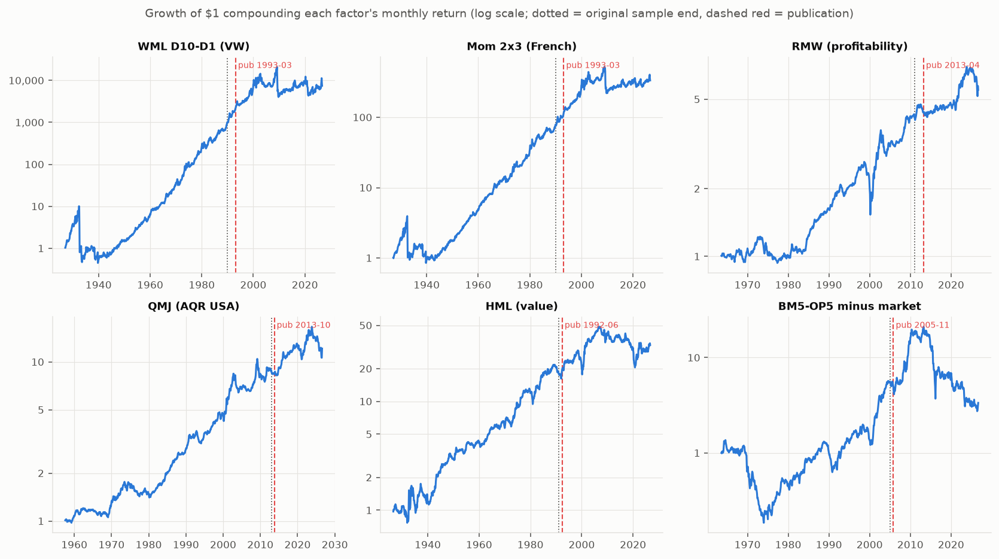
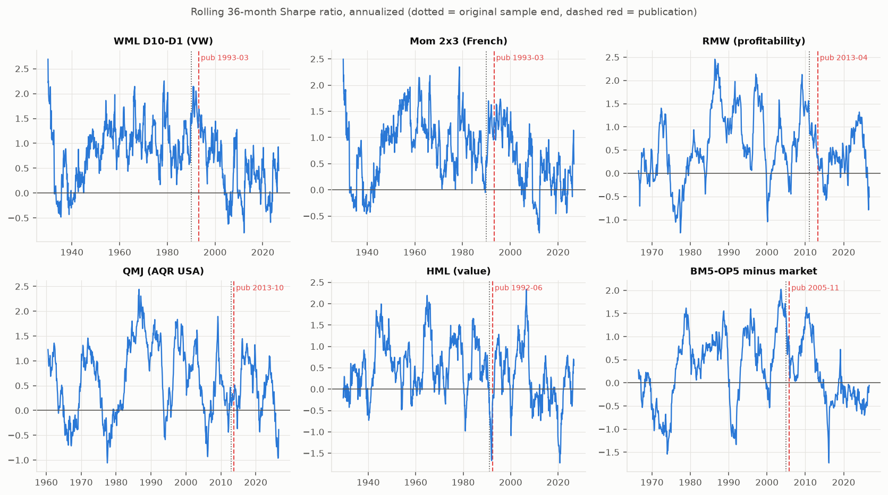
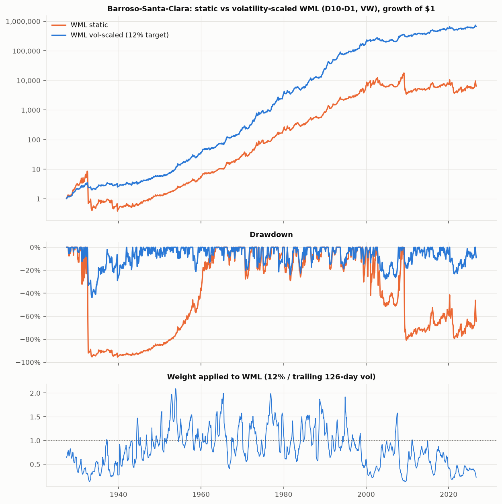
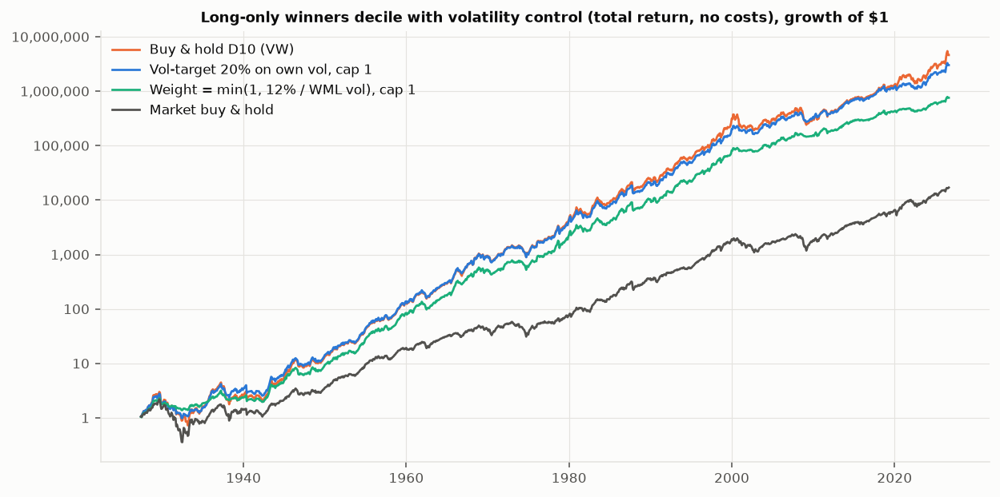
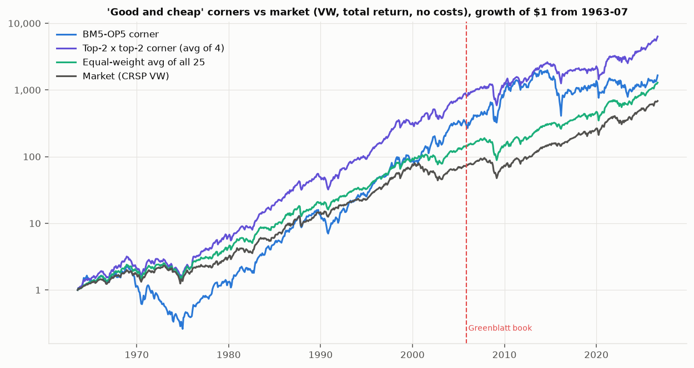
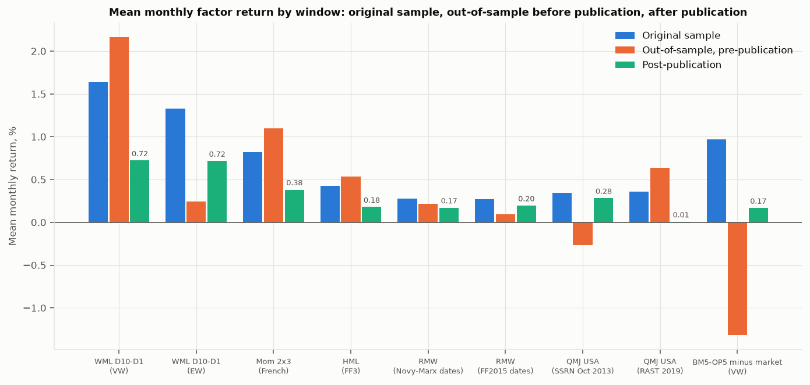

# Academic evidence: do the three strategy ideas work at the factor level?
Generated by `quant/validation/factor_checks.py` from Ken French's data library (CRSP, vintage `202608`; data through 2026-08) and AQR's QMJ dataset. These are long-history, survivorship-free CRSP portfolios (1926-2026), so they test the IDEAS at factor/decile level; they are **not** a test of our stock-level S&P-style backtests (2011-2026), they are gross of costs, and French's momentum deciles are not 5-10 stock books. All returns are decimals in the code and shown here in percent. Sharpe ratios are annualized from monthly arithmetic means (mean/sd x sqrt(12)).

## Key findings

- **Momentum is real in the long sample and mostly gone since 2009.** Decile WML (D10-D1, VW) earned 13.6%/yr with Sharpe 0.49 over 1927-2026 and Sharpe 0.62 before JT93's March 1993 publication versus 0.29 after; 2009-2026 Sharpe is 0.03. The long-only winners decile (VW) had CAPM alpha 8.3%/yr in the JT sample, 7.8%/yr (t 5.4) before 1993-03 and 3.2%/yr (t 1.5) after; in 2009-2026 it is 0.9%/yr (t 0.3) and its Sharpe (0.76) is below the market's (0.91). Equal-weighted winners did better than value-weighted ones over the full sample (Sharpe 0.70 vs 0.66) but also lost their alpha after 2009.
- **Volatility scaling works and still helps out of sample.** Barroso-Santa-Clara scaling of WML moves Sharpe 0.54 -> 1.00 (1927-2011; research/01 replication: 0.54 -> 1.00) and 0.20 -> 0.37 in 2012-2026, with the worst month cut from -77.7% to -24.2%. For the long-only winners decile a 20% own-vol target (cap 1) lifts full-sample Sharpe 0.60 -> 0.67 and cuts max drawdown -83.8% -> -73.8% (daily-formed decile, research/01 section 8: 0.61 -> 0.67, -83.8% -> -74.0%); on the monthly-formed decile 0.66 -> 0.71, -75.8% -> -64.7%. The gain is modest for a long-only book: most of the 1930s drawdown is the market's.
- **Crashes are a bear-state, short-leg phenomenon.** 183 of 1035 months in 1927-01..2013-03 are bear states (DM: 183 of 1,035). WML averages -1.11%/mo in bear states vs 1.56%/mo otherwise; the winners decile beats the market by 0.04%/mo in bear vs 0.66%/mo in non-bear months. 14 of the 15 worst WML months up to 2013-03 are in bear states (DM: 14); across the whole sample the winners decile fell in only 4 of the 15 worst WML months, while 14 of 15 were months of rising markets.
- **Current regime (2026-08-31).** 126-day WML volatility is 53.0% against a long-run 27.6% (monthly-file spread; 97th percentile of its own daily history): the BSC weight on WML is 0.23; winners-decile vol is 41.6% (20%-target long-only weight 0.48). The market's prior-24-month return is 39.7%, so the DM bear flag is off: a volatility-driven, not bear-driven, momentum stress. French data end 2026-08-31; recompute from daily prices before trading.
- **Profitability and quality are positive but have weakened.** RMW earned 3.0%/yr (Sharpe 0.38, t 3.0) in 1963-2026; Sharpe is 0.43 before 2013 and 0.22 since (mean 3.3% -> 1.8%/yr, post-2013 t 0.8). AQR QMJ (USA): 3.9%/yr, Sharpe 0.49 (t 4.0) from 1957; Sharpe 0.56 to 2012 vs 0.29 since 2013. Quality is a diversifier for momentum, not a crash hedge: RMW's correlation with Mom 2x3 is 0.05 and QMJ's is 0.24; in the worst 5% Mom months RMW averaged -0.49%/mo and QMJ -1.97%/mo. A 50/50 Mom+RMW blend has Sharpe 0.61 vs 0.50 (Mom) and 0.39 (RMW) over 1963-07..2026-07; Mom+QMJ 0.62.
- **'Good and cheap' (B/M x profitability corners, VW)**: the top-2 x top-2 corner (4 portfolios) beat the market by 4.5%/yr over 1963-2026 (t 2.6), 6.5%/yr (t 3.3) before the 2005 Greenblatt book, 0.5%/yr (t 0.1) after, and -2.3%/yr (t -0.7) in 2010-2026. The extreme BM5-OP5 corner is noisier (excess vs market 4.5%/yr, t 1.4 full; 2.0%/yr post-2005; -5.8%/yr in 2010-2026): CAPM alpha 4.9%/yr (t 1.4) before vs -1.8%/yr (t -0.3) after, FF3 alpha after 1.4%/yr (t 0.2). The E/P top-minus-bottom quintile spread (VW) is 7.1%/yr before and -0.6%/yr after 2005-11 (-1.9%/yr in 2010-2026). Honest read: cheap-and-profitable beat the market for four decades and has not since the book appeared; this matches research/03's post-2010 evidence, so the Magic Formula should be justified by process, not by a recent edge.
- **Value (HML)**: 4.2%/yr (t 3.4) over 1926-2026; 5.3%/yr before FF92 publication (1992-06) vs 2.1%/yr after (t 1.1); -0.6%/yr in 2010-2026 (t -0.2) and -2.6%/yr in 2007-2018. The plain across-industry value factor has been flat for a decade or more, which is a headwind for the comps idea; industry-relative value (what comps actually buys) cannot be built from these files.
- **Decay after publication** (mean monthly return, post vs original sample): WML 56%, HML 58%, RMW 38%, QMJ 18%, BM5-OP5-minus-market 83% (average of these 51%), against McLean-Pontiff's 58% post-publication (26% out-of-sample) for 97 anomalies. These are single factors with wide error bands (post-vs-in-sample t-stats are mostly below 2 in magnitude); the pattern, not any one percentage, is the evidence.

## A. Momentum (Jegadeesh-Titman 1993; Daniel-Moskowitz 2016; Barroso-Santa-Clara 2015)

### A1. Winners decile and WML across periods

Source: Ken French `10_Portfolios_Prior_12_2` (monthly, formed on months -12..-2, NYSE/AMEX/NASDAQ, CRSP). D1 = losers, D10 = winners; WML = D10 - D1. Winners are measured as EXCESS returns over the one-month T-bill; WML and Mom 2x3 are zero-cost spreads. Max DD is on the compounded total return for long-only legs and on the spread itself for WML. CAPM alpha regresses the series on Mkt-RF with Newey-West t (lags max(4, NW rule)). t(mean) is the plain i.i.d. t-statistic. No costs.

**WML (D10-D1, VW)**

| Period | n | Mean %/mo | t(mean) | Vol %/yr | Sharpe | Worst mo % | Max DD % | CAPM a %/yr | t(a, NW) |
|---|---|---|---|---|---|---|---|---|---|
| Full sample | 1196 | 1.13 | 4.9 | 27.6 | 0.49 | -77.7 | -95.6 | 18.0 | 8.3 |
| 1927-1964 (before JT sample) | 456 | 1.08 | 2.6 | 30.4 | 0.43 | -77.7 | -95.6 | 20.2 | 6.1 |
| 1965-1989 (JT93 sample) | 300 | 1.64 | 5.1 | 19.2 | 1.03 | -19.7 | -29.0 | 19.9 | 5.3 |
| 1990-2008 | 228 | 1.57 | 3.1 | 26.5 | 0.71 | -41.8 | -51.6 | 20.5 | 3.8 |
| 2009-2026 | 212 | 0.07 | 0.1 | 32.1 | 0.03 | -45.2 | -80.8 | 10.0 | 1.8 |
| 2012-2026 | 176 | 0.47 | 0.8 | 28.9 | 0.20 | -32.1 | -64.8 | 13.0 | 2.2 |
| 1927-2011 (BSC sample) | 1020 | 1.25 | 5.0 | 27.4 | 0.55 | -77.7 | -95.6 | 18.9 | 8.0 |
| Pre-publication (to 1993-02) | 794 | 1.34 | 5.0 | 26.2 | 0.62 | -77.7 | -95.6 | 20.2 | 8.5 |
| Post-publication (1993-03 on) | 402 | 0.72 | 1.7 | 30.3 | 0.29 | -45.2 | -80.8 | 13.9 | 3.4 |

**Winners D10 (VW), excess**

| Period | n | Mean %/mo | t(mean) | Vol %/yr | Sharpe | Worst mo % | Max DD % | CAPM a %/yr | t(a, NW) |
|---|---|---|---|---|---|---|---|---|---|
| Full sample | 1196 | 1.25 | 6.6 | 22.6 | 0.66 | -28.3 | -75.8 | 6.5 | 5.3 |
| 1927-1964 (before JT sample) | 456 | 1.41 | 4.4 | 23.7 | 0.72 | -28.3 | -75.8 | 7.5 | 3.8 |
| 1965-1989 (JT93 sample) | 300 | 1.12 | 3.1 | 21.9 | 0.62 | -27.3 | -39.3 | 8.3 | 3.8 |
| 1990-2008 | 228 | 0.96 | 2.3 | 21.9 | 0.52 | -25.0 | -48.5 | 6.3 | 2.1 |
| 2009-2026 | 212 | 1.40 | 3.2 | 22.0 | 0.76 | -15.8 | -31.2 | 0.9 | 0.3 |
| 2012-2026 | 176 | 1.48 | 3.2 | 21.5 | 0.83 | -15.8 | -31.2 | 2.1 | 0.7 |
| 1927-2011 (BSC sample) | 1020 | 1.21 | 5.9 | 22.8 | 0.64 | -28.3 | -75.8 | 7.0 | 5.3 |
| Pre-publication (to 1993-02) | 794 | 1.30 | 5.6 | 22.9 | 0.68 | -28.3 | -75.8 | 7.8 | 5.4 |
| Post-publication (1993-03 on) | 402 | 1.15 | 3.6 | 22.1 | 0.63 | -25.0 | -51.3 | 3.2 | 1.5 |

**WML (D10-D1, EW)**

| Period | n | Mean %/mo | t(mean) | Vol %/yr | Sharpe | Worst mo % | Max DD % | CAPM a %/yr | t(a, NW) |
|---|---|---|---|---|---|---|---|---|---|
| Full sample | 1196 | 0.84 | 3.9 | 26.2 | 0.39 | -87.4 | -99.3 | 13.8 | 7.0 |
| 1927-1964 (before JT sample) | 456 | 0.68 | 1.6 | 32.1 | 0.26 | -87.4 | -99.3 | 14.7 | 4.3 |
| 1965-1989 (JT93 sample) | 300 | 1.33 | 4.8 | 16.7 | 0.96 | -27.9 | -34.8 | 16.1 | 5.7 |
| 1990-2008 | 228 | 1.05 | 2.2 | 25.3 | 0.50 | -60.8 | -60.8 | 13.7 | 3.0 |
| 2009-2026 | 212 | 0.27 | 0.6 | 24.1 | 0.14 | -37.0 | -80.3 | 9.6 | 1.7 |
| 2012-2026 | 176 | 0.83 | 1.9 | 20.3 | 0.49 | -28.9 | -53.4 | 16.2 | 3.9 |
| 1927-2011 (BSC sample) | 1020 | 0.84 | 3.4 | 27.1 | 0.37 | -87.4 | -99.3 | 13.4 | 6.1 |
| Pre-publication (to 1993-02) | 794 | 0.91 | 3.3 | 26.8 | 0.41 | -87.4 | -99.3 | 14.5 | 6.6 |
| Post-publication (1993-03 on) | 402 | 0.72 | 2.0 | 25.0 | 0.34 | -60.8 | -81.4 | 12.2 | 3.3 |

**Winners D10 (EW), excess**

| Period | n | Mean %/mo | t(mean) | Vol %/yr | Sharpe | Worst mo % | Max DD % | CAPM a %/yr | t(a, NW) |
|---|---|---|---|---|---|---|---|---|---|
| Full sample | 1196 | 1.46 | 7.0 | 25.2 | 0.70 | -32.6 | -73.3 | 8.0 | 5.2 |
| 1927-1964 (before JT sample) | 456 | 1.73 | 4.6 | 27.9 | 0.74 | -30.1 | -73.3 | 9.6 | 4.1 |
| 1965-1989 (JT93 sample) | 300 | 1.40 | 3.5 | 23.7 | 0.71 | -32.6 | -44.9 | 11.3 | 3.8 |
| 1990-2008 | 228 | 1.33 | 2.9 | 23.6 | 0.68 | -22.4 | -50.1 | 10.7 | 2.7 |
| 2009-2026 | 212 | 1.12 | 2.5 | 22.4 | 0.60 | -20.9 | -36.0 | -3.4 | -1.2 |
| 2012-2026 | 176 | 1.10 | 2.4 | 21.5 | 0.62 | -20.9 | -36.0 | -3.0 | -0.9 |
| 1927-2011 (BSC sample) | 1020 | 1.52 | 6.6 | 25.7 | 0.71 | -32.6 | -73.3 | 9.8 | 5.9 |
| Pre-publication (to 1993-02) | 794 | 1.60 | 6.0 | 26.1 | 0.73 | -32.6 | -73.3 | 10.3 | 5.7 |
| Post-publication (1993-03 on) | 402 | 1.19 | 3.6 | 23.2 | 0.62 | -22.4 | -59.2 | 3.2 | 1.2 |

**French Mom 2x3**

| Period | n | Mean %/mo | t(mean) | Vol %/yr | Sharpe | Worst mo % | Max DD % | CAPM a %/yr | t(a, NW) |
|---|---|---|---|---|---|---|---|---|---|
| Full sample | 1196 | 0.61 | 4.5 | 16.3 | 0.45 | -52.6 | -78.4 | 9.9 | 7.6 |
| 1927-1964 (before JT sample) | 456 | 0.64 | 2.6 | 18.5 | 0.41 | -52.6 | -78.4 | 11.9 | 5.9 |
| 1965-1989 (JT93 sample) | 300 | 0.82 | 4.0 | 12.3 | 0.80 | -13.8 | -20.3 | 9.8 | 4.2 |
| 1990-2008 | 228 | 0.92 | 2.9 | 16.4 | 0.68 | -25.4 | -31.8 | 12.1 | 3.8 |
| 2009-2026 | 212 | -0.07 | -0.2 | 15.8 | -0.05 | -34.4 | -56.4 | 3.7 | 1.3 |
| 2012-2026 | 176 | 0.20 | 0.7 | 13.3 | 0.18 | -16.2 | -25.4 | 6.2 | 2.4 |
| 1927-2011 (BSC sample) | 1020 | 0.68 | 4.5 | 16.7 | 0.49 | -52.6 | -78.4 | 10.4 | 7.2 |
| Pre-publication (to 1993-02) | 794 | 0.73 | 4.4 | 16.1 | 0.54 | -52.6 | -78.4 | 11.1 | 7.5 |
| Post-publication (1993-03 on) | 402 | 0.38 | 1.6 | 16.6 | 0.28 | -34.4 | -57.8 | 7.4 | 3.1 |

**Market (Mkt-RF)**

| Period | n | Mean %/mo | t(mean) | Vol %/yr | Sharpe | Worst mo % | Max DD % | CAPM a %/yr | t(a, NW) |
|---|---|---|---|---|---|---|---|---|---|
| Full sample | 1202 | 0.70 | 4.5 | 18.4 | 0.45 | -28.7 | -83.7 | n/a | n/a |
| 1927-1964 (before JT sample) | 456 | 0.86 | 2.9 | 22.2 | 0.46 | -28.7 | -83.7 | n/a | n/a |
| 1965-1989 (JT93 sample) | 300 | 0.36 | 1.3 | 16.2 | 0.27 | -23.2 | -46.5 | n/a | n/a |
| 1990-2008 | 228 | 0.37 | 1.3 | 15.0 | 0.29 | -17.2 | -45.0 | n/a | n/a |
| 2009-2026 | 212 | 1.16 | 3.8 | 15.4 | 0.91 | -13.4 | -24.8 | n/a | n/a |
| 2012-2026 | 176 | 1.13 | 3.6 | 14.5 | 0.94 | -13.4 | -24.8 | n/a | n/a |
| 1927-2011 (BSC sample) | 1020 | 0.62 | 3.6 | 19.0 | 0.39 | -28.7 | -83.7 | n/a | n/a |
| Pre-publication (to 1993-02) | 800 | 0.66 | 3.3 | 19.8 | 0.40 | -28.7 | -83.7 | n/a | n/a |
| Post-publication (1993-03 on) | 402 | 0.77 | 3.5 | 15.3 | 0.60 | -17.2 | -50.3 | n/a | n/a |

*CSV: `momentum_performance.csv` (all series, all periods, incl. FF3 alpha columns)*

### A2. Barroso-Santa-Clara volatility-scaled WML

Rule (research/01 section 4.1): weight for month t = 12% / sigma_hat, sigma_hat = sqrt(252 x mean of the squared daily WML returns over the previous 126 trading days up to the last day of month t-1) (uncentered, no cap). Daily WML = D10 - D1 from the daily VW decile file (formed on days -250..-21); the monthly return that is scaled is the monthly-file D10 - D1. Weights start 1927-05 (first month with 126 prior daily observations). Gross of costs; the leverage is on the long-short spread.

| Period | n | Static mean % | vol % | Sharpe | worst mo % | max DD % | Scaled mean % | vol %  | Sharpe  | worst mo %  | max DD %  | avg w | max w |
|---|---|---|---|---|---|---|---|---|---|---|---|---|---|
| 1927-05..2011-12 (BSC sample) | 1016 | 14.9 | 27.4 | 0.54 | -77.7 | -95.6 | 16.7 | 16.8 | 1.00 | -24.2 | -43.8 | 0.90 | 2.09 |
| Full sample (to latest) | 1192 | 13.5 | 27.6 | 0.49 | -77.7 | -95.6 | 14.9 | 16.2 | 0.92 | -24.2 | -43.8 | 0.84 | 2.09 |
| 1965-1989 (JT93 sample) | 300 | 19.7 | 19.2 | 1.03 | -19.7 | -29.0 | 25.3 | 19.2 | 1.32 | -16.9 | -24.1 | 1.11 | 2.00 |
| 1990-2008 | 228 | 18.9 | 26.5 | 0.71 | -41.8 | -51.6 | 15.2 | 15.8 | 0.96 | -13.6 | -27.7 | 0.79 | 1.92 |
| 2009-2026 | 212 | 0.8 | 32.1 | 0.03 | -45.2 | -80.8 | 4.4 | 12.1 | 0.36 | -12.5 | -23.0 | 0.51 | 1.02 |
| 2012-2026 | 176 | 5.7 | 28.9 | 0.20 | -32.1 | -64.8 | 4.6 | 12.2 | 0.37 | -12.5 | -23.0 | 0.50 | 0.99 |

*CSV: `momentum_vol_scaling_wml.csv`*

### A3. Long-only winners decile with volatility control (cash = T-bill)

Setup as research/01 section 8: monthly decisions from data through the prior month-end; exposure w in D10 and (1-w) in the T-bill (French RF); no costs; decile-level (hundreds of stocks), not a 5-10 stock book. Sharpe is on excess returns over RF. Own-vol rule: w = min(1, 20% / sigma_hat of D10 daily); WML-vol rule: w = min(1, 12% / sigma_hat of WML daily). Sample starts with the first available weight (1927-05). Two versions of the winners decile are shown because French publishes two: the monthly file (portfolio re-formed once a month) and the daily file (re-formed every day on the day -250..-21 return); research/01 section 8 used the daily file, so that block is the one that reproduces its numbers.

**Winners decile = monthly-file D10 (formed monthly, as in A1/A2)**

| Strategy | Period | n | CAGR % | Vol % | Sharpe | Max DD % | Worst mo % | CAPM a %/yr | t(a) | Avg exposure |
|---|---|---|---|---|---|---|---|---|---|---|
| Buy & hold D10 (VW) | Full (from first weight) | 1192 | 16.7 | 22.6 | 0.66 | -75.8 | -28.3 | 6.4 | 5.2 | 1.00 |
| Buy & hold D10 (VW) | 2009-2026 | 212 | 16.9 | 22.0 | 0.76 | -31.2 | -15.7 | 0.9 | 0.3 | 1.00 |
| Buy & hold D10 (VW) | 1965-1989 | 300 | 19.5 | 21.9 | 0.62 | -39.3 | -26.7 | 8.3 | 3.8 | 1.00 |
| Buy & hold D10 (VW) | 1990-2008 | 228 | 13.8 | 21.9 | 0.52 | -48.5 | -24.4 | 6.3 | 2.1 | 1.00 |
| Vol-target 20% on own vol, cap 1 | Full (from first weight) | 1192 | 16.2 | 19.2 | 0.71 | -64.7 | -28.3 | 6.8 | 6.0 | 0.90 |
| Vol-target 20% on own vol, cap 1 | 2009-2026 | 212 | 14.1 | 16.7 | 0.79 | -20.5 | -15.6 | 1.6 | 0.7 | 0.83 |
| Vol-target 20% on own vol, cap 1 | 1965-1989 | 300 | 18.5 | 21.0 | 0.59 | -38.4 | -26.7 | 7.6 | 3.5 | 0.96 |
| Vol-target 20% on own vol, cap 1 | 1990-2008 | 228 | 14.9 | 18.2 | 0.64 | -29.6 | -17.0 | 7.4 | 3.2 | 0.90 |
| Weight = min(1, 12% / WML vol), cap 1 | Full (from first weight) | 1192 | 14.6 | 16.1 | 0.73 | -40.1 | -26.7 | 6.4 | 5.6 | 0.74 |
| Weight = min(1, 12% / WML vol), cap 1 | 2009-2026 | 212 | 9.6 | 10.7 | 0.79 | -18.8 | -11.2 | 1.2 | 0.7 | 0.51 |
| Weight = min(1, 12% / WML vol), cap 1 | 1965-1989 | 300 | 17.7 | 19.6 | 0.59 | -33.3 | -26.7 | 6.9 | 3.1 | 0.89 |
| Weight = min(1, 12% / WML vol), cap 1 | 1990-2008 | 228 | 15.1 | 15.5 | 0.74 | -18.2 | -17.0 | 8.0 | 3.4 | 0.73 |
| Market buy & hold | Full (from first weight) | 1192 | 10.3 | 18.4 | 0.45 | -83.7 | -28.7 | n/a | n/a | 1.00 |
| Market buy & hold | 2009-2026 | 212 | 15.0 | 15.4 | 0.91 | -24.8 | -13.2 | n/a | n/a | 1.00 |
| Market buy & hold | 1965-1989 | 300 | 10.3 | 16.2 | 0.27 | -46.5 | -22.6 | n/a | n/a | 1.00 |
| Market buy & hold | 1990-2008 | 228 | 7.4 | 15.0 | 0.29 | -45.0 | -17.1 | n/a | n/a | 1.00 |

**Winners decile = daily-file D10 compounded to months (formed daily; the basis of research/01 section 8)**

| Strategy | Period | n | CAGR % | Vol % | Sharpe | Max DD % | Worst mo % | CAPM a %/yr | t(a) | Avg exposure |
|---|---|---|---|---|---|---|---|---|---|---|
| Buy & hold D10 (VW) | Full (from first weight) | 1192 | 15.5 | 23.2 | 0.60 | -83.8 | -32.1 | 5.3 | 4.5 | 1.00 |
| Buy & hold D10 (VW) | 2009-2026 | 212 | 16.8 | 21.4 | 0.77 | -34.3 | -16.1 | 1.2 | 0.4 | 1.00 |
| Buy & hold D10 (VW) | 1965-1989 | 300 | 18.7 | 21.7 | 0.59 | -39.9 | -28.3 | 7.7 | 3.5 | 1.00 |
| Buy & hold D10 (VW) | 1990-2008 | 228 | 14.4 | 22.0 | 0.54 | -42.6 | -22.7 | 6.8 | 2.4 | 1.00 |
| Vol-target 20% on own vol, cap 1 | Full (from first weight) | 1192 | 15.3 | 19.6 | 0.67 | -73.8 | -30.8 | 6.0 | 5.3 | 0.90 |
| Vol-target 20% on own vol, cap 1 | 2009-2026 | 212 | 14.3 | 16.4 | 0.82 | -23.1 | -16.1 | 2.1 | 1.0 | 0.83 |
| Vol-target 20% on own vol, cap 1 | 1965-1989 | 300 | 17.9 | 20.9 | 0.57 | -38.9 | -28.3 | 7.1 | 3.2 | 0.96 |
| Vol-target 20% on own vol, cap 1 | 1990-2008 | 228 | 15.2 | 18.3 | 0.65 | -29.6 | -15.4 | 7.7 | 3.2 | 0.90 |
| Weight = min(1, 12% / WML vol), cap 1 | Full (from first weight) | 1192 | 13.9 | 16.2 | 0.69 | -48.9 | -28.3 | 5.8 | 5.1 | 0.74 |
| Weight = min(1, 12% / WML vol), cap 1 | 2009-2026 | 212 | 9.6 | 10.5 | 0.80 | -17.4 | -11.5 | 1.5 | 0.9 | 0.51 |
| Weight = min(1, 12% / WML vol), cap 1 | 1965-1989 | 300 | 17.1 | 19.5 | 0.56 | -33.8 | -28.3 | 6.5 | 2.9 | 0.89 |
| Weight = min(1, 12% / WML vol), cap 1 | 1990-2008 | 228 | 15.6 | 15.4 | 0.76 | -15.4 | -15.4 | 8.4 | 3.6 | 0.73 |
| Market buy & hold | Full (from first weight) | 1192 | 10.3 | 18.4 | 0.45 | -83.7 | -28.7 | n/a | n/a | 1.00 |
| Market buy & hold | 2009-2026 | 212 | 15.0 | 15.4 | 0.91 | -24.8 | -13.2 | n/a | n/a | 1.00 |
| Market buy & hold | 1965-1989 | 300 | 10.3 | 16.2 | 0.27 | -46.5 | -22.6 | n/a | n/a | 1.00 |
| Market buy & hold | 1990-2008 | 228 | 7.4 | 15.0 | 0.29 | -45.0 | -17.1 | n/a | n/a | 1.00 |

*CSV: `momentum_vol_scaling_longonly.csv`*

### A4. Daniel-Moskowitz bear state and the worst WML months

Bear state at month t = cumulative CRSP market return over the previous 24 months (t-24..t-1) is negative. Count: **183 bear months out of 1035** in 1927-01..2013-03 (Daniel-Moskowitz report 183 of 1,035) and 191 of 1196 through 2026-08. Samples start 1927-01.

| Series | State | n | Mean %/mo | SD %/mo | t(mean) | Worst mo % | Welch t (bear vs non) |
|---|---|---|---|---|---|---|---|
| WML (D10-D1, VW) | Bear (prior 24m market < 0) | 191 | -1.11 | 14.1 | -1.1 | -77.7 | -2.6 |
| WML (D10-D1, VW) | Non-bear | 1005 | 1.56 | 6.1 | 8.2 | -41.8 | -2.6 |
| Winners D10 excess (VW) | Bear (prior 24m market < 0) | 191 | 0.78 | 7.7 | 1.4 | -23.9 | -0.9 |
| Winners D10 excess (VW) | Non-bear | 1005 | 1.34 | 6.3 | 6.8 | -28.3 | -0.9 |
| Losers D1 excess (VW) | Bear (prior 24m market < 0) | 191 | 1.89 | 18.4 | 1.4 | -42.2 | 1.6 |
| Losers D1 excess (VW) | Non-bear | 1005 | -0.22 | 7.0 | -1.0 | -33.1 | 1.6 |
| Winners D10 minus market | Bear (prior 24m market < 0) | 191 | 0.04 | 4.4 | 0.1 | -21.1 | -1.8 |
| Winners D10 minus market | Non-bear | 1005 | 0.66 | 3.4 | 6.2 | -15.1 | -1.8 |
| Market excess (Mkt-RF) | Bear (prior 24m market < 0) | 191 | 0.75 | 8.9 | 1.2 | -28.7 | 0.1 |
| Market excess (Mkt-RF) | Non-bear | 1005 | 0.68 | 4.3 | 5.0 | -23.2 | 0.1 |

*CSV: `momentum_dm_bear_state.csv`*

**The 15 worst WML months** (11 of 15 are in a bear state, 14 of 15 had a rising market, the winners decile fell in 4 of 15; Daniel-Moskowitz: 14 of 15 in a bear state, all in rising markets):

| Month | WML % | D1 % | D10 % | Market % | Prior-24m mkt % | Bear |
|---|---|---|---|---|---|---|
| 1932-08 | -77.7 | 93.8 | 16.2 | 37.1 | -67.6 | yes |
| 1932-07 | -62.4 | 74.9 | 12.6 | 33.6 | -74.7 | yes |
| 2009-04 | -45.2 | 45.1 | -0.1 | 10.2 | -40.5 | yes |
| 1939-09 | -44.4 | 52.3 | 7.9 | 16.9 | -21.9 | yes |
| 2001-01 | -41.8 | 36.0 | -5.8 | 3.8 | 10.7 | no |
| 2009-03 | -39.2 | 44.7 | 5.5 | 9.0 | -44.8 | yes |
| 1938-06 | -33.3 | 43.6 | 10.2 | 23.9 | -28.2 | yes |
| 2020-04 | -32.1 | 46.8 | 14.7 | 13.6 | -0.7 | yes |
| 1933-04 | -31.5 | 60.2 | 28.7 | 38.9 | -59.0 | yes |
| 1933-05 | -30.6 | 49.5 | 18.8 | 21.5 | -36.7 | yes |
| 1931-06 | -29.3 | 37.1 | 7.8 | 14.0 | -47.5 | yes |
| 2020-11 | -27.1 | 37.5 | 10.4 | 12.5 | 27.1 | no |
| 2009-08 | -24.9 | 25.1 | 0.2 | 3.3 | -27.2 | yes |
| 2026-07 | -22.7 | 7.3 | -15.4 | -0.3 | 41.4 | no |
| 2021-02 | -22.6 | 19.8 | -2.8 | 2.8 | 49.1 | no |

*CSV: `momentum_worst15_wml.csv`*

Within Daniel-Moskowitz's own window (1927-01..2013-03) the 15 worst WML months are 14 of 15 in a bear state (they report 14 of 15, the exception being 2001-01; ours: 2001-01). 10 of the 10 worst months in their Table 2 appear among our 15 worst in that window (1932-07, 1932-08, 1933-04, 1938-06, 1939-09, 2001-01, 2002-11, 2009-03, 2009-04, 2009-08); magnitudes differ (e.g. 1932-08: ours -77.7% vs their -74.4%; 2002-11: ours -20.6% vs -37.0%) because they build their own deciles from CRSP while French's use NYSE breakpoints and a newer CRSP vintage, so these are listed for orientation and are not counted as reference checks.

### A5. Current momentum volatility regime

Computed from the daily decile files through 2026-08-31 (French data lag the calendar by about a month; recompute from daily prices before the live decision).

| Metric | Value |
|---|---|
| Last daily observation | 2026-08-31 |
| WML (126d) annualized vol | 53.0% |
| WML long-run vol: monthly-file spread (1927-2026) / daily-file, all days | 27.6% / 23.8% |
| WML vol percentile vs own daily history | 97th |
| BSC weight on WML (12% target, uncapped) | 0.23 |
| Winners D10 (126d) annualized vol | 41.6% |
| Winners D10 long-run vol: monthly-file / daily-file, all days | 22.6% / 23.4% |
| Winners D10 vol percentile vs own daily history | 95th |
| Long-only weight, 20% own-vol target, cap 1 | 0.48 |
| Long-only weight, min(1, 12%/WML vol) | 0.23 |
| French Mom 2x3 (126d) annualized vol (daily-file long-run 12.6%) | 23.8% |
| Market return, last 24 calendar months (Daniel-Moskowitz definition) | 39.7% |
| Market return, last 504 trading days (the window research/01 section 13 used) | 41.7% |
| DM bear state for the NEXT month | no |
| WML last 3 monthly returns (oldest..latest) | 15.4%, -22.7%, -14.4% |
| Winners D10 last 3 monthly returns | 8.4%, -15.4%, -0.1% |

*CSV: `momentum_current_regime.csv`*

## B. Profitability and quality (Novy-Marx 2013; Fama-French 2015; AQR QMJ)

RMW = robust minus weak operating profitability (French 2x3, value-weighted, formed each June). QMJ = AQR's quality-minus-junk (USA column of 'Quality Minus Junk: Factors, Monthly'; value-weighted long-short, self-financing; AQR notes its web dataset also uses a payout component and is rebuilt on each update, so it differs slightly from the paper). Both are zero-cost spreads: mean/Sharpe are on the spread itself. a(CAPM) regresses on Mkt-RF; a(4F) on Mkt-RF, SMB, HML and Mom (French FF3 file and Mom 2x3), Newey-West t.

| Series | Period | n | Mean %/mo | t(mean) | Vol %/yr | Sharpe | Max DD % | a(CAPM) %/yr | t | a(4F) %/yr | t  | Mom load |
|---|---|---|---|---|---|---|---|---|---|---|---|---|
| RMW (FF5 2x3) | Full sample (1963-07 on) | 758 | 0.25 | 3.0 | 7.9 | 0.38 | -41.8 | 3.7 | 3.3 | 3.6 | 3.6 | 0.02 |
| RMW (FF5 2x3) | Original sample 1963-07..2010-12 (Novy-Marx) | 570 | 0.28 | 2.9 | 7.9 | 0.42 | -41.8 | 3.9 | 2.9 | 4.0 | 3.4 | 0.05 |
| RMW (FF5 2x3) | Pre-2013 (to 2012-12) | 594 | 0.28 | 3.0 | 7.8 | 0.43 | -41.8 | 4.0 | 3.1 | 4.0 | 3.5 | 0.05 |
| RMW (FF5 2x3) | Post-2013 (2013-01 on) | 164 | 0.15 | 0.8 | 8.2 | 0.22 | -25.9 | 2.3 | 1.2 | 1.6 | 1.1 | -0.15 |
| RMW (FF5 2x3) | Post-FF5 paper (2015-04 on) | 137 | 0.20 | 0.9 | 8.7 | 0.27 | -25.9 | 2.7 | 1.2 | 1.8 | 1.0 | -0.16 |
| RMW (FF5 2x3) | 2009-2026 | 212 | 0.16 | 1.0 | 7.7 | 0.25 | -25.9 | 2.9 | 1.7 | 2.3 | 1.6 | -0.07 |
| QMJ (AQR, USA) | Full sample (1957-07 on) | 829 | 0.33 | 4.0 | 8.1 | 0.49 | -36.2 | 5.9 | 6.3 | 5.7 | 6.3 | 0.07 |
| QMJ (AQR, USA) | Pre-2013 (to 2012-12) | 666 | 0.35 | 4.2 | 7.4 | 0.56 | -28.2 | 5.6 | 5.6 | 6.2 | 7.2 | 0.09 |
| QMJ (AQR, USA) | Post-2013 (2013-01 on) | 163 | 0.25 | 1.1 | 10.4 | 0.29 | -36.2 | 7.3 | 3.2 | 6.0 | 2.6 | -0.06 |
| QMJ (AQR, USA) | 2009-2026 | 211 | 0.16 | 0.7 | 10.5 | 0.18 | -36.2 | 7.0 | 3.5 | 5.9 | 3.1 | 0.04 |

*CSV: `quality_performance.csv`*

### B2. Does quality hedge momentum?

Common sample 1963-07..2026-07 (n=757). Correlations of monthly returns:

|  | WML (D10-D1, VW) | Mom 2x3 | RMW | HML | Mkt-RF | QMJ |
|---|---|---|---|---|---|---|
| WML (D10-D1, VW) | 1.00 | 0.90 | 0.07 | -0.20 | -0.19 | 0.26 |
| Mom 2x3 | 0.90 | 1.00 | 0.05 | -0.19 | -0.16 | 0.24 |
| RMW | 0.07 | 0.05 | 1.00 | 0.09 | -0.19 | 0.70 |
| HML | -0.20 | -0.19 | 0.09 | 1.00 | -0.21 | -0.01 |
| Mkt-RF | -0.19 | -0.16 | -0.19 | -0.21 | 1.00 | -0.51 |
| QMJ | 0.26 | 0.24 | 0.70 | -0.01 | -0.51 | 1.00 |

| 2009-2026 | WML (D10-D1, VW) | Mom 2x3 | RMW | HML | Mkt-RF | QMJ |
|---|---|---|---|---|---|---|
| WML (D10-D1, VW) | 1.00 | 0.87 | -0.05 | -0.39 | -0.31 | 0.26 |
| Mom 2x3 | 0.87 | 1.00 | -0.08 | -0.31 | -0.31 | 0.24 |
| RMW | -0.05 | -0.08 | 1.00 | 0.05 | -0.14 | 0.70 |
| HML | -0.39 | -0.31 | 0.05 | 1.00 | 0.13 | -0.04 |
| Mkt-RF | -0.31 | -0.31 | -0.14 | 0.13 | 1.00 | -0.54 |
| QMJ | 0.26 | 0.24 | 0.70 | -0.04 | -0.54 | 1.00 |

*CSV: `quality_momentum_correlation.csv`*

Average monthly returns (%) of each factor in momentum's worst months (a hedge would show up as positive RMW/QMJ numbers there):

| months | WML (D10-D1, VW) mean %/mo | Mom 2x3 mean %/mo | RMW mean %/mo | HML mean %/mo | Mkt-RF mean %/mo | QMJ mean %/mo |
|---|---|---|---|---|---|---|
| All months | 1.19 | 0.60 | 0.26 | 0.30 | 0.60 | 0.34 |
| Worst 5% Mom 2x3 months (n=38) | -16.74 | -10.36 | -0.49 | 1.71 | 2.69 | -1.97 |
| 10 worst WML (VW) months in the sample | -29.86 | -14.78 | -0.08 | 1.79 | 6.58 | -3.39 |

*CSV: `quality_momentum_tails.csv`*

Simple 50/50 blends of zero-cost factor returns (no leverage adjustment, no costs):

| Sample | Series | n | Mean %/yr | Vol %/yr | Sharpe | Max DD % | Worst mo % |
|---|---|---|---|---|---|---|---|
| Full common sample | Mom 2x3 | 757 | 7.3 | 14.6 | 0.50 | -57.8 | -34.4 |
| Full common sample | WML (D10-D1, VW) | 757 | 14.3 | 25.4 | 0.56 | -80.8 | -45.2 |
| Full common sample | RMW | 757 | 3.1 | 7.9 | 0.39 | -41.8 | -18.9 |
| Full common sample | 50/50 Mom 2x3 + RMW | 757 | 5.2 | 8.5 | 0.61 | -34.5 | -16.5 |
| Full common sample | QMJ | 757 | 4.1 | 8.4 | 0.49 | -36.2 | -8.9 |
| Full common sample | 50/50 Mom 2x3 + QMJ | 757 | 5.7 | 9.2 | 0.62 | -41.3 | -20.7 |
| Full common sample | 50/50 WML + QMJ | 757 | 9.2 | 14.4 | 0.64 | -58.9 | -26.1 |
| 2009-2026 | Mom 2x3 | 211 | -0.5 | 15.8 | -0.03 | -56.4 | -34.4 |
| 2009-2026 | WML (D10-D1, VW) | 211 | 1.6 | 32.0 | 0.05 | -80.8 | -45.2 |
| 2009-2026 | RMW | 211 | 2.1 | 7.7 | 0.28 | -25.9 | -8.2 |
| 2009-2026 | 50/50 Mom 2x3 + RMW | 211 | 0.8 | 8.5 | 0.10 | -34.0 | -16.5 |
| 2009-2026 | QMJ | 211 | 1.9 | 10.5 | 0.18 | -36.2 | -8.8 |
| 2009-2026 | 50/50 Mom 2x3 + QMJ | 211 | 0.7 | 10.5 | 0.06 | -41.3 | -20.7 |
| 2009-2026 | 50/50 WML + QMJ | 211 | 1.7 | 18.1 | 0.10 | -58.9 | -26.1 |

*CSV: `quality_momentum_combos.csv`*

## C. "Good and cheap": Magic Formula proxy from B/M x operating profitability and E/P sorts

The Magic Formula buys stocks that are both cheap (high EBIT/EV, an earnings yield) and profitable (high ROC). Ken French's `25_Portfolios_BEME_OP_5x5` sorts all stocks on book-to-market (BM1..BM5, 5 = cheapest) and operating profitability (OP1..OP5, 5 = most profitable), so BM5_OP5 is the closest long-history analogue of 'cheap AND good'. The 'top-2 x top-2 corner' is the equal-weight average of BM4/BM5 x OP4/OP5 (four portfolios, the cheapest-and-best 16% of the grid). The 25-portfolio equal-weight average is a crude 'universe' benchmark; the CRSP value-weighted market is the other. All series are TOTAL returns of re-formed-each-June portfolios, no costs, no short positions. B/M and OP are not EBIT/EV and ROC: this is a style proxy, not a replication of Greenblatt.

Excess returns over RF; Max DD on total return; alphas regress the excess return on Mkt-RF (CAPM) and Mkt-RF/SMB/HML (FF3) with Newey-West t.

**Value-weighted portfolios**

| Series | Period | n | Excess mean %/mo | t | Vol %/yr | Sharpe | Max DD % | a(CAPM) %/yr | t  | a(FF3) %/yr | t   |
|---|---|---|---|---|---|---|---|---|---|---|---|
| BM5-OP5 corner | Full sample (1963-07 on) | 758 | 0.98 | 3.2 | 29.5 | 0.40 | -88.7 | 2.9 | 0.9 | -1.6 | -0.6 |
| Top-2 x top-2 corner (avg of 4) | Full sample (1963-07 on) | 758 | 0.98 | 4.5 | 20.7 | 0.57 | -53.5 | 4.0 | 2.2 | 0.1 | 0.1 |
| Equal-weight avg of all 25 | Full sample (1963-07 on) | 758 | 0.70 | 4.0 | 16.5 | 0.51 | -53.3 | 0.9 | 1.4 | -0.4 | -1.1 |
| Market (CRSP VW) | Full sample (1963-07 on) | 758 | 0.60 | 3.7 | 15.4 | 0.47 | -50.3 | n/a | n/a | n/a | n/a |
| BM5-OP5 corner | 1988-2004 (Greenblatt sample) | 204 | 1.66 | 3.5 | 23.8 | 0.84 | -55.9 | 11.1 | 1.9 | 1.7 | 0.5 |
| Top-2 x top-2 corner (avg of 4) | 1988-2004 (Greenblatt sample) | 204 | 1.32 | 3.5 | 18.4 | 0.86 | -41.9 | 7.8 | 1.9 | -0.6 | -0.4 |
| Equal-weight avg of all 25 | 1988-2004 (Greenblatt sample) | 204 | 0.84 | 2.8 | 14.7 | 0.69 | -28.9 | 2.2 | 1.3 | -1.2 | -1.8 |
| Market (CRSP VW) | 1988-2004 (Greenblatt sample) | 204 | 0.69 | 2.4 | 14.6 | 0.57 | -45.0 | n/a | n/a | n/a | n/a |
| BM5-OP5 corner | Pre-publication (to 2005-10) | 508 | 0.95 | 2.8 | 26.5 | 0.43 | -88.7 | 4.9 | 1.4 | -3.7 | -1.5 |
| Top-2 x top-2 corner (avg of 4) | Pre-publication (to 2005-10) | 508 | 1.01 | 4.1 | 19.3 | 0.63 | -53.5 | 6.4 | 3.1 | -0.7 | -0.6 |
| Equal-weight avg of all 25 | Pre-publication (to 2005-10) | 508 | 0.61 | 3.0 | 16.0 | 0.46 | -43.8 | 1.7 | 2.1 | -0.8 | -2.2 |
| Market (CRSP VW) | Pre-publication (to 2005-10) | 508 | 0.47 | 2.4 | 15.4 | 0.37 | -46.5 | n/a | n/a | n/a | n/a |
| BM5-OP5 corner | Post-publication (2005-11 on) | 250 | 1.03 | 1.6 | 34.7 | 0.36 | -79.3 | -1.8 | -0.3 | 1.4 | 0.2 |
| Top-2 x top-2 corner (avg of 4) | Post-publication (2005-11 on) | 250 | 0.91 | 2.1 | 23.4 | 0.46 | -52.0 | -1.7 | -0.5 | 0.5 | 0.2 |
| Equal-weight avg of all 25 | Post-publication (2005-11 on) | 250 | 0.88 | 2.8 | 17.5 | 0.60 | -53.3 | -0.8 | -0.8 | 0.1 | 0.1 |
| Market (CRSP VW) | Post-publication (2005-11 on) | 250 | 0.87 | 3.1 | 15.5 | 0.67 | -50.3 | n/a | n/a | n/a | n/a |
| BM5-OP5 corner | 2010-2026 | 200 | 0.61 | 0.9 | 33.6 | 0.22 | -79.3 | -10.6 | -1.7 | -7.5 | -1.3 |
| Top-2 x top-2 corner (avg of 4) | 2010-2026 | 200 | 0.90 | 2.0 | 22.5 | 0.48 | -52.0 | -4.5 | -1.2 | -2.3 | -0.9 |
| Equal-weight avg of all 25 | 2010-2026 | 200 | 1.08 | 3.2 | 16.6 | 0.78 | -26.0 | -1.1 | -0.9 | -0.1 | -0.1 |
| Market (CRSP VW) | 2010-2026 | 200 | 1.09 | 3.6 | 14.9 | 0.88 | -24.8 | n/a | n/a | n/a | n/a |

**Equal-weighted portfolios**

| Series | Period | n | Excess mean %/mo | t | Vol %/yr | Sharpe | Max DD % | a(CAPM) %/yr | t  | a(FF3) %/yr | t   |
|---|---|---|---|---|---|---|---|---|---|---|---|
| BM5-OP5 corner | Full sample (1963-07 on) | 758 | 1.15 | 3.6 | 30.2 | 0.46 | -86.3 | 4.9 | 1.5 | 0.2 | 0.1 |
| Top-2 x top-2 corner (avg of 4) | Full sample (1963-07 on) | 758 | 1.24 | 5.1 | 22.9 | 0.65 | -69.6 | 6.7 | 2.9 | 2.6 | 2.0 |
| Equal-weight avg of all 25 | Full sample (1963-07 on) | 758 | 0.89 | 4.3 | 19.9 | 0.54 | -58.8 | 2.5 | 1.8 | 0.7 | 1.2 |
| Market (CRSP VW) | Full sample (1963-07 on) | 758 | 0.60 | 3.7 | 15.4 | 0.47 | -50.3 | n/a | n/a | n/a | n/a |
| BM5-OP5 corner | 1988-2004 (Greenblatt sample) | 204 | 1.48 | 3.4 | 21.8 | 0.82 | -40.9 | 10.5 | 2.3 | 4.6 | 1.2 |
| Top-2 x top-2 corner (avg of 4) | 1988-2004 (Greenblatt sample) | 204 | 1.49 | 4.5 | 16.6 | 1.08 | -37.7 | 11.4 | 2.9 | 4.9 | 2.1 |
| Equal-weight avg of all 25 | 1988-2004 (Greenblatt sample) | 204 | 1.11 | 3.3 | 16.9 | 0.79 | -28.9 | 5.6 | 1.9 | 2.0 | 1.5 |
| Market (CRSP VW) | 1988-2004 (Greenblatt sample) | 204 | 0.69 | 2.4 | 14.6 | 0.57 | -45.0 | n/a | n/a | n/a | n/a |
| BM5-OP5 corner | Pre-publication (to 2005-10) | 508 | 1.19 | 3.7 | 24.9 | 0.57 | -84.4 | 8.3 | 2.8 | 1.1 | 0.5 |
| Top-2 x top-2 corner (avg of 4) | Pre-publication (to 2005-10) | 508 | 1.39 | 5.5 | 19.8 | 0.84 | -53.7 | 11.1 | 4.9 | 4.4 | 3.6 |
| Equal-weight avg of all 25 | Pre-publication (to 2005-10) | 508 | 0.91 | 3.7 | 19.4 | 0.57 | -57.3 | 4.9 | 2.8 | 0.9 | 1.4 |
| Market (CRSP VW) | Pre-publication (to 2005-10) | 508 | 0.47 | 2.4 | 15.4 | 0.37 | -46.5 | n/a | n/a | n/a | n/a |
| BM5-OP5 corner | Post-publication (2005-11 on) | 250 | 1.07 | 1.5 | 38.9 | 0.33 | -86.3 | -3.8 | -0.5 | 0.8 | 0.1 |
| Top-2 x top-2 corner (avg of 4) | Post-publication (2005-11 on) | 250 | 0.93 | 1.8 | 28.3 | 0.39 | -69.6 | -3.7 | -0.9 | -0.2 | -0.1 |
| Equal-weight avg of all 25 | Post-publication (2005-11 on) | 250 | 0.83 | 2.2 | 20.8 | 0.48 | -58.8 | -2.7 | -1.3 | -0.4 | -0.3 |
| Market (CRSP VW) | Post-publication (2005-11 on) | 250 | 0.87 | 3.1 | 15.5 | 0.67 | -50.3 | n/a | n/a | n/a | n/a |
| BM5-OP5 corner | 2010-2026 | 200 | 0.87 | 1.2 | 36.6 | 0.29 | -86.3 | -8.9 | -1.2 | -3.8 | -0.7 |
| Top-2 x top-2 corner (avg of 4) | 2010-2026 | 200 | 1.00 | 1.8 | 27.1 | 0.44 | -68.2 | -5.9 | -1.1 | -1.7 | -0.6 |
| Equal-weight avg of all 25 | 2010-2026 | 200 | 0.97 | 2.4 | 19.8 | 0.59 | -38.4 | -3.9 | -1.7 | -0.8 | -0.9 |
| Market (CRSP VW) | 2010-2026 | 200 | 1.09 | 3.6 | 14.9 | 0.88 | -24.8 | n/a | n/a | n/a | n/a |

*CSV: `good_and_cheap_performance.csv`*

**Active return of the corners versus the market and versus the 25-portfolio average** (NW t of the mean difference):

| Wt | Active series | Period | n | Mean %/mo | t(NW) | Mean %/yr | TE %/yr | IR |
|---|---|---|---|---|---|---|---|---|
| VW | BM5-OP5 corner minus Market (CRSP VW) | Full sample (1963-07 on) | 758 | 0.37 | 1.4 | 4.5 | 22.9 | 0.20 |
| VW | BM5-OP5 corner minus Equal-weight avg of all 25 | Full sample (1963-07 on) | 758 | 0.27 | 1.2 | 3.3 | 20.6 | 0.16 |
| VW | Top-2 x top-2 corner (avg of 4) minus Market (CRSP VW) | Full sample (1963-07 on) | 758 | 0.38 | 2.6 | 4.5 | 12.5 | 0.36 |
| VW | Top-2 x top-2 corner (avg of 4) minus Equal-weight avg of all 25 | Full sample (1963-07 on) | 758 | 0.28 | 2.6 | 3.3 | 9.4 | 0.36 |
| VW | BM5-OP5 corner minus Market (CRSP VW) | 1988-2004 (Greenblatt sample) | 204 | 0.97 | 2.1 | 11.6 | 18.1 | 0.64 |
| VW | BM5-OP5 corner minus Equal-weight avg of all 25 | 1988-2004 (Greenblatt sample) | 204 | 0.82 | 2.2 | 9.8 | 15.5 | 0.63 |
| VW | Top-2 x top-2 corner (avg of 4) minus Market (CRSP VW) | 1988-2004 (Greenblatt sample) | 204 | 0.62 | 2.0 | 7.5 | 12.0 | 0.62 |
| VW | Top-2 x top-2 corner (avg of 4) minus Equal-weight avg of all 25 | 1988-2004 (Greenblatt sample) | 204 | 0.47 | 2.3 | 5.7 | 8.4 | 0.67 |
| VW | BM5-OP5 corner minus Market (CRSP VW) | Pre-publication (to 2005-10) | 508 | 0.47 | 1.6 | 5.7 | 19.9 | 0.29 |
| VW | BM5-OP5 corner minus Equal-weight avg of all 25 | Pre-publication (to 2005-10) | 508 | 0.33 | 1.3 | 4.0 | 17.8 | 0.22 |
| VW | Top-2 x top-2 corner (avg of 4) minus Market (CRSP VW) | Pre-publication (to 2005-10) | 508 | 0.54 | 3.3 | 6.5 | 11.3 | 0.58 |
| VW | Top-2 x top-2 corner (avg of 4) minus Equal-weight avg of all 25 | Pre-publication (to 2005-10) | 508 | 0.40 | 3.4 | 4.8 | 8.4 | 0.57 |
| VW | BM5-OP5 corner minus Market (CRSP VW) | Post-publication (2005-11 on) | 250 | 0.17 | 0.3 | 2.0 | 28.1 | 0.07 |
| VW | BM5-OP5 corner minus Equal-weight avg of all 25 | Post-publication (2005-11 on) | 250 | 0.16 | 0.3 | 1.9 | 25.4 | 0.07 |
| VW | Top-2 x top-2 corner (avg of 4) minus Market (CRSP VW) | Post-publication (2005-11 on) | 250 | 0.04 | 0.1 | 0.5 | 14.5 | 0.03 |
| VW | Top-2 x top-2 corner (avg of 4) minus Equal-weight avg of all 25 | Post-publication (2005-11 on) | 250 | 0.03 | 0.1 | 0.3 | 11.0 | 0.03 |
| VW | BM5-OP5 corner minus Market (CRSP VW) | 2010-2026 | 200 | -0.49 | -0.9 | -5.8 | 27.3 | -0.21 |
| VW | BM5-OP5 corner minus Equal-weight avg of all 25 | 2010-2026 | 200 | -0.47 | -1.0 | -5.7 | 24.5 | -0.23 |
| VW | Top-2 x top-2 corner (avg of 4) minus Market (CRSP VW) | 2010-2026 | 200 | -0.19 | -0.7 | -2.3 | 14.4 | -0.16 |
| VW | Top-2 x top-2 corner (avg of 4) minus Equal-weight avg of all 25 | 2010-2026 | 200 | -0.18 | -0.8 | -2.1 | 11.0 | -0.19 |
| EW | BM5-OP5 corner minus Market (CRSP VW) | Full sample (1963-07 on) | 758 | 0.55 | 1.9 | 6.6 | 23.8 | 0.28 |
| EW | BM5-OP5 corner minus Equal-weight avg of all 25 | Full sample (1963-07 on) | 758 | 0.26 | 1.2 | 3.1 | 18.2 | 0.17 |
| EW | Top-2 x top-2 corner (avg of 4) minus Market (CRSP VW) | Full sample (1963-07 on) | 758 | 0.63 | 3.3 | 7.6 | 15.0 | 0.51 |
| EW | Top-2 x top-2 corner (avg of 4) minus Equal-weight avg of all 25 | Full sample (1963-07 on) | 758 | 0.35 | 3.4 | 4.2 | 8.3 | 0.51 |
| EW | BM5-OP5 corner minus Market (CRSP VW) | 1988-2004 (Greenblatt sample) | 204 | 0.79 | 2.1 | 9.5 | 17.7 | 0.54 |
| EW | BM5-OP5 corner minus Equal-weight avg of all 25 | 1988-2004 (Greenblatt sample) | 204 | 0.37 | 1.3 | 4.5 | 12.4 | 0.36 |
| EW | Top-2 x top-2 corner (avg of 4) minus Market (CRSP VW) | 1988-2004 (Greenblatt sample) | 204 | 0.80 | 2.5 | 9.6 | 12.4 | 0.77 |
| EW | Top-2 x top-2 corner (avg of 4) minus Equal-weight avg of all 25 | 1988-2004 (Greenblatt sample) | 204 | 0.38 | 2.3 | 4.6 | 6.6 | 0.69 |
| EW | BM5-OP5 corner minus Market (CRSP VW) | Pre-publication (to 2005-10) | 508 | 0.72 | 2.8 | 8.6 | 19.0 | 0.45 |
| EW | BM5-OP5 corner minus Equal-weight avg of all 25 | Pre-publication (to 2005-10) | 508 | 0.27 | 1.5 | 3.3 | 13.7 | 0.24 |
| EW | Top-2 x top-2 corner (avg of 4) minus Market (CRSP VW) | Pre-publication (to 2005-10) | 508 | 0.92 | 4.9 | 11.0 | 12.6 | 0.87 |
| EW | Top-2 x top-2 corner (avg of 4) minus Equal-weight avg of all 25 | Pre-publication (to 2005-10) | 508 | 0.47 | 5.2 | 5.7 | 6.1 | 0.93 |
| EW | BM5-OP5 corner minus Market (CRSP VW) | Post-publication (2005-11 on) | 250 | 0.20 | 0.3 | 2.4 | 31.3 | 0.08 |
| EW | BM5-OP5 corner minus Equal-weight avg of all 25 | Post-publication (2005-11 on) | 250 | 0.24 | 0.5 | 2.9 | 25.0 | 0.11 |
| EW | Top-2 x top-2 corner (avg of 4) minus Market (CRSP VW) | Post-publication (2005-11 on) | 250 | 0.06 | 0.1 | 0.7 | 18.8 | 0.04 |
| EW | Top-2 x top-2 corner (avg of 4) minus Equal-weight avg of all 25 | Post-publication (2005-11 on) | 250 | 0.10 | 0.4 | 1.2 | 11.4 | 0.10 |
| EW | BM5-OP5 corner minus Market (CRSP VW) | 2010-2026 | 200 | -0.22 | -0.4 | -2.6 | 30.1 | -0.09 |
| EW | BM5-OP5 corner minus Equal-weight avg of all 25 | 2010-2026 | 200 | -0.10 | -0.2 | -1.2 | 24.4 | -0.05 |
| EW | Top-2 x top-2 corner (avg of 4) minus Market (CRSP VW) | 2010-2026 | 200 | -0.10 | -0.2 | -1.1 | 18.7 | -0.06 |
| EW | Top-2 x top-2 corner (avg of 4) minus Equal-weight avg of all 25 | 2010-2026 | 200 | 0.02 | 0.1 | 0.3 | 11.6 | 0.02 |

*CSV: `good_and_cheap_active.csv`*

### C2. Earnings-to-price sorts (positive earnings only: quintiles formed on E/P, 1951-07 on)

Excess returns over RF for the single quintiles; the two 'minus' rows are zero-cost spreads / active returns. CAPM and FF3 alphas, Newey-West t.

**Value-weighted**

| Series | Period | n | Excess mean %/mo | t | Vol %/yr | Sharpe | Max DD % | a(CAPM) %/yr | t  | a(FF3) %/yr | t   |
|---|---|---|---|---|---|---|---|---|---|---|---|
| Top quintile Q5 (highest E/P) | Full sample (1951-07 on) | 902 | 1.00 | 6.1 | 17.1 | 0.70 | -51.4 | 4.0 | 3.4 | 1.2 | 1.7 |
| Bottom quintile Q1 (lowest positive E/P) | Full sample (1951-07 on) | 902 | 0.58 | 3.5 | 17.2 | 0.41 | -53.9 | -1.7 | -2.3 | -0.1 | -0.1 |
| Negative earnings (E<=0) | Full sample (1951-07 on) | 902 | 0.80 | 3.3 | 24.9 | 0.38 | -80.6 | -1.5 | -0.9 | -1.9 | -1.3 |
| Q5 minus Q1 | Full sample (1951-07 on) | 902 | 0.42 | 3.5 | 12.3 | 0.41 | -48.8 | 5.7 | 3.3 | 1.3 | 1.3 |
| Q5 minus market | Full sample (1951-07 on) | 902 | 0.33 | 4.2 | 8.2 | 0.49 | -35.6 | 4.0 | 3.4 | 1.2 | 1.7 |
| Top quintile Q5 (highest E/P) | Pre-publication (to 2005-10) | 652 | 1.04 | 5.6 | 16.4 | 0.76 | -42.7 | 5.6 | 4.1 | 1.0 | 1.1 |
| Bottom quintile Q1 (lowest positive E/P) | Pre-publication (to 2005-10) | 652 | 0.44 | 2.3 | 17.0 | 0.31 | -53.9 | -2.5 | -2.9 | 0.2 | 0.3 |
| Negative earnings (E<=0) | Pre-publication (to 2005-10) | 652 | 0.68 | 2.3 | 25.7 | 0.32 | -78.4 | -1.8 | -0.8 | -4.6 | -2.5 |
| Q5 minus Q1 | Pre-publication (to 2005-10) | 652 | 0.59 | 4.5 | 11.8 | 0.61 | -43.7 | 8.0 | 4.0 | 0.8 | 0.6 |
| Q5 minus market | Pre-publication (to 2005-10) | 652 | 0.45 | 4.9 | 8.0 | 0.67 | -35.6 | 5.6 | 4.1 | 1.0 | 1.1 |
| Top quintile Q5 (highest E/P) | Post-publication (2005-11 on) | 250 | 0.91 | 2.6 | 18.8 | 0.58 | -51.4 | -0.4 | -0.2 | 0.7 | 0.5 |
| Bottom quintile Q1 (lowest positive E/P) | Post-publication (2005-11 on) | 250 | 0.95 | 2.9 | 17.7 | 0.65 | -52.7 | 0.3 | 0.2 | -0.3 | -0.3 |
| Negative earnings (E<=0) | Post-publication (2005-11 on) | 250 | 1.11 | 2.7 | 22.8 | 0.59 | -61.7 | -0.5 | -0.2 | 0.7 | 0.3 |
| Q5 minus Q1 | Post-publication (2005-11 on) | 250 | -0.05 | -0.2 | 13.3 | -0.04 | -48.8 | -0.7 | -0.2 | 0.9 | 0.5 |
| Q5 minus market | Post-publication (2005-11 on) | 250 | 0.04 | 0.2 | 8.5 | 0.05 | -30.3 | -0.4 | -0.2 | 0.7 | 0.5 |
| Top quintile Q5 (highest E/P) | 2010-2026 | 200 | 1.06 | 2.8 | 18.2 | 0.70 | -39.0 | -1.3 | -0.5 | -0.4 | -0.3 |
| Bottom quintile Q1 (lowest positive E/P) | 2010-2026 | 200 | 1.22 | 3.5 | 17.2 | 0.85 | -33.5 | 0.5 | 0.3 | 0.2 | 0.2 |
| Negative earnings (E<=0) | 2010-2026 | 200 | 1.41 | 3.1 | 22.1 | 0.77 | -33.8 | -0.4 | -0.1 | 1.8 | 0.8 |
| Q5 minus Q1 | 2010-2026 | 200 | -0.16 | -0.5 | 14.1 | -0.13 | -48.8 | -1.8 | -0.4 | -0.7 | -0.3 |
| Q5 minus market | 2010-2026 | 200 | -0.03 | -0.2 | 8.9 | -0.04 | -30.3 | -1.3 | -0.5 | -0.4 | -0.3 |

**Equal-weighted**

| Series | Period | n | Excess mean %/mo | t | Vol %/yr | Sharpe | Max DD % | a(CAPM) %/yr | t  | a(FF3) %/yr | t   |
|---|---|---|---|---|---|---|---|---|---|---|---|
| Top quintile Q5 (highest E/P) | Full sample (1951-07 on) | 902 | 1.19 | 6.5 | 19.0 | 0.75 | -61.7 | 5.9 | 3.9 | 3.1 | 4.9 |
| Bottom quintile Q1 (lowest positive E/P) | Full sample (1951-07 on) | 902 | 0.68 | 3.5 | 20.2 | 0.41 | -68.0 | -1.4 | -1.2 | -1.2 | -1.9 |
| Negative earnings (E<=0) | Full sample (1951-07 on) | 902 | 0.90 | 3.4 | 27.7 | 0.39 | -74.4 | 0.2 | 0.1 | -0.7 | -0.5 |
| Q5 minus Q1 | Full sample (1951-07 on) | 902 | 0.51 | 6.0 | 8.8 | 0.69 | -38.1 | 7.3 | 5.8 | 4.3 | 5.7 |
| Q5 minus market | Full sample (1951-07 on) | 902 | 0.52 | 5.0 | 10.8 | 0.58 | -45.9 | 5.9 | 3.9 | 3.1 | 4.9 |
| Top quintile Q5 (highest E/P) | Pre-publication (to 2005-10) | 652 | 1.29 | 6.5 | 17.6 | 0.88 | -49.1 | 8.7 | 5.1 | 3.8 | 5.1 |
| Bottom quintile Q1 (lowest positive E/P) | Pre-publication (to 2005-10) | 652 | 0.63 | 2.7 | 20.7 | 0.37 | -68.0 | -1.1 | -0.7 | -1.5 | -1.8 |
| Negative earnings (E<=0) | Pre-publication (to 2005-10) | 652 | 1.05 | 3.3 | 28.1 | 0.45 | -74.4 | 3.3 | 1.2 | -0.5 | -0.3 |
| Q5 minus Q1 | Pre-publication (to 2005-10) | 652 | 0.66 | 6.6 | 8.8 | 0.90 | -32.1 | 9.7 | 7.2 | 5.2 | 5.7 |
| Q5 minus market | Pre-publication (to 2005-10) | 652 | 0.70 | 6.1 | 10.2 | 0.83 | -34.5 | 8.7 | 5.1 | 3.8 | 5.1 |
| Top quintile Q5 (highest E/P) | Post-publication (2005-11 on) | 250 | 0.91 | 2.3 | 22.3 | 0.49 | -61.7 | -1.8 | -0.7 | 0.9 | 0.7 |
| Bottom quintile Q1 (lowest positive E/P) | Post-publication (2005-11 on) | 250 | 0.82 | 2.4 | 18.8 | 0.52 | -55.6 | -2.1 | -1.4 | -0.5 | -0.5 |
| Negative earnings (E<=0) | Post-publication (2005-11 on) | 250 | 0.51 | 1.1 | 26.6 | 0.23 | -69.8 | -8.3 | -2.2 | -5.5 | -1.9 |
| Q5 minus Q1 | Post-publication (2005-11 on) | 250 | 0.10 | 0.6 | 8.7 | 0.14 | -38.1 | 0.2 | 0.1 | 1.4 | 1.2 |
| Q5 minus market | Post-publication (2005-11 on) | 250 | 0.05 | 0.2 | 12.0 | 0.05 | -45.9 | -1.8 | -0.7 | 0.9 | 0.7 |
| Top quintile Q5 (highest E/P) | 2010-2026 | 200 | 1.12 | 2.6 | 21.4 | 0.63 | -47.9 | -2.2 | -0.7 | 1.0 | 0.8 |
| Bottom quintile Q1 (lowest positive E/P) | 2010-2026 | 200 | 1.00 | 2.7 | 17.7 | 0.67 | -26.1 | -2.7 | -1.7 | -0.4 | -0.6 |
| Negative earnings (E<=0) | 2010-2026 | 200 | 0.64 | 1.2 | 25.4 | 0.30 | -58.9 | -10.2 | -2.7 | -5.7 | -2.2 |
| Q5 minus Q1 | 2010-2026 | 200 | 0.13 | 0.7 | 9.0 | 0.17 | -38.1 | 0.4 | 0.2 | 1.4 | 1.1 |
| Q5 minus market | 2010-2026 | 200 | 0.03 | 0.1 | 12.2 | 0.03 | -45.9 | -2.2 | -0.7 | 1.0 | 0.8 |

*CSV: `ep_quintiles.csv`*

## D. Value (relevant to trading comps): HML since 1926

HML (value minus growth, French's size x B/M 2x3 sorts, value-weighted) from the 3-factor file. Zero-cost spread; CAPM alpha on Mkt-RF with Newey-West t. This is the plain, across-industry B/M factor.

| Period | n | Mean %/mo | t(mean) | Vol %/yr | Sharpe | Worst mo % | Max DD % | CAPM a %/yr | t(a, NW) |
|---|---|---|---|---|---|---|---|---|---|
| Full sample (1926-07 on) | 1202 | 0.35 | 3.4 | 12.3 | 0.34 | -13.8 | -57.8 | 3.0 | 2.2 |
| 1926-07..1963-06 (before FF sample) | 444 | 0.45 | 2.2 | 15.1 | 0.36 | -13.2 | -43.7 | 1.5 | 0.7 |
| 1963-07..1991-12 (FF92 sample and after) | 342 | 0.38 | 2.8 | 8.8 | 0.52 | -9.9 | -28.0 | 5.5 | 3.2 |
| Pre-publication (to 1992-05) | 791 | 0.44 | 3.4 | 12.8 | 0.41 | -13.2 | -43.7 | 3.6 | 2.3 |
| Post-publication (1992-06 on) | 411 | 0.18 | 1.1 | 11.3 | 0.19 | -13.8 | -57.8 | 2.9 | 1.1 |
| 1992-2009 | 216 | 0.48 | 2.1 | 11.4 | 0.50 | -11.0 | -39.8 | 6.7 | 1.9 |
| 2010-2026 | 200 | -0.05 | -0.2 | 11.3 | -0.05 | -13.8 | -53.4 | -0.8 | -0.2 |
| 2007-2018 (weak-value decade) | 144 | -0.22 | -1.0 | 9.1 | -0.29 | -11.0 | -31.9 | -3.9 | -1.3 |

*CSV: `value_hml.csv`*

**Caveat for the trading-comps idea.** Trading comps buys stocks that are cheap versus their GICS industry peers, i.e. an industry-RELATIVE value signal. The literature summarized in `research/04_trading_comps.md` finds most of the value effect is within industries (Asness-Porter-Stevens 2000 and Cohen-Polk-Vuolteenaho 2003 are cited there; the "about 80% of B/M information is industry-relative" figure is quoted from that literature and is NOT verified here), and that industry-adjusted HML was statistically indistinguishable from zero in 2007-2018 (Lev & Srivastava, as quoted in research/04). An industry-neutral value series **cannot be built from the French files used here** (they sort across all stocks); French's separate industry-portfolio files (49 industries) would be needed to approximate it, and even then they are not comps-multiple-based. Treat HML as an upper-level sanity check for 'cheap beats expensive', not as evidence for the 0.85x-peer-median rule.

## E. Post-publication decay (McLean & Pontiff 2016 style)

For each factor: average monthly return (%) in the original-paper sample, in the gap between the sample end and publication (out-of-sample, pre-publication), and after publication, with the percentage decline vs in-sample = 1 - mean(window)/mean(in-sample). With a single factor, McLean-Pontiff's regression r = a + b1 OOS + b2 POST reduces to these differences in means (b1 = mean(OOS) - mean(IS), b2 = mean(POST) - mean(IS)); `t(post vs IS)` is the Newey-West t of b2. McLean-Pontiff (97 equal-weighted long-short anomalies, 1926-2013): in-sample mean 58.2 bps/month; 26% lower out-of-sample and 58% lower post-publication (raw means 40.2 and 26.4 bps; research/06 section 1). Publication months: JT93 Mar 1993 (J. Finance), FF92 Jun 1992, Novy-Marx Apr 2013 (JFE 108(1)), Fama-French Apr 2015, QMJ SSRN Oct 2013 / RAST 2019, Greenblatt book late 2005; these dates come from memory and the research notes, not from the papers, so treat them as +-1 year. 'Pre-sample' is the history BEFORE the original sample, a free extra out-of-sample check that McLean-Pontiff do not use. Windows with fewer than about 24 months (see the n columns: the pre-publication gap is only 9-38 months for most factors) are too short to interpret and are shown for completeness.

| Factor | In-sample | Pub | n IS | n OOS | n post | Pre-sample %/mo | IS %/mo | t IS | OOS pre-pub %/mo | Post-pub %/mo | Decline OOS % | Decline post % | t post | t(post vs IS) | Sharpe IS | Sharpe post |
|---|---|---|---|---|---|---|---|---|---|---|---|---|---|---|---|---|
| WML D10-D1 (VW) | 1965-01..1989-12 | 1993-03 | 300 | 38 | 402 | 1.08 | 1.64 | 5.1 | 2.16 | 0.72 | -32 | 56 | 1.7 | -1.7 | 1.03 | 0.29 |
| WML D10-D1 (EW) | 1965-01..1989-12 | 1993-03 | 300 | 38 | 402 | 0.68 | 1.33 | 4.8 | 0.24 | 0.72 | 82 | 46 | 2.0 | -1.3 | 0.96 | 0.34 |
| Mom 2x3 (French) | 1965-01..1989-12 | 1993-03 | 300 | 38 | 402 | 0.64 | 0.82 | 4.0 | 1.10 | 0.38 | -34 | 53 | 1.6 | -1.4 | 0.80 | 0.28 |
| HML (FF3) | 1963-07..1990-12 | 1992-06 | 330 | 17 | 411 | 0.45 | 0.42 | 3.0 | 0.53 | 0.18 | -25 | 58 | 1.1 | -1.0 | 0.58 | 0.19 |
| RMW (Novy-Marx dates) | 1963-07..2010-12 | 2013-04 | 570 | 27 | 161 | n/a | 0.28 | 2.9 | 0.22 | 0.17 | 22 | 38 | 0.9 | -0.5 | 0.42 | 0.25 |
| RMW (FF2015 dates) | 1963-07..2013-12 | 2015-04 | 606 | 15 | 137 | n/a | 0.27 | 2.9 | 0.09 | 0.20 | 66 | 27 | 0.9 | -0.3 | 0.41 | 0.27 |
| QMJ USA (SSRN Oct 2013) | 1957-07..2012-12 | 2013-10 | 666 | 9 | 154 | n/a | 0.35 | 4.2 | -0.26 | 0.28 | 176 | 18 | 1.1 | -0.2 | 0.56 | 0.32 |
| QMJ USA (RAST 2019) | 1957-07..2016-12 | 2019-01 | 714 | 24 | 91 | n/a | 0.36 | 4.5 | 0.64 | 0.01 | -78 | 98 | 0.0 | -1.0 | 0.58 | 0.01 |
| BM5-OP5 minus market (VW) | 1988-01..2004-12 | 2005-11 | 204 | 10 | 250 | 0.19 | 0.97 | 2.6 | -1.31 | 0.17 | 236 | 83 | 0.3 | -1.1 | 0.64 | 0.07 |

*CSV: `mclean_pontiff.csv`*

## Sanity check against the research notes

Our numbers vs the reference values written in `research/01_momentum.md` sections 3, 4, 8, 9, 13 (the notes' own replication on the same French files) and the Fama-French / AQR paper tables quoted in `research/02_quality.md`. Tolerance reflects the rounding used in the notes. **145 of 147 checks match.** DIFF rows are listed in full; matching rows are in `reference_checks.csv`.

| item | ours | research | diff | tol | note |
|---|---|---|---|---|---|
| QMJ USA 1957-07..2016-12 mean %/mo (AFP Table 4) | 0.359 | 0.290 | +0.069 | 0.05 | AQR web dataset is rebuilt on each update and adds a payout component, so it is not the paper's series |
| QMJ USA 1957-07..2016-12 t-stat (AFP Table 4) | 4.464 | 3.620 | +0.844 | 0.50 | same: dataset differs from the paper's series |

## Data sources and download status

| dataset | source | first | last | rows | status |
|---|---|---|---|---|---|
| Mom deciles monthly VW/EW | 10_Portfolios_Prior_12_2_CSV.zip | 1927-01-31 | 2026-08-31 | 1196 | ok |
| Mom deciles daily VW/EW | 10_Portfolios_Prior_12_2_Daily_CSV.zip | 1926-11-03 | 2026-08-31 | 26216 | ok |
| FF3 monthly | F-F_Research_Data_Factors_CSV.zip | 1926-07-31 | 2026-08-31 | 1202 | ok |
| FF5 (2x3) monthly | F-F_Research_Data_5_Factors_2x3_CSV.zip | 1963-07-31 | 2026-08-31 | 758 | ok |
| Mom 2x3 monthly | F-F_Momentum_Factor_CSV.zip | 1927-01-31 | 2026-08-31 | 1196 | ok |
| 25 BM x OP monthly VW/EW | 25_Portfolios_BEME_OP_5x5_CSV.zip | 1963-07-31 | 2026-08-31 | 758 | ok |
| E/P portfolios monthly VW/EW | Portfolios_Formed_on_E-P_CSV.zip | 1951-07-31 | 2026-08-31 | 902 | ok |
| AQR QMJ USA monthly | aqr.com Quality-Minus-Junk-Factors-Monthly.xlsx (sheet 'QMJ Factors', column USA) | 1957-07-31 | 2026-07-31 | 829 | ok |

*CSV: `data_sources.csv`*

## Method notes and limits

- **Sampling.** Monthly returns are indexed by month-end; the 126-day volatility uses French's daily decile files (6-day trading weeks before 1952 are in the data as published).
- **Daily vs monthly deciles.** The monthly deciles are formed on months -12..-2; the daily deciles on days -250..-21. We scale the monthly-file spread with volatility from the daily-file spread, as in the research notes.
- **Newey-West.** `quant.backtest.stats.ols_hac` (Bartlett kernel, small-sample factor T/(T-k); a private equivalent is the fallback); lags = max(4, floor(4 (T/100)^(2/9))).
- **Alpha units.** Alpha %/yr = 12 x monthly alpha; t-stats are HAC. The mean t-stat in the tables is i.i.d.
- **Max drawdown** compounds monthly returns (including for zero-cost spreads, where it is a convention, not an investable path).
- **Not tested here:** industry-relative value, transaction costs, shorting costs, the long-only 5-10 stock concentration, and anything after the data end. Daily data end with the monthly files; recompute the current-regime numbers from daily prices through the decision date.
- **McLean-Pontiff comparison** is indicative: they pool 97 equal-weighted long-short portfolios; here each factor is one noisy series with value-weighted spreads (apart from the EW WML row).

