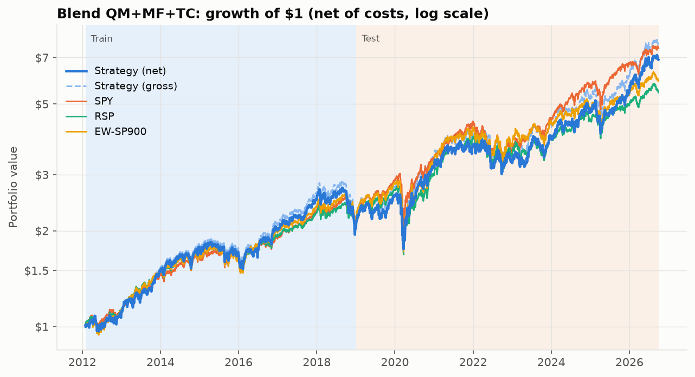
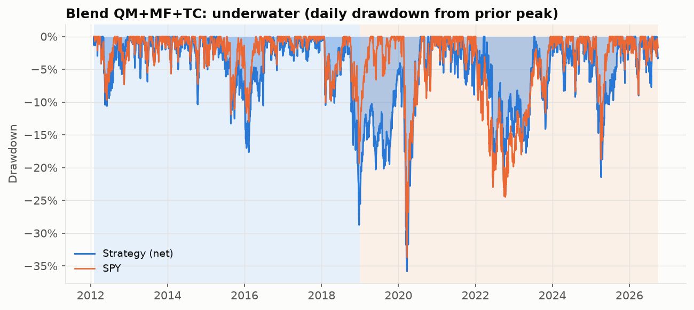
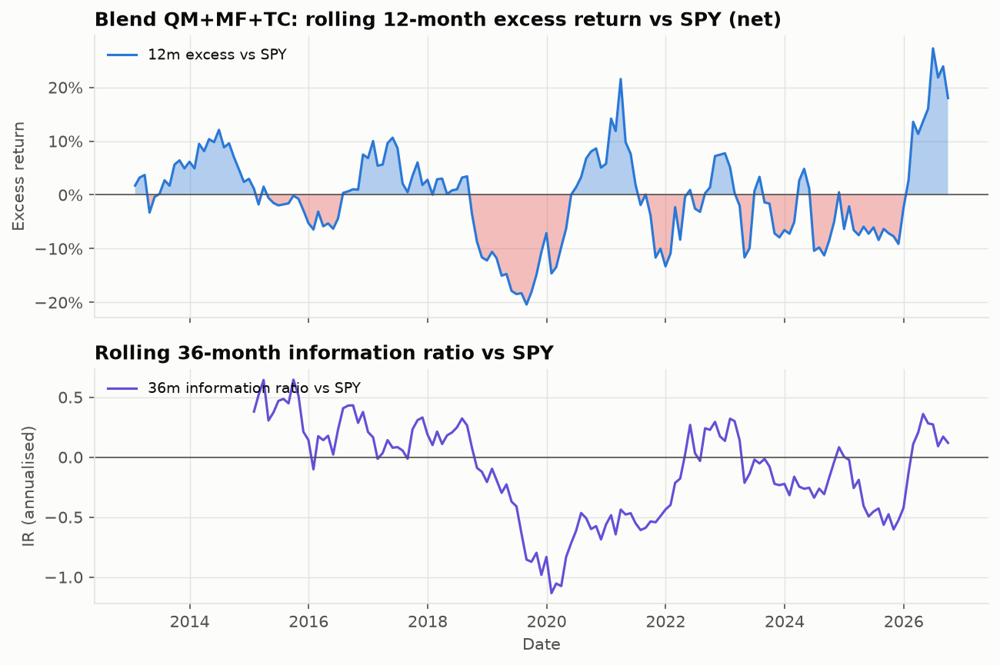
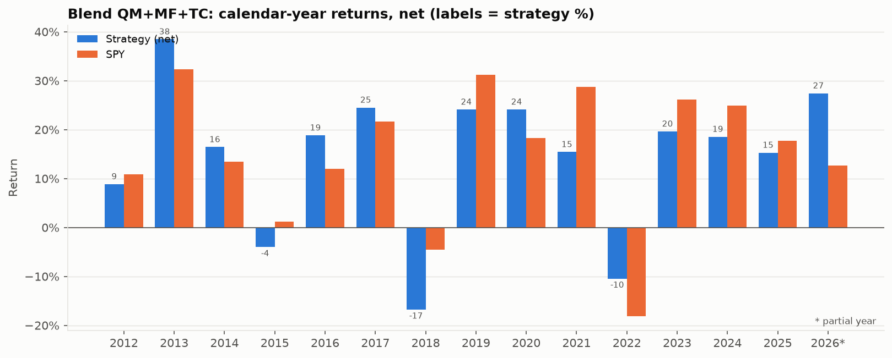
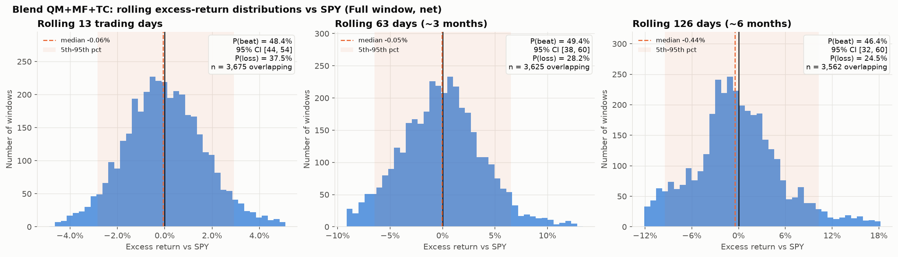
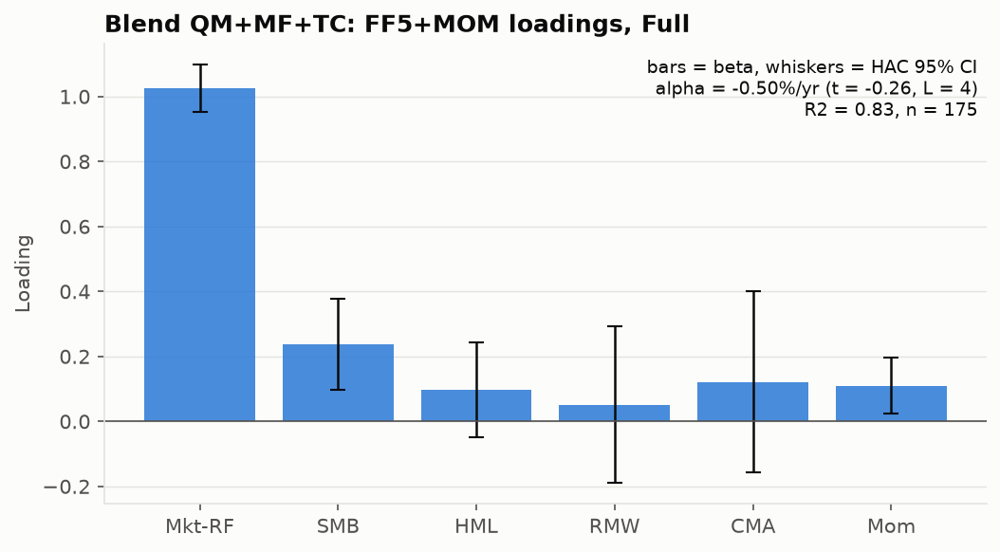
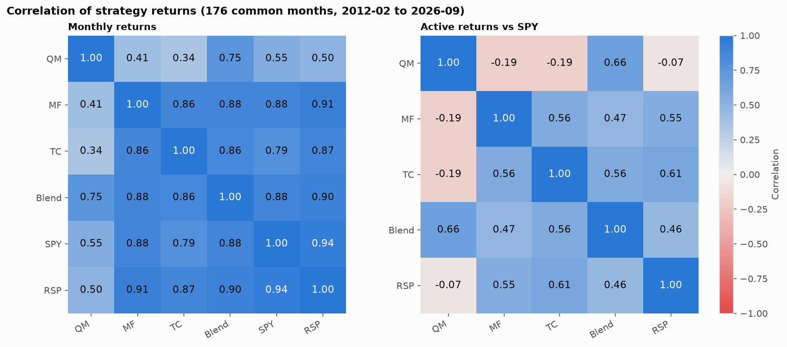

# Blend QM+MF+TC: tear sheet

| item | value |
|---|---|
| Generated | 2026-10-19 04:16 UTC |
| Data | 2012-02-01 to 2026-09-30 (3,687 trading days) |
| Benchmarks | SPY, RSP, EW-SP900 (reference: SPY) |
| strategy | Blend: equal-weight QM + MF + TC (chosen parameters) |
| components | QM: order=MF, shortlist=0.2, x_debt=1, N=10, quality=Q3a, technical=sma_rsi, stop_loss=none, vol_target=none; MF: ranking=MF, n=25, min_cap=5e+09, holding=staggered, universe=SP900, cost_bps=10, excess_cash=min_ca_cl, ebit=opinc; TC: theta=0.1, pe_cap=40, ev_cap=35, size_filter=False, basis=TTM |
| construction | arithmetic average of the three strategies' DAILY net returns (1/3 each, daily re-equalised): approximates a monthly-rebalanced equal-dollar blend; the re-equalisation cost between strategies is ignored; common period only (all three live) |
| universe | the three strategies' universes (point-in-time S&P 900) |
| windows | 2012-02-01 to 2026-09-30; train to 2018-12, test from 2019-01 |
| trials N (sum of the three ledgers) | 323 |
| costs | 10 bps one-way inside each strategy; turnover = average of the three, holdings = sum (overlaps not netted) |
| survivorship | SURVIVORSHIP-BIASED (yfinance has no delisted names): 81.0% of point-in-time S&P 900 members have a price history (monthly mean 2011-2026, minimum 63.2%); EW-SP900 minus RSP = +0.5%/yr CAGR gap (EW-SP500 minus RSP +0.9%/yr, the like-for-like bias proxy; the S&P 900 gap also contains the mid-cap premium); see output/survivorship.md |
| benchmarks | SPY, RSP, EW-SP900 (equal-weight S&P 900 ex Financials and Real Estate, 10 bps) |
| git commit | 2c7657cd70 |

## T1 Performance, net of costs

Monthly statistics from calendar-month compounded daily returns (partial leading/trailing months dropped); MaxDD is daily. Benchmark-relative rows are vs SPY; Sharpe CI = stationary bootstrap (mean block 6, B=500).

### Full (2012-02 to 2026-09)

| metric | Strategy (net) | Strategy (gross) | SPY | RSP | EW-SP900 |
|---|---|---|---|---|---|
| Months | 176 | 176 | 176 | 176 | 176 |
| CAGR | 14.1% | 14.9% | 14.7% | 12.2% | 12.9% |
| AnnVol | 16.6% | 16.6% | 13.9% | 15.1% | 16.2% |
| Sharpe | 0.78 | 0.82 | 0.94 | 0.73 | 0.73 |
| Sharpe 95% CI | [0.34, 1.28] | [0.38, 1.33] | [0.56, 1.47] | [0.36, 1.21] | [0.36, 1.21] |
| Sortino | 1.23 | 1.32 | 1.51 | 1.13 | 1.14 |
| MaxDD (daily) | -35.8% | -35.0% | -33.7% | -39.0% | -40.1% |
| MaxDD peak>trough | 2018-08-29 > 2020-03-23 | 2018-08-29 > 2020-03-23 | 2020-02-19 > 2020-03-23 | 2020-02-12 > 2020-03-23 | 2020-01-16 > 2020-03-23 |
| Calmar | 0.39 | 0.43 | 0.44 | 0.31 | 0.32 |
| Beta vs SPY | 1.05 | 1.05 | – | 1.02 | 1.08 |
| TE vs SPY | 8.0% | 8.0% | – | 5.2% | 6.2% |
| IR vs SPY | -0.02 | 0.07 | – | -0.39 | -0.21 |
| ActiveCAGR vs SPY | -0.6% | 0.2% | – | -2.2% | -1.6% |
| HitRate 1m | 48% | 49% | – | 46% | 47% |
| HitRate 3m | 48% | 52% | – | 40% | 41% |
| HitRate 6m | 44% | 47% | – | 39% | 44% |
| Up capture vs SPY | 101% | 103% | – | 95% | 100% |
| Down capture vs SPY | 104% | 103% | – | 106% | 110% |
| IR vs RSP | 0.26 | – | – | – | – |
| IR vs EW-SP900 | 0.17 | – | – | – | – |
| Cost drag (bps/yr, gross CAGR - net CAGR) | 87 | – | – | – | – |
| Avg holdings | 76.24 | – | – | – | – |
| Annual one-way turnover | 397% | – | – | – | – |

### Train (2012-02 to 2018-12)

| metric | Strategy (net) | Strategy (gross) | SPY | RSP | EW-SP900 |
|---|---|---|---|---|---|
| Months | 83 | 83 | 83 | 83 | 83 |
| CAGR | 11.1% | 12.0% | 12.0% | 11.2% | 11.9% |
| AnnVol | 13.0% | 13.0% | 10.6% | 11.1% | 11.7% |
| Sharpe | 0.84 | 0.90 | 1.08 | 0.97 | 0.98 |
| Sharpe 95% CI | [0.03, 1.87] | [0.07, 1.94] | [0.39, 2.03] | [0.24, 1.99] | [0.24, 1.99] |
| Sortino | 1.31 | 1.42 | 1.71 | 1.52 | 1.53 |
| MaxDD (daily) | -28.7% | -28.5% | -19.3% | -19.8% | -21.3% |
| MaxDD peak>trough | 2018-08-29 > 2018-12-24 | 2018-08-29 > 2018-12-24 | 2018-09-20 > 2018-12-24 | 2018-09-21 > 2018-12-24 | 2018-09-21 > 2018-12-24 |
| Calmar | 0.39 | 0.42 | 0.62 | 0.57 | 0.56 |
| Beta vs SPY | 1.08 | 1.08 | – | 1.02 | 1.04 |
| TE vs SPY | 6.2% | 6.2% | – | 2.6% | 3.9% |
| IR vs SPY | -0.08 | 0.04 | – | -0.25 | 0.01 |
| ActiveCAGR vs SPY | -0.8% | -0.0% | – | -0.7% | -0.1% |
| HitRate 1m | 47% | 48% | – | 45% | 51% |
| HitRate 3m | 46% | 52% | – | 43% | 46% |
| HitRate 6m | 49% | 51% | – | 45% | 56% |
| Up capture vs SPY | 97% | 100% | – | 98% | 102% |
| Down capture vs SPY | 100% | 98% | – | 102% | 104% |
| IR vs RSP | 0.03 | – | – | – | – |
| IR vs EW-SP900 | -0.11 | – | – | – | – |
| Cost drag (bps/yr, gross CAGR - net CAGR) | 85 | – | – | – | – |
| Avg holdings | 72.57 | – | – | – | – |
| Annual one-way turnover | 396% | – | – | – | – |

### Test (2019-01 to 2026-09)

| metric | Strategy (net) | Strategy (gross) | SPY | RSP | EW-SP900 |
|---|---|---|---|---|---|
| Months | 93 | 93 | 93 | 93 | 93 |
| CAGR | 16.7% | 17.6% | 17.2% | 13.1% | 13.7% |
| AnnVol | 19.3% | 19.3% | 16.4% | 17.9% | 19.4% |
| Sharpe | 0.76 | 0.80 | 0.89 | 0.63 | 0.62 |
| Sharpe 95% CI | [0.24, 1.38] | [0.28, 1.43] | [0.35, 1.59] | [0.10, 1.33] | [0.10, 1.28] |
| Sortino | 1.21 | 1.29 | 1.44 | 0.97 | 0.97 |
| MaxDD (daily) | -33.1% | -33.1% | -33.7% | -39.0% | -40.1% |
| MaxDD peak>trough | 2020-01-16 > 2020-03-23 | 2020-01-16 > 2020-03-23 | 2020-02-19 > 2020-03-23 | 2020-02-12 > 2020-03-23 | 2020-01-16 > 2020-03-23 |
| Calmar | 0.51 | 0.53 | 0.51 | 0.34 | 0.34 |
| Beta vs SPY | 1.03 | 1.03 | – | 1.02 | 1.10 |
| TE vs SPY | 9.3% | 9.3% | – | 6.8% | 7.6% |
| IR vs SPY | 0.01 | 0.10 | – | -0.49 | -0.33 |
| ActiveCAGR vs SPY | -0.4% | 0.4% | – | -3.5% | -3.0% |
| HitRate 1m | 49% | 49% | – | 47% | 44% |
| HitRate 3m | 52% | 54% | – | 35% | 36% |
| HitRate 6m | 43% | 45% | – | 32% | 36% |
| Up capture vs SPY | 104% | 105% | – | 93% | 99% |
| Down capture vs SPY | 107% | 105% | – | 107% | 114% |
| IR vs RSP | 0.40 | – | – | – | – |
| IR vs EW-SP900 | 0.32 | – | – | – | – |
| Cost drag (bps/yr, gross CAGR - net CAGR) | 89 | – | – | – | – |
| Avg holdings | 79.52 | – | – | – | – |
| Annual one-way turnover | 398% | – | – | – | – |

### Last 36m (2023-10 to 2026-09)

| metric | Strategy (net) | Strategy (gross) | SPY | RSP | EW-SP900 |
|---|---|---|---|---|---|
| Months | 36 | 36 | 36 | 36 | 36 |
| CAGR | 23.5% | 24.4% | 22.8% | 15.5% | 14.0% |
| AnnVol | 16.6% | 16.6% | 12.4% | 12.9% | 14.0% |
| Sharpe | 1.09 | 1.14 | 1.37 | 0.85 | 0.70 |
| Sharpe 95% CI | [0.30, 2.05] | [0.35, 2.10] | [0.60, 2.16] | [0.19, 1.64] | [-0.02, 1.55] |
| Sortino | 1.92 | 2.02 | 2.86 | 1.38 | 1.11 |
| MaxDD (daily) | -21.5% | -21.3% | -18.8% | -17.8% | -21.1% |
| MaxDD peak>trough | 2025-02-18 > 2025-04-08 | 2025-02-18 > 2025-04-08 | 2025-02-19 > 2025-04-08 | 2024-11-29 > 2025-04-08 | 2024-11-25 > 2025-04-08 |
| Calmar | 1.09 | 1.14 | 1.21 | 0.87 | 0.66 |
| Beta vs SPY | 1.08 | 1.09 | – | 0.84 | 0.91 |
| TE vs SPY | 9.9% | 9.9% | – | 7.8% | 8.3% |
| IR vs SPY | 0.12 | 0.20 | – | -0.78 | -0.88 |
| ActiveCAGR vs SPY | 0.6% | 1.3% | – | -5.9% | -7.1% |
| HitRate 1m | 50% | 50% | – | 47% | 33% |
| HitRate 3m | 56% | 56% | – | 26% | 21% |
| HitRate 6m | 45% | 45% | – | 16% | 23% |
| Up capture vs SPY | 111% | 113% | – | 84% | 84% |
| Down capture vs SPY | 125% | 122% | – | 116% | 132% |
| IR vs RSP | 0.89 | – | – | – | – |
| IR vs EW-SP900 | 1.20 | – | – | – | – |
| Cost drag (bps/yr, gross CAGR - net CAGR) | 94 | – | – | – | – |
| Avg holdings | 79.05 | – | – | – | – |
| Annual one-way turnover | 385% | – | – | – | – |

### 2011-14 (2012-02 to 2014-12)

| metric | Strategy (net) | Strategy (gross) | SPY | RSP | EW-SP900 |
|---|---|---|---|---|---|
| Months | 35 | 35 | 35 | 35 | 35 |
| CAGR | 21.3% | 22.2% | 19.1% | 20.3% | 19.9% |
| AnnVol | 11.3% | 11.3% | 9.1% | 9.9% | 10.2% |
| Sharpe | 1.77 | 1.84 | 1.97 | 1.92 | 1.83 |
| Sharpe 95% CI | [0.96, 2.69] | [1.02, 2.77] | [1.23, 3.02] | [1.08, 3.10] | [0.97, 2.99] |
| Sortino | 3.74 | 3.94 | 3.74 | 3.61 | 3.51 |
| MaxDD (daily) | -10.6% | -10.5% | -9.7% | -11.2% | -10.4% |
| MaxDD peak>trough | 2012-04-27 > 2012-06-04 | 2012-04-27 > 2012-06-04 | 2012-04-02 > 2012-06-04 | 2012-03-26 > 2012-06-04 | 2012-03-26 > 2012-06-04 |
| Calmar | 2.01 | 2.11 | 1.97 | 1.81 | 1.91 |
| Beta vs SPY | 1.03 | 1.03 | – | 1.06 | 1.04 |
| TE vs SPY | 6.3% | 6.3% | – | 2.4% | 3.7% |
| IR vs SPY | 0.33 | 0.45 | – | 0.47 | 0.21 |
| ActiveCAGR vs SPY | 1.9% | 2.6% | – | 1.0% | 0.7% |
| HitRate 1m | 54% | 54% | – | 51% | 54% |
| HitRate 3m | 48% | 52% | – | 61% | 48% |
| HitRate 6m | 50% | 50% | – | 67% | 67% |
| Up capture vs SPY | 104% | 106% | – | 106% | 106% |
| Down capture vs SPY | 85% | 82% | – | 105% | 110% |
| IR vs RSP | 0.17 | – | – | – | – |
| IR vs EW-SP900 | 0.25 | – | – | – | – |
| Cost drag (bps/yr, gross CAGR - net CAGR) | 89 | – | – | – | – |
| Avg holdings | 65.42 | – | – | – | – |
| Annual one-way turnover | 382% | – | – | – | – |

### 2015-18 (2015-01 to 2018-12)

| metric | Strategy (net) | Strategy (gross) | SPY | RSP | EW-SP900 |
|---|---|---|---|---|---|
| Months | 48 | 48 | 48 | 48 | 48 |
| CAGR | 4.3% | 5.1% | 7.1% | 5.0% | 6.4% |
| AnnVol | 14.0% | 14.0% | 11.5% | 11.7% | 12.6% |
| Sharpe | 0.31 | 0.37 | 0.58 | 0.41 | 0.49 |
| Sharpe 95% CI | [-0.70, 1.80] | [-0.66, 1.87] | [-0.25, 1.98] | [-0.42, 1.70] | [-0.36, 1.83] |
| Sortino | 0.44 | 0.52 | 0.86 | 0.58 | 0.71 |
| MaxDD (daily) | -28.7% | -28.5% | -19.3% | -19.8% | -21.3% |
| MaxDD peak>trough | 2018-08-29 > 2018-12-24 | 2018-08-29 > 2018-12-24 | 2018-09-20 > 2018-12-24 | 2018-09-21 > 2018-12-24 | 2018-09-21 > 2018-12-24 |
| Calmar | 0.15 | 0.18 | 0.37 | 0.25 | 0.30 |
| Beta vs SPY | 1.09 | 1.09 | – | 0.99 | 1.04 |
| TE vs SPY | 6.1% | 6.1% | – | 2.8% | 4.1% |
| IR vs SPY | -0.39 | -0.26 | – | -0.71 | -0.13 |
| ActiveCAGR vs SPY | -2.7% | -1.9% | – | -1.9% | -0.7% |
| HitRate 1m | 42% | 44% | – | 40% | 48% |
| HitRate 3m | 41% | 50% | – | 28% | 41% |
| HitRate 6m | 42% | 47% | – | 23% | 47% |
| Up capture vs SPY | 91% | 94% | – | 90% | 98% |
| Down capture vs SPY | 106% | 104% | – | 101% | 102% |
| IR vs RSP | -0.08 | – | – | – | – |
| IR vs EW-SP900 | -0.38 | – | – | – | – |
| Cost drag (bps/yr, gross CAGR - net CAGR) | 82 | – | – | – | – |
| Avg holdings | 77.79 | – | – | – | – |
| Annual one-way turnover | 407% | – | – | – | – |

### 2019-22 (2019-01 to 2022-12)

| metric | Strategy (net) | Strategy (gross) | SPY | RSP | EW-SP900 |
|---|---|---|---|---|---|
| Months | 48 | 48 | 48 | 48 | 48 |
| CAGR | 12.3% | 13.2% | 13.1% | 13.5% | 14.5% |
| AnnVol | 21.4% | 21.5% | 19.4% | 21.4% | 23.2% |
| Sharpe | 0.60 | 0.63 | 0.67 | 0.65 | 0.65 |
| Sharpe 95% CI | [-0.11, 1.62] | [-0.08, 1.67] | [-0.06, 1.74] | [-0.06, 1.78] | [-0.03, 1.73] |
| Sortino | 0.91 | 0.97 | 1.03 | 0.99 | 1.02 |
| MaxDD (daily) | -33.1% | -33.1% | -33.7% | -39.0% | -40.1% |
| MaxDD peak>trough | 2020-01-16 > 2020-03-23 | 2020-01-16 > 2020-03-23 | 2020-02-19 > 2020-03-23 | 2020-02-12 > 2020-03-23 | 2020-01-16 > 2020-03-23 |
| Calmar | 0.37 | 0.40 | 0.39 | 0.35 | 0.36 |
| Beta vs SPY | 1.01 | 1.01 | – | 1.06 | 1.14 |
| TE vs SPY | 8.6% | 8.6% | – | 5.6% | 7.1% |
| IR vs SPY | -0.03 | 0.06 | – | 0.14 | 0.29 |
| ActiveCAGR vs SPY | -0.7% | 0.1% | – | 0.4% | 1.3% |
| HitRate 1m | 52% | 52% | – | 50% | 54% |
| HitRate 3m | 52% | 57% | – | 46% | 50% |
| HitRate 6m | 49% | 51% | – | 49% | 49% |
| Up capture vs SPY | 100% | 102% | – | 104% | 110% |
| Down capture vs SPY | 102% | 101% | – | 103% | 108% |
| IR vs RSP | -0.13 | – | – | – | – |
| IR vs EW-SP900 | -0.29 | – | – | – | – |
| Cost drag (bps/yr, gross CAGR - net CAGR) | 86 | – | – | – | – |
| Avg holdings | 80.37 | – | – | – | – |
| Annual one-way turnover | 408% | – | – | – | – |

### 2023-26 (2023-01 to 2026-09)

| metric | Strategy (net) | Strategy (gross) | SPY | RSP | EW-SP900 |
|---|---|---|---|---|---|
| Months | 45 | 45 | 45 | 45 | 45 |
| CAGR | 21.6% | 22.6% | 21.7% | 12.7% | 12.9% |
| AnnVol | 16.8% | 16.8% | 12.5% | 13.6% | 14.6% |
| Sharpe | 0.99 | 1.03 | 1.29 | 0.62 | 0.60 |
| Sharpe 95% CI | [0.26, 1.70] | [0.31, 1.75] | [0.70, 2.10] | [-0.00, 1.29] | [-0.05, 1.27] |
| Sortino | 1.77 | 1.87 | 2.58 | 1.00 | 0.98 |
| MaxDD (daily) | -21.5% | -21.3% | -18.8% | -17.8% | -21.1% |
| MaxDD peak>trough | 2025-02-18 > 2025-04-08 | 2025-02-18 > 2025-04-08 | 2025-02-19 > 2025-04-08 | 2024-11-29 > 2025-04-08 | 2024-11-25 > 2025-04-08 |
| Calmar | 1.01 | 1.06 | 1.16 | 0.71 | 0.61 |
| Beta vs SPY | 1.08 | 1.08 | – | 0.90 | 0.98 |
| TE vs SPY | 10.1% | 10.0% | – | 7.7% | 8.0% |
| IR vs SPY | 0.05 | 0.13 | – | -1.00 | -0.92 |
| ActiveCAGR vs SPY | -0.1% | 0.7% | – | -7.4% | -7.3% |
| HitRate 1m | 47% | 47% | – | 44% | 33% |
| HitRate 3m | 53% | 53% | – | 21% | 19% |
| HitRate 6m | 40% | 42% | – | 12% | 18% |
| Up capture vs SPY | 108% | 110% | – | 80% | 84% |
| Down capture vs SPY | 120% | 117% | – | 120% | 130% |
| IR vs RSP | 0.91 | – | – | – | – |
| IR vs EW-SP900 | 1.00 | – | – | – | – |
| Cost drag (bps/yr, gross CAGR - net CAGR) | 94 | – | – | – | – |
| Avg holdings | 78.60 | – | – | – | – |
| Annual one-way turnover | 388% | – | – | – | – |

## T2 Factor regressions (monthly, Newey-West HAC)

alpha is annualised (12 x monthly intercept); loadings show beta (HAC t, L=4). t at L=6 / L=12 are robustness checks; excess = strategy minus rf, active = strategy minus the reference benchmark.

| window | y | model | n | alpha (ann %) | t (L=4) | t (L=6) | t (L=12) | Mkt-RF | SMB | HML | RMW | CMA | Mom | R2 | adj R2 |
|---|---|---|---|---|---|---|---|---|---|---|---|---|---|---|---|
| Full | excess vs rf | CAPM | 175 | -0.45 | -0.20 | -0.20 | -0.20 | 1.02 (23.0) |  |  |  |  |  | 0.79 | 0.79 |
| Full | excess vs rf | FF3+MOM | 175 | -0.36 | -0.18 | -0.19 | -0.20 | 1.01 (28.4) | 0.21 (3.3) | 0.16 (2.2) |  |  | 0.11 (2.5) | 0.82 | 0.82 |
| Full | excess vs rf | FF5+MOM | 175 | -0.50 | -0.26 | -0.26 | -0.27 | 1.02 (27.7) | 0.24 (3.3) | 0.10 (1.3) | 0.05 (0.4) | 0.12 (0.9) | 0.11 (2.5) | 0.83 | 0.82 |
| Full | active vs SPY | FF5+MOM | 175 | -0.31 | -0.16 | -0.16 | -0.17 | 0.04 (1.0) | 0.35 (5.1) | 0.07 (1.0) | 0.00 (0.0) | 0.10 (0.7) | 0.11 (2.5) | 0.23 | 0.20 |
| Train | excess vs rf | CAPM | 83 | -1.55 | -0.64 | -0.63 | -0.64 | 1.07 (15.3) |  |  |  |  |  | 0.81 | 0.81 |
| Train | excess vs rf | FF3+MOM | 83 | -1.19 | -0.50 | -0.48 | -0.48 | 1.04 (19.8) | 0.22 (2.7) | -0.01 (-0.2) |  |  | 0.06 (1.2) | 0.83 | 0.82 |
| Train | excess vs rf | FF5+MOM | 83 | -1.34 | -0.58 | -0.57 | -0.59 | 1.06 (23.5) | 0.33 (4.0) | 0.02 (0.2) | 0.41 (2.4) | -0.04 (-0.3) | 0.08 (1.6) | 0.85 | 0.84 |
| Train | active vs SPY | FF5+MOM | 83 | -1.03 | -0.44 | -0.43 | -0.45 | 0.07 (1.4) | 0.45 (5.6) | 0.03 (0.3) | 0.37 (2.1) | -0.08 (-0.5) | 0.07 (1.5) | 0.30 | 0.24 |
| Test | excess vs rf | CAPM | 92 | 0.33 | 0.10 | 0.10 | 0.10 | 1.00 (18.7) |  |  |  |  |  | 0.78 | 0.78 |
| Test | excess vs rf | FF3+MOM | 92 | 0.39 | 0.12 | 0.13 | 0.15 | 1.00 (22.6) | 0.20 (2.1) | 0.19 (2.2) |  |  | 0.11 (1.9) | 0.82 | 0.82 |
| Test | excess vs rf | FF5+MOM | 92 | 0.44 | 0.14 | 0.15 | 0.17 | 1.02 (22.2) | 0.19 (1.7) | 0.13 (1.5) | -0.05 (-0.4) | 0.16 (0.9) | 0.08 (1.3) | 0.83 | 0.81 |
| Test | active vs SPY | FF5+MOM | 92 | 0.55 | 0.17 | 0.18 | 0.21 | 0.03 (0.6) | 0.30 (2.9) | 0.10 (1.1) | -0.10 (-0.8) | 0.14 (0.8) | 0.08 (1.3) | 0.24 | 0.19 |

## T7 Short-horizon behaviour (rolling windows from the backtest)

Overlapping compounded windows on daily net returns; excess = strategy minus benchmark. Effective independent windows (`indep.`) are about n/h, so the binomial uncertainty of P(beat) is large; the bracket is a stationary-bootstrap 95% CI.

| vs | window | horizon | windows | indep. | mean excess | 5% | 25% | median | 75% | 95% | worst | P(beat) | P(loss) | P(beat by >2pt) |
|---|---|---|---|---|---|---|---|---|---|---|---|---|---|---|
| SPY | Full | 13d | 3675 | 284 | -0.00% | -2.84% | -1.16% | -0.06% | 1.11% | 2.93% | -7.04% | 48.4% [44-54] | 37.5% | 12.1% |
| SPY | Full | 63d | 3625 | 59 | -0.01% | -6.50% | -2.71% | -0.05% | 2.39% | 6.52% | -10.25% | 49.4% [38-60] | 28.2% | 28.6% |
| SPY | Full | 126d | 3562 | 29 | -0.04% | -9.45% | -3.36% | -0.44% | 3.05% | 10.29% | -13.17% | 46.4% [32-60] | 24.5% | 32.2% |
| SPY | Test | 13d | 1935 | 150 | -0.00% | -3.30% | -1.40% | -0.07% | 1.37% | 3.48% | -7.04% | 48.6% [42-56] | 37.0% | 17.0% |
| SPY | Test | 63d | 1885 | 31 | -0.04% | -7.11% | -3.64% | -0.12% | 2.85% | 8.29% | -10.25% | 48.9% [35-63] | 31.5% | 32.2% |
| SPY | Test | 126d | 1822 | 15 | -0.03% | -9.62% | -4.61% | -0.67% | 3.14% | 13.97% | -12.79% | 44.7% [26-63] | 27.8% | 31.8% |
| RSP | Full | 13d | 3675 | 284 | 0.10% | -2.54% | -0.88% | 0.09% | 1.13% | 2.69% | -8.04% | 52.8% [48-58] | 37.5% | 10.2% |
| RSP | Full | 63d | 3625 | 59 | 0.45% | -5.29% | -2.01% | 0.09% | 2.92% | 6.78% | -9.33% | 51.1% [42-64] | 28.2% | 30.4% |
| RSP | Full | 126d | 3562 | 29 | 0.91% | -7.98% | -2.68% | 0.31% | 4.11% | 11.71% | -11.51% | 52.9% [39-69] | 24.5% | 35.9% |
| EW-SP900 | Full | 13d | 3675 | 284 | 0.06% | -2.35% | -0.86% | 0.06% | 0.99% | 2.48% | -8.70% | 52.0% [47-57] | 37.5% | 8.4% |
| EW-SP900 | Full | 63d | 3625 | 59 | 0.23% | -5.86% | -1.93% | 0.16% | 2.46% | 6.14% | -10.79% | 52.2% [42-65] | 28.2% | 28.3% |
| EW-SP900 | Full | 126d | 3562 | 29 | 0.46% | -8.36% | -3.14% | 0.39% | 3.46% | 10.13% | -14.93% | 53.8% [37-71] | 24.5% | 35.0% |

### Forward expectation: P(beat SPY) = Phi(IR x sqrt(h/252))

Backtest IR (full sample, monthly) = -0.02. Haircuts follow McLean & Pontiff (2016): a self-tuned strategy can decay by more than their 26% data-mining cap, so treat these as optimistic.

| scenario | IR | 13d | 63d | 126d |
|---|---|---|---|---|
| IR = 0 (no skill) | 0.00 | 50.0% | 50.0% | 50.0% |
| backtest IR, no haircut | -0.02 | 49.8% | 49.6% | 49.4% |
| haircut 26% (data-mining only) | -0.02 | 49.9% | 49.7% | 49.5% |
| haircut 58% (post-publication) | -0.01 | 49.9% | 49.8% | 49.7% |

## Charts

### C1 Growth of $1

### C2 Underwater

### C3 Rolling excess and IR

### C4 Calendar-year returns

### C5 Rolling-horizon excess-return histograms

### C8 Factor loadings

## Blend vs components

| series | window | CAGR | Sharpe | MaxDD |
|---|---|---|---|---|
| QM | train | 11.4% | 0.72 | -33.0% |
| QM | test | 20.0% | 0.69 | -40.0% |
| QM | full | 15.9% | 0.68 | -40.0% |
| MF | train | 13.3% | 1.04 | -25.6% |
| MF | test | 13.6% | 0.61 | -35.3% |
| MF | full | 13.4% | 0.75 | -35.3% |
| TC | train | 8.0% | 0.55 | -33.3% |
| TC | test | 13.0% | 0.51 | -46.6% |
| TC | full | 10.6% | 0.51 | -52.4% |
| Blend | train | 11.1% | 0.84 | -28.7% |
| Blend | test | 16.7% | 0.76 | -33.1% |
| Blend | full | 14.1% | 0.78 | -35.8% |

## C10 / correlations

Monthly return correlation (full):

|  | QM | MF | TC | Blend | SPY | RSP |
|---|---|---|---|---|---|---|
| QM | 1.00 | 0.41 | 0.34 | 0.75 | 0.55 | 0.50 |
| MF | 0.41 | 1.00 | 0.86 | 0.88 | 0.88 | 0.91 |
| TC | 0.34 | 0.86 | 1.00 | 0.86 | 0.79 | 0.87 |
| Blend | 0.75 | 0.88 | 0.86 | 1.00 | 0.88 | 0.90 |
| SPY | 0.55 | 0.88 | 0.79 | 0.88 | 1.00 | 0.94 |
| RSP | 0.50 | 0.91 | 0.87 | 0.90 | 0.94 | 1.00 |

Active-return correlation vs SPY (full):

|  | QM | MF | TC | Blend | RSP |
|---|---|---|---|---|---|
| QM | 1.00 | -0.19 | -0.19 | 0.66 | -0.07 |
| MF | -0.19 | 1.00 | 0.56 | 0.47 | 0.55 |
| TC | -0.19 | 0.56 | 1.00 | 0.56 | 0.61 |
| Blend | 0.66 | 0.47 | 0.56 | 1.00 | 0.46 |
| RSP | -0.07 | 0.55 | 0.61 | 0.46 | 1.00 |

Active-return correlation vs SPY (test):

|  | QM | MF | TC | Blend | RSP |
|---|---|---|---|---|---|
| QM | 1.00 | -0.27 | -0.29 | 0.65 | -0.09 |
| MF | -0.27 | 1.00 | 0.64 | 0.44 | 0.58 |
| TC | -0.29 | 0.64 | 1.00 | 0.50 | 0.66 |
| Blend | 0.65 | 0.44 | 0.50 | 1.00 | 0.47 |
| RSP | -0.09 | 0.58 | 0.66 | 0.47 | 1.00 |

## Assumptions and limitations

- Returns are net of the stated trading costs (per side, on traded notional); signals at the close of day t, trades at the close of t+1; point-in-time rule: filings usable only if filed strictly before the signal date.
- Survivorship, XBRL tag mapping and a short test window limit what can be concluded; see the header and the coverage audit.
- Sharpe ratios are annualised from monthly data with sqrt(12), exact only for iid returns; HAC t-statistics over-reject in short samples.
- Expected decay: published anomalies lose roughly a quarter to a half of their returns out of sample and after publication (McLean & Pontiff 2016, Journal of Finance 71(1)); parameters were fixed on the train window with a pre-registered plateau rule and confirmed once on the test window, so the live result should be expected to be smaller than the backtest.

