# Magic Formula: results

Generated 2026-10-19 04:13 UTC · git `2c7657cd70` · data to 2026-10-16, backtest to 2026-09-30 · 18 pre-registered cells · 38 trials in the ledger.

**Universe**: point-in-time S&P 900 (S&P 500 + MidCap 400) ex GICS Financials, Real Estate and Utilities, raw price >= $5. Net of 10 bps one-way costs, signal at month-end close, trade at the next close.

## Verdict: 4/7 criteria passed -> mixed (failed: #1, #6, #7); fewer than 5/7: do not claim it works, hold it as a research hypothesis at a modest weight

## Parameters

- **Chosen** (plateau_v1 choice): `ranking=MF, n=25, min_cap=5e+09, holding=staggered, universe=SP900, cost_bps=10, excess_cash=min_ca_cl, ebit=opinc`
- **Literature default**: `ranking=MF, n=30, min_cap=1e+09, holding=staggered, universe=SP900, cost_bps=10, excess_cash=min_ca_cl, ebit=opinc`
- Train 2011-10 to 2018-12 (87 months): chosen Sharpe 1.13, default 1.02; plateau width 7 cells; bootstrap stability: 90% within one step

### Train

| series | months | CAGR | vol | Sharpe | MaxDD (daily) | FF5+MOM alpha (t) |
|---|---|---|---|---|---|---|
| chosen | 87 | 16.4% | 13.9% | 1.13 | -25.6% | 1.5% (0.78) |
| default | 87 | 15.7% | 14.9% | 1.02 | -26.4% | 1.1% (0.56) |
| SPY | 87 | 13.8% | 11.1% | 1.18 | -19.3% | -0.3% (-1.48) |
| RSP | 87 | 13.3% | 11.9% | 1.07 | -19.8% | -0.3% (-0.45) |
| EW-SP900 | 87 | 15.5% | 14.2% | 1.05 | -22.7% | 0.4% (0.41) |

### Test (single look)

| series | months | CAGR | vol | Sharpe | MaxDD (daily) | FF5+MOM alpha (t) |
|---|---|---|---|---|---|---|
| chosen | 93 | 13.6% | 19.3% | 0.61 | -35.3% | -0.9% (-0.32) |
| default | 93 | 14.4% | 20.2% | 0.63 | -37.7% | 0.0% (0.01) |
| SPY | 93 | 17.2% | 16.4% | 0.89 | -33.7% | -0.1% (-0.34) |
| RSP | 93 | 13.1% | 17.9% | 0.63 | -39.0% | -2.0% (-1.70) |
| EW-SP900 | 93 | 14.0% | 20.1% | 0.62 | -40.5% | -1.9% (-1.37) |

### Full period

| series | months | CAGR | vol | Sharpe | MaxDD (daily) | FF5+MOM alpha (t) |
|---|---|---|---|---|---|---|
| chosen | 180 | 14.9% | 16.9% | 0.81 | -35.3% | 0.6% (0.29) |
| default | 180 | 15.0% | 17.8% | 0.78 | -37.7% | 0.8% (0.46) |
| SPY | 180 | 15.6% | 14.0% | 0.99 | -33.7% | -0.2% (-0.95) |
| RSP | 180 | 13.2% | 15.3% | 0.78 | -39.0% | -1.1% (-1.43) |
| EW-SP900 | 180 | 14.7% | 17.5% | 0.78 | -40.5% | -0.6% (-0.74) |

### Last 36 months

| series | months | CAGR | vol | Sharpe | MaxDD (daily) | FF5+MOM alpha (t) |
|---|---|---|---|---|---|---|
| chosen | 36 | 15.0% | 15.6% | 0.70 | -15.5% | -5.8% (-1.02) |
| default | 36 | 14.6% | 15.6% | 0.67 | -15.9% | -5.8% (-1.06) |
| SPY | 36 | 22.8% | 12.4% | 1.37 | -18.8% |  |
| RSP | 36 | 15.5% | 12.9% | 0.85 | -17.8% |  |
| EW-SP900 | 36 | 13.8% | 14.4% | 0.67 | -22.2% |  |

## Selection and confirmation

- chosen: **ranking=MF, n=25, min_cap=5e+09, holding=staggered, universe=SP900, cost_bps=10, excess_cash=min_ca_cl, ebit=opinc** (plateau_v1 choice)
- default: ranking=MF, n=30, min_cap=1e+09, holding=staggered, universe=SP900, cost_bps=10, excess_cash=min_ca_cl, ebit=opinc (train Sharpe 1.02)
- train Sharpe of chosen 1.13; plateau score 1.070; peak ratio 1.02; plateau width 7 cells (>= 90% of chosen)
- bootstrap stability (B=500, mean block 6): 35% select exactly this cell, 90% within one grid step -> pass
- sensitivity (not used for selection): argmax -> f3ac97b076 (Sharpe 1.16, MORE THAN one step); lam0 -> d6b4cbd46c (Sharpe 1.13, within one step)

Reasons:
- train window 2011-10-31..2018-12-31: 87 months, 18 of 18 cells evaluable; metric = net Sharpe (annualised, excess of rf)
- plateau pick: score 1.070, peak ratio 1.02 (max 1.25)
- categorical plateau scores: holding=staggered=1.070; holding=annual=1.080 (default category kept unless another beats it by >= 0.10)
- bootstrap stability (B=500): 35% exactly this cell, 90% within one grid step (need >= 50%) -> pass

Neighbourhood of the chosen cell (train):

| role | axis | step | n | min_cap | holding | sharpe |
|---|---|---|---|---|---|---|
| self |  | 0 | 25 | 5000000000.0 | staggered | 1.13 |
| neighbor | n | -1 | 20 | 5000000000.0 | staggered | 1.15 |
| neighbor | n | 1 | 30 | 5000000000.0 | staggered | 1.13 |
| neighbor | min_cap | -1 | 25 | 1000000000.0 | staggered | 1.04 |

Plateau result per categorical level:

| category | n_cells | is_default_category | n_eligible | score | peak_ratio | sharpe | chosen |
|---|---|---|---|---|---|---|---|
| holding=staggered | 9 | True | 9 | 1.07 | 1.02 | 1.13 | True |
| holding=annual | 9 | False | 9 | 1.08 | 1.02 | 1.14 | False |

Confirmation on the untouched test window 2019-01-01 to 2026-09-30:

| cell | sharpe | cagr | vol | maxdd | tstat | n_months |
|---|---|---|---|---|---|---|
| chosen | 0.61 | 13.6% | 19.3% | -22.7% | 1.71 | 93 |
| default | 0.63 | 14.4% | 20.2% | -24.8% | 1.75 | 93 |
| grid_median | 0.63 | 14.3% | 20.2% | -24.3% | 1.75 | 93 |

- chosen minus default Sharpe: -0.02; chosen minus grid median: -0.01; rank percentile among cells: 17%
- Spearman(train Sharpe, test Sharpe) across cells: -0.81; test/train Sharpe of the chosen cell: 0.54
- criteria: test_sharpe_positive=yes, test_ge_half_train=yes, landscape_persists=NO, beats_grid_median=NO

## Overfitting diagnostics (train)

| diagnostic | value |
|---|---|
| Months / window | 87 / 2011-10-31..2018-12-31 |
| Trials N (ledger, distinct configurations) | 38 |
| Cells in grid / effective trials N_hat | 18 / 1.20 |
| Net Sharpe (annualised) | 1.13 |
| t-stat of mean excess return | 3.03  (vs 2.0: pass; 3.0: pass; 3.39: fail) |
| PSR(0) | 0.999 |
| Expected max Sharpe SR0 of N null trials (annualised) | 0.13 |
| DSR at N = 38 (ledger) | 0.996 |
| DSR at N_hat = 1.20 | 0.999 |
| DSR at N = 18 (grid cells) | 0.996 |
| Bonferroni haircut Sharpe (annualised) / haircut | 0.63 / 44% |
| Minimum track record for PSR(0) >= 95% (years) | 2.28 |
| PBO (CSCV, S=16, selector: plateau) | 30.1%  (12,870 splits) |
| P(OOS Sharpe < 0) of the selected trial | 0.6% |
| Degradation slope (OOS on IS Sharpe; negative = overfit) | -0.91 |

DSR on the full sample:

| diagnostic | value |
|---|---|
| Months / window | 180 / full |
| Trials N (ledger, distinct configurations) | 38 |
| Cells in grid / effective trials N_hat | 18 / 1.16 |
| Net Sharpe (annualised) | 0.81 |
| t-stat of mean excess return | 3.15  (vs 2.0: pass; 3.0: pass; 3.39: fail) |
| PSR(0) | 0.999 |
| Expected max Sharpe SR0 of N null trials (annualised) | 0.04 |
| DSR at N = 38 (ledger) | 0.998 |
| DSR at N_hat = 1.16 | 0.999 |
| DSR at N = 18 (grid cells) | 0.999 |
| Bonferroni haircut Sharpe (annualised) / haircut | 0.48 / 41% |
| Minimum track record for PSR(0) >= 95% (years) | 4.25 |

## Grid regression (train)

Response: net Sharpe of each of 18 grid cells on 2011-10-31..2018-12-31; ordinal parameters scaled to [-1, 1]; R2 = 0.99. Bootstrap SDs resample months jointly across cells (B=500); cells overlap, so OLS p-values would be meaningless. A flat surface (small coefficients, low R2) is good news.

| term | coef | bootstrap SD | coef / SD |
|---|---|---|---|
| const | 1.046 | 0.380 | 2.8 |
| n | -0.019 | 0.022 | -0.8 |
| min_cap | 0.063 | 0.032 | 2.0 |
| n^2 | 0.012 | 0.008 | 1.6 |
| min_cap^2 | 0.030 | 0.030 | 1.0 |
| n*min_cap | 0.005 | 0.010 | 0.5 |
| holding=staggered | -0.010 | 0.012 | -0.8 |

## Robustness (each run is a ledger trial)

Full-period net results of one-at-a-time changes around the chosen cell. Every run is logged in the ledger as an extra trial (it raises N for the DSR).

| run | full CAGR | full Sharpe | train Sharpe | test Sharpe | test CAGR | MaxDD | turnover/yr | FF5+MOM alpha | IR vs SPY | IR vs EW |
|---|---|---|---|---|---|---|---|---|---|---|
| chosen (base, 10 bps) | 14.9% | 0.81 | 1.13 | 0.61 | 13.6% | -35.3% | 64% | 0.6% (t=0.29) | -0.02 | 0.01 |
| cost 0 bps | 15.0% | 0.82 | 1.13 | 0.62 | 13.7% | -35.2% | 64% | 0.7% (t=0.35) | -0.00 | 0.03 |
| ablation ey_only | 11.5% | 0.54 | 0.76 | 0.42 | 10.7% | -53.1% | 68% | -2.2% (t=-0.87) | -0.16 | -0.21 |
| ablation roc_only | 14.5% | 0.82 | 1.32 | 0.52 | 11.3% | -34.6% | 43% | 0.5% (t=0.24) | -0.08 | -0.04 |
| ablation gpa_quality | 13.9% | 0.71 | 0.92 | 0.61 | 14.6% | -42.8% | 59% | -1.2% (t=-0.63) | -0.08 | -0.08 |
| ablation us_all_universe | 13.3% | 0.72 | 1.09 | 0.49 | 11.1% | -36.0% | 67% | -0.7% (t=-0.40) | -0.19 | -0.19 |
| ablation sp1500_universe | 14.8% | 0.81 | 1.13 | 0.61 | 13.4% | -35.3% | 64% | 0.5% (t=0.25) | -0.03 | -0.00 |
| ablation all_cash | 14.8% | 0.81 | 1.15 | 0.60 | 13.1% | -34.5% | 62% | 0.6% (t=0.30) | -0.03 | -0.01 |
| ablation ebit_pretax_interest | 15.4% | 0.85 | 1.14 | 0.66 | 14.3% | -33.9% | 65% | 1.0% (t=0.52) | 0.02 | 0.06 |
| ablation cost_25bps | 14.7% | 0.80 | 1.12 | 0.60 | 13.4% | -35.3% | 64% | 0.4% (t=0.20) | -0.04 | -0.02 |
| ablation cost_50bps | 14.4% | 0.78 | 1.10 | 0.59 | 13.0% | -35.3% | 64% | 0.1% (t=0.05) | -0.08 | -0.06 |

## Evidence ladder

**4/7 criteria passed -> mixed (failed: #1, #6, #7); fewer than 5/7: do not claim it works, hold it as a research hypothesis at a modest weight**

| # | criterion | pass | evidence |
|---|---|---|---|
| 1 | Direction replicates: net IR vs same-universe EW > 0 on train AND test | NO | IR train 0.15, test -0.07 |
| 2 | Plateau: chosen cell passes the 5.4 eligibility and bootstrap stability | yes | passed; stability 90% within one step |
| 3 | Costs: FF5+MOM net alpha still > 0 at 25 bps one-way | yes | alpha 0.4%/yr (t=0.20) at 25 bps; buy/hold-spread check for momentum not run |
| 4 | Factor view: FF5+MOM alpha > 0, or explained by the expected factors with no large negative alpha | yes | alpha 0.6%/yr (t=0.29, full sample to 2026-08, French data end 2026-08); expected-factor loadings with abs(t) > 2: RMW 0.22 (t=2.8) |
| 5 | Overfitting: PBO < 0.5 (DSR at N_hat and haircut Sharpe reported) | yes | PBO 30.1%; DSR(ledger N=38) 0.996, DSR(N_hat=1.20) 0.999; haircut Sharpe 0.63 (train, aim DSR > 0.5: met) |
| 6 | Bias stress: FF5+MOM alpha survives a 150 bps/yr survivorship drag | NO | break-even drag 56 bps/yr (alpha 0.56%); active CAGR vs EW-SP900 0.2% |
| 7 | Subperiods: positive active return vs SPY in at least 3 of 4 subperiods | NO | 2 of 4 positive (2011-14 5.8%, 2015-18 -0.6%, 2019-22 1.2%, 2023-26 -7.4%); worst 12m active return vs SPY -19.0% |

## Bias stress

SURVIVORSHIP-BIASED (yfinance has no delisted names): 81.0% of point-in-time S&P 900 members have a price history (monthly mean 2011-2026, minimum 63.2%); EW-SP900 minus RSP = +0.5%/yr CAGR gap (EW-SP500 minus RSP +0.9%/yr, the like-for-like bias proxy; the S&P 900 gap also contains the mid-cap premium); see output/survivorship.md

Break-even drag (alpha = 0): 56 bps/yr.

| assumed drag (bps/yr) | FF5+MOM alpha after drag | t |
|---|---|---|
| 0 | 0.56% | 0.29 |
| 50 | 0.06% | 0.03 |
| 100 | -0.44% | -0.23 |
| 150 | -0.94% | -0.50 |
| 200 | -1.44% | -0.76 |
| 300 | -2.44% | -1.28 |

Coverage by year and the EW-minus-RSP gap are in `output/survivorship.md`. Overall: share with prices 81.0%; EW-SP900 minus RSP +0.48%/yr.

## Short horizon (daily net returns, chosen parameters)

| window | horizon | P(beat SPY) | P(loss) | excess 5%/median/95% | return 5%/median/95% |
|---|---|---|---|---|---|
| full | 13d | 50.2% [45-54] | 37.6% | -3.0 / 0.0 / 2.8 pts | -5.5 / 0.9 / 6.3% |
| full | 63d | 47.5% [37-59] | 27.7% | -6.3 / -0.2 / 5.8 pts | -8.2 / 4.1 / 14.6% |
| full | 126d | 47.7% [34-63] | 20.9% | -9.2 / -0.3 / 8.8 pts | -8.0 / 7.0 / 21.4% |
| test | 13d | 47.0% [40-54] | 39.3% | -3.6 / -0.2 / 3.4 pts | -5.9 / 1.0 / 6.7% |
| test | 63d | 41.0% [30-55] | 32.5% | -8.1 / -1.2 / 7.5 pts | -9.2 / 3.4 / 15.5% |
| test | 126d | 38.4% [21-57] | 24.8% | -10.5 / -2.0 / 9.5 pts | -8.5 / 5.6 / 23.5% |

## Live picks (as of 2026-10-16)

- chosen (25): GEN, HRB, ADBE, CROX, CI, GDDY, ACN, MO, HON, MU, IT, INCY, TPR, BMY, SAIC, BAH, G, SOLV, SNDK, CTSH, TTEK, HPQ, BKNG, ANF, LDOS
- default (30): GEN, HRB, ADBE, KBR, CROX, CI, GDDY, ACN, MO, HON, MU, VNT, INCY, BMY, TPR, IT, SAIC, G, BAH, SOLV, BBWI, CTSH, SNDK, HPQ, ANF, LDOS, TTEK, PNR, BKNG, THC
- tables: `output/live/magic_formula_chosen.csv`, `output/live/magic_formula_default.csv` (+ diagnostics JSON in `output/live/`)
- fundamentals age of the chosen picks: {'max_age_days': 138.0, 'median_age_days': 108.0, 'n_older_than_150': 0, 'n_older_than_200': 0}

## Files

- tear sheet (chosen): [magic_formula_chosen_tearsheet.md](magic_formula_chosen_tearsheet.md)
- tear sheet (default): [magic_formula_default_tearsheet.md](magic_formula_default_tearsheet.md)
- grid: `grid_cells.csv`, `grid_monthly_returns.csv`, `grid_metrics_{train,test,full}.csv`
- daily series: `daily_chosen.csv`, `daily_default.csv`, `daily_benchmarks.csv`

## Figures

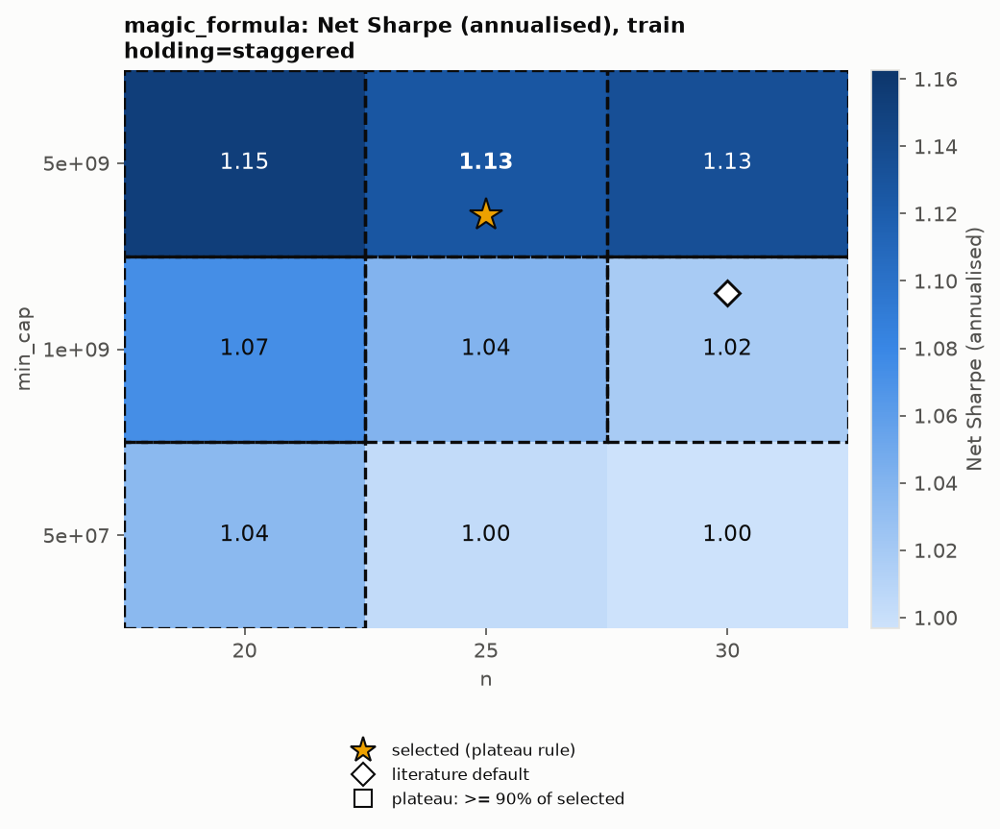

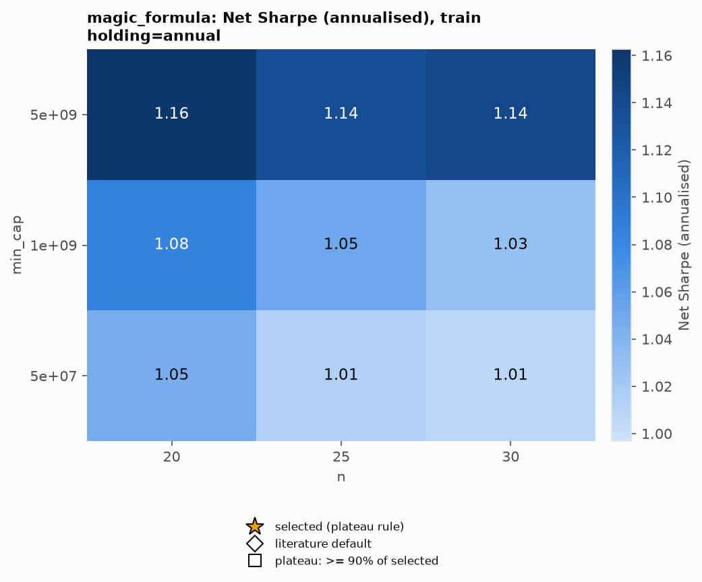

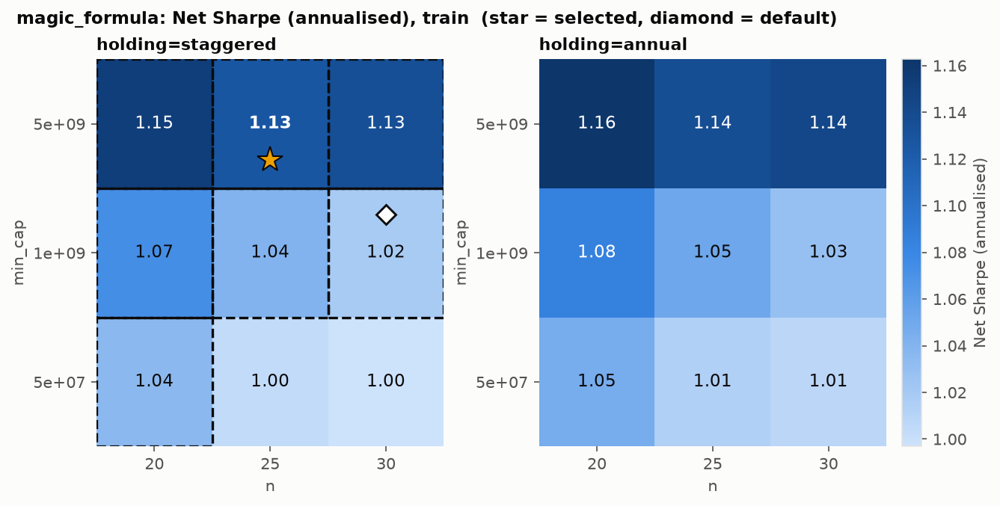

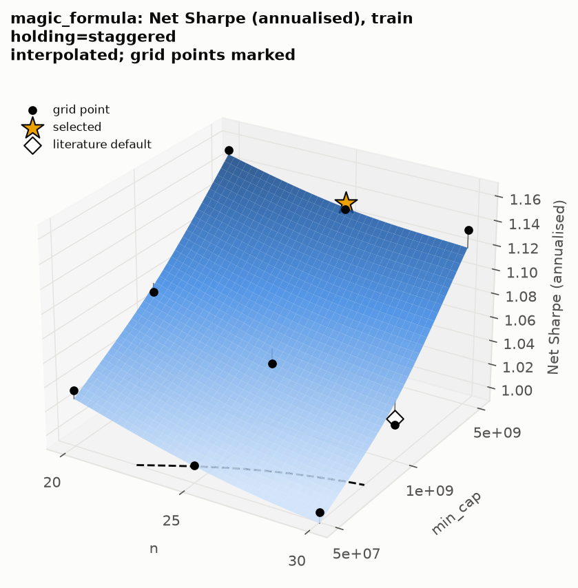

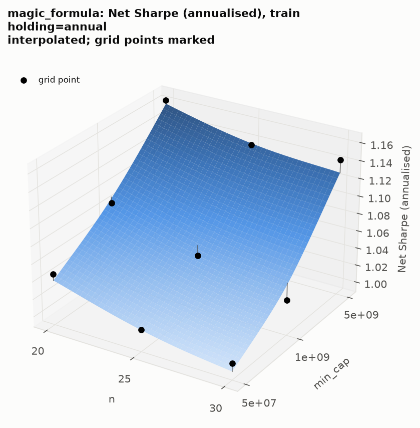

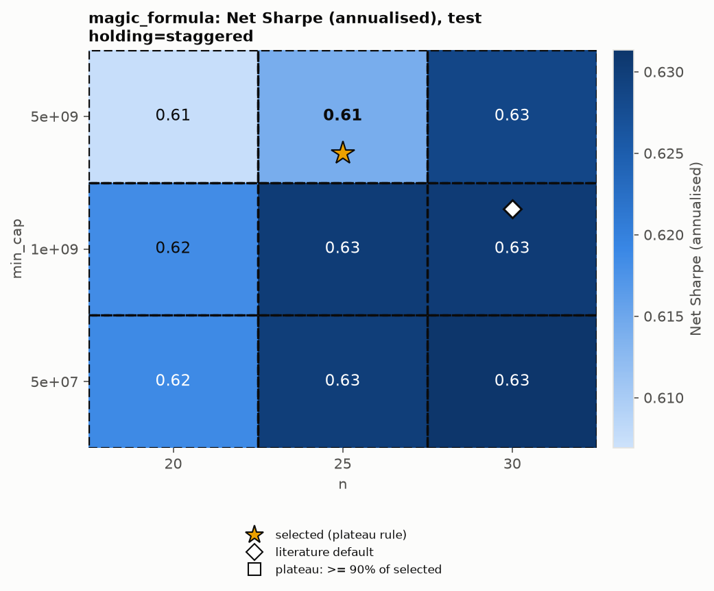

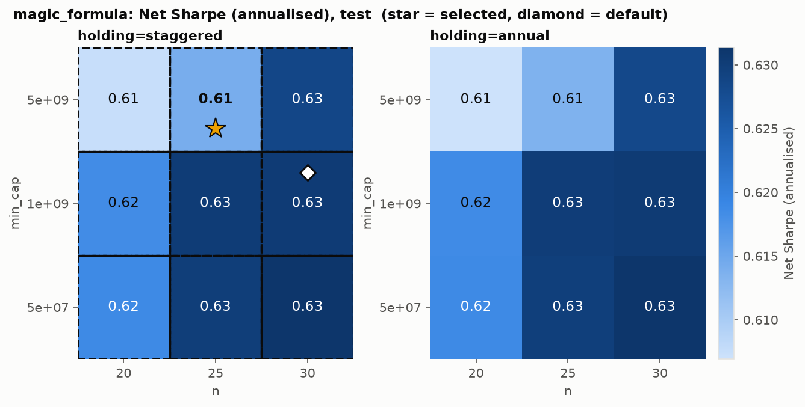

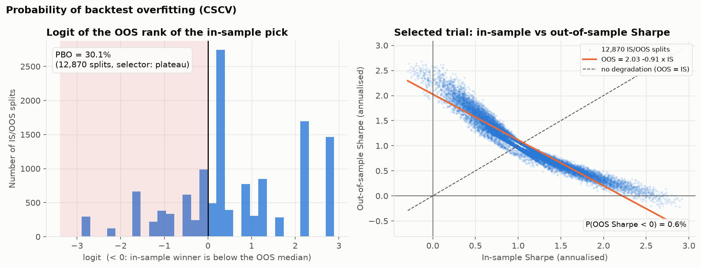

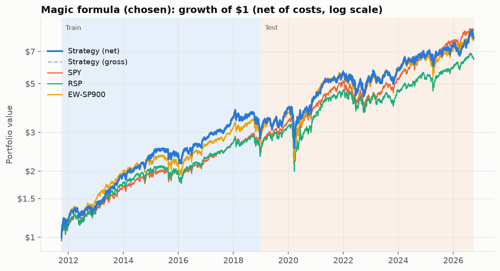

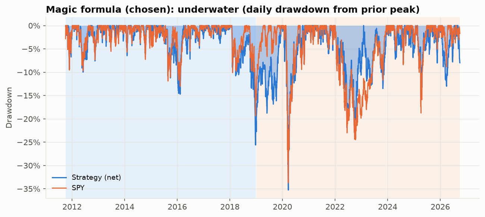

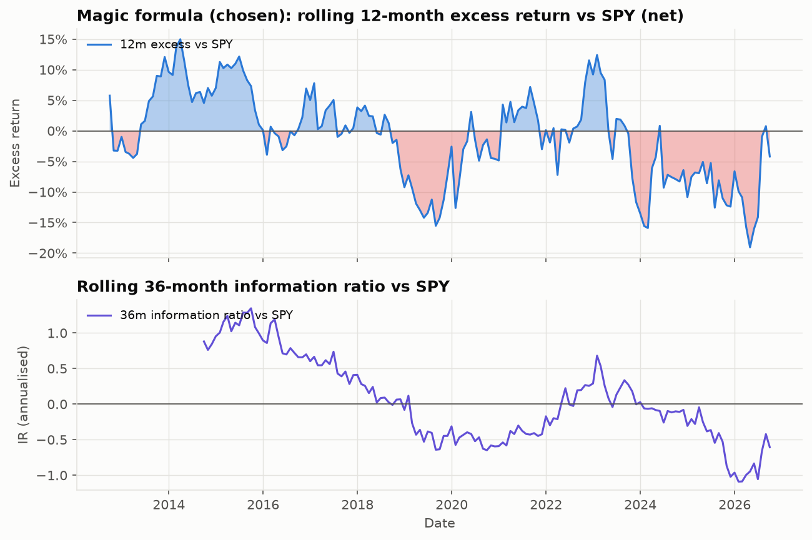

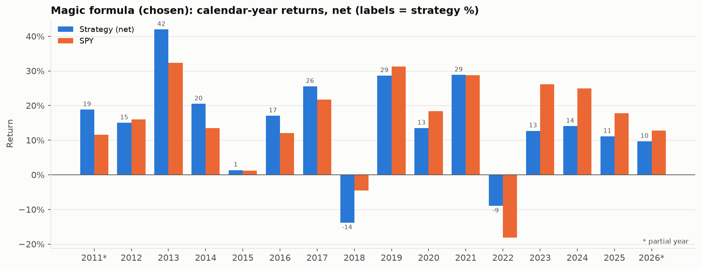

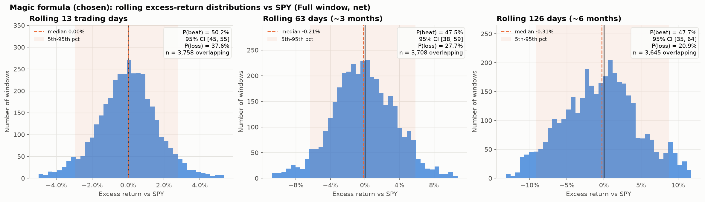

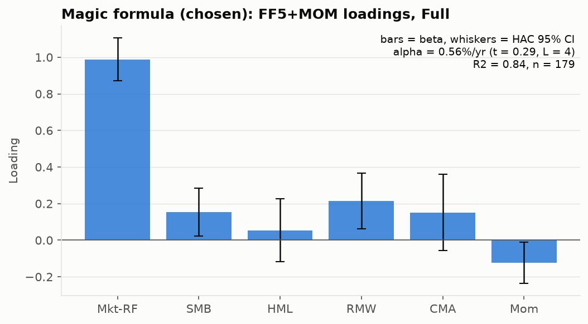

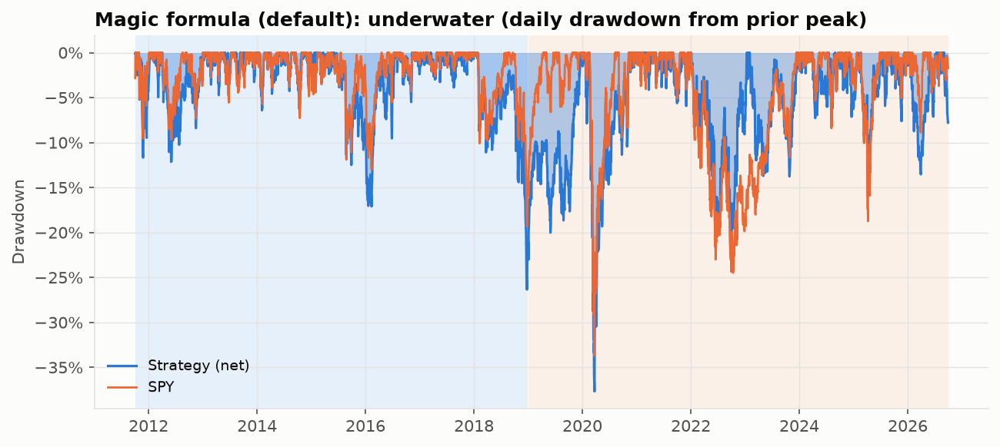

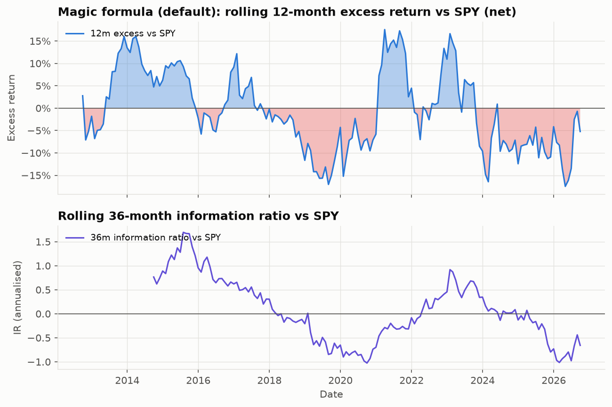

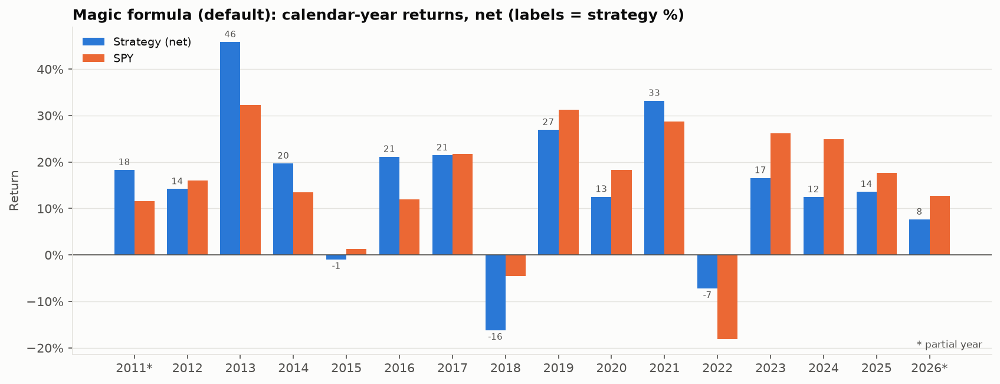

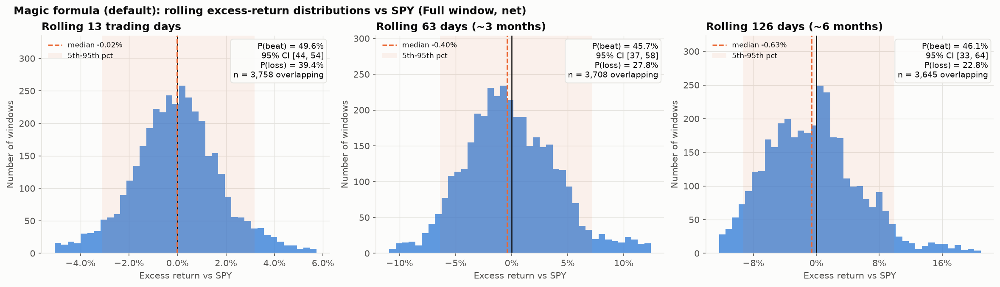

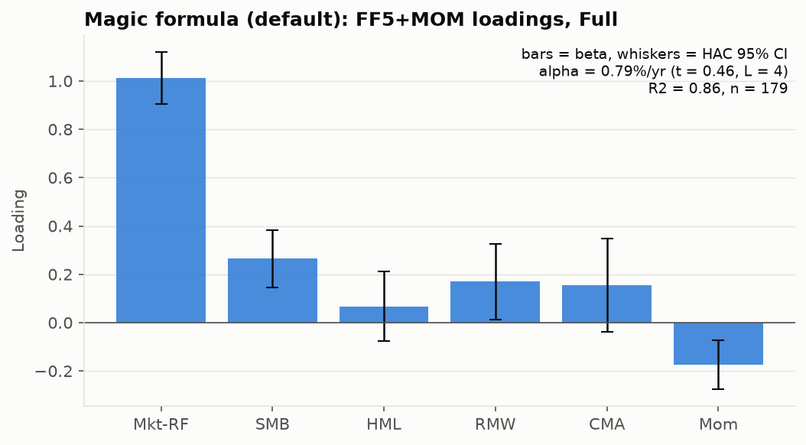

## Runtime (seconds)

| start_date | grid | select_confirm | pbo_regression | grid_figures | final_backtests | benchmarks | analysis | robustness | horizon | tearsheets | live |
|---|---|---|---|---|---|---|---|---|---|---|---|
| 9.5 | 23.9 | 0.1 | 2.1 | 0.7 | 1.6 | 0.5 | 0.0 | 74.1 | 3.7 | 3.3 | 0.1 |
