# Quality-filtered momentum: results

Generated 2026-10-19 04:11 UTC · git `2c7657cd70` · data to 2026-10-16, backtest to 2026-09-30 · 216 pre-registered cells · 223 trials in the ledger.

**Universe**: point-in-time S&P 900 (S&P 500 + MidCap 400) ex GICS Financials and Real Estate, raw price >= $5. Net of 10 bps one-way costs, signal at month-end close, trade at the next close.

## Verdict: 1/7 criteria passed -> does not work (failed: #1, #2, #3, #5, #6, #7); fewer than 5/7: do not claim it works, hold it as a research hypothesis at a modest weight

## Parameters

- **Chosen** (= literature default; FALLBACK: bootstrap stability check failed): `order=MF, shortlist=0.2, x_debt=1, N=10, quality=Q3a, technical=sma_rsi, stop_loss=none, vol_target=none`
- **Literature default**: `order=MF, shortlist=0.2, x_debt=1, N=10, quality=Q3a, technical=sma_rsi, stop_loss=none, vol_target=none`
- Train 2011-02 to 2018-12 (95 months): chosen Sharpe 0.53, default 0.53; plateau width 3 cells; bootstrap stability: 30% within one step

### Train

| series | months | CAGR | vol | Sharpe | MaxDD (daily) | FF5+MOM alpha (t) |
|---|---|---|---|---|---|---|
| chosen | 95 | 8.0% | 16.4% | 0.53 | -33.0% | -3.0% (-0.76) |
| SPY | 95 | 11.0% | 11.4% | 0.93 | -19.3% | -0.3% (-1.27) |
| RSP | 95 | 10.1% | 12.4% | 0.80 | -22.9% | -0.5% (-0.70) |
| EW-SP900 | 95 | 11.3% | 13.1% | 0.85 | -23.3% | 0.3% (0.36) |

### Test (single look)

| series | months | CAGR | vol | Sharpe | MaxDD (daily) | FF5+MOM alpha (t) |
|---|---|---|---|---|---|---|
| chosen | 93 | 20.0% | 28.4% | 0.69 | -40.0% | 3.8% (0.52) |
| SPY | 93 | 17.2% | 16.4% | 0.89 | -33.7% | -0.1% (-0.34) |
| RSP | 93 | 13.1% | 17.9% | 0.63 | -39.0% | -2.0% (-1.70) |
| EW-SP900 | 93 | 13.7% | 19.4% | 0.62 | -40.1% | -1.9% (-1.45) |

### Full period

| series | months | CAGR | vol | Sharpe | MaxDD (daily) | FF5+MOM alpha (t) |
|---|---|---|---|---|---|---|
| chosen | 188 | 13.8% | 23.2% | 0.61 | -40.0% | 0.3% (0.07) |
| SPY | 188 | 14.0% | 14.1% | 0.90 | -33.7% | -0.2% (-0.88) |
| RSP | 188 | 11.6% | 15.4% | 0.69 | -39.0% | -1.1% (-1.48) |
| EW-SP900 | 188 | 12.5% | 16.5% | 0.70 | -40.1% | -0.7% (-0.84) |

### Last 36 months

| series | months | CAGR | vol | Sharpe | MaxDD (daily) | FF5+MOM alpha (t) |
|---|---|---|---|---|---|---|
| chosen | 36 | 36.7% | 37.1% | 0.92 | -40.0% | 5.6% (0.36) |
| SPY | 36 | 22.8% | 12.4% | 1.37 | -18.8% |  |
| RSP | 36 | 15.5% | 12.9% | 0.85 | -17.8% |  |
| EW-SP900 | 36 | 14.0% | 14.0% | 0.70 | -21.1% |  |

## Selection and confirmation

- chosen: **order=MF, shortlist=0.2, x_debt=1, N=10, quality=Q3a, technical=sma_rsi, stop_loss=none, vol_target=none** (literature default; FALLBACK: bootstrap stability check failed)
- default: order=MF, shortlist=0.2, x_debt=1, N=10, quality=Q3a, technical=sma_rsi, stop_loss=none, vol_target=none (train Sharpe 0.53)
- train Sharpe of chosen 0.53; plateau score 0.732; peak ratio 1.09; plateau width 3 cells (>= 90% of chosen)
- bootstrap stability (B=500, mean block 6): 18% select exactly this cell, 30% within one grid step -> FAIL
- sensitivity (not used for selection): argmax -> 3dcdc52700 (Sharpe 0.81, MORE THAN one step); lam0 -> d12be4383d (Sharpe 0.80, MORE THAN one step)

Reasons:
- train window 2011-02-28..2018-12-31: 95 months, 216 of 216 cells evaluable; metric = net Sharpe (annualised, excess of rf)
- plateau pick: score 0.732, peak ratio 1.09 (max 1.25)
- categorical plateau scores: technical=none,vol_target=none,quality=Q0=0.520; technical=none,vol_target=none,quality=Q3a=0.480; technical=none,vol_target=none,quality=Q1-50=0.732; technical=none,vol_target=none,quality=Q2-Q50=0.538; technical=none,vol_target=0.2,quality=Q0=0.395; technical=none,vol_target=0.2,quality=Q3a=0.507; technical=none,vol_target=0.2,quality=Q1-50=0.705; technical=none,vol_target=0.2,quality=Q2-Q50=0.541; technical=sma,vol_target=none,quality=Q0=0.489; technical=sma,vol_target=none,quality=Q3a=0.536; technical=sma,vol_target=none,quality=Q1-50=0.669; technical=sma,vol_target=none,quality=Q2-Q50=0.545; technical=sma,vol_target=0.2,quality=Q0=0.449; technical=sma,vol_target=0.2,quality=Q3a=0.567; technical=sma,vol_target=0.2,quality=Q1-50=0.654; technical=sma,vol_target=0.2,quality=Q2-Q50=0.549; technical=sma_rsi,vol_target=none,quality=Q0=0.407; technical=sma_rsi,vol_target=none,quality=Q3a=0.479; technical=sma_rsi,vol_target=none,quality=Q1-50=0.570; technical=sma_rsi,vol_target=none,quality=Q2-Q50=0.394; technical=sma_rsi,vol_target=0.2,quality=Q0=0.511; technical=sma_rsi,vol_target=0.2,quality=Q3a=0.491; technical=sma_rsi,vol_target=0.2,quality=Q1-50=0.618; technical=sma_rsi,vol_target=0.2,quality=Q2-Q50=0.411 (default category kept unless another beats it by >= 0.10)
- bootstrap stability (B=500): 18% exactly this cell, 30% within one grid step (need >= 50%) -> FAIL
- FALLBACK to literature default: bootstrap stability check failed

Neighbourhood of the chosen cell (train):

| role | axis | step | N | stop_loss | technical | vol_target | quality | sharpe |
|---|---|---|---|---|---|---|---|---|
| self |  | 0 | 10 | none | sma_rsi | none | Q3a | 0.53 |
| neighbor | N | -1 | 5 | none | sma_rsi | none | Q3a | 0.48 |
| neighbor | N | 1 | 20 | none | sma_rsi | none | Q3a | 0.57 |
| neighbor | stop_loss | 1 | 10 | 0.15 | sma_rsi | none | Q3a | 0.41 |

Plateau result per categorical level:

| category | n_cells | is_default_category | n_eligible | score | peak_ratio | sharpe | chosen |
|---|---|---|---|---|---|---|---|
| technical=none,vol_target=none,quality=Q0 | 9 | False | 9 | 0.52 | 1.24 | 0.68 | False |
| technical=none,vol_target=none,quality=Q3a | 9 | False | 9 | 0.48 | 1.05 | 0.54 | False |
| technical=none,vol_target=none,quality=Q1-50 | 9 | False | 9 | 0.73 | 1.09 | 0.81 | True |
| technical=none,vol_target=none,quality=Q2-Q50 | 9 | False | 9 | 0.54 | 1.19 | 0.65 | False |
| technical=none,vol_target=0.2,quality=Q0 | 9 | False | 8 | 0.40 | 0.95 | 0.49 | False |
| technical=none,vol_target=0.2,quality=Q3a | 9 | False | 9 | 0.51 | 1.06 | 0.59 | False |
| technical=none,vol_target=0.2,quality=Q1-50 | 9 | False | 9 | 0.71 | 1.08 | 0.80 | False |
| technical=none,vol_target=0.2,quality=Q2-Q50 | 9 | False | 9 | 0.54 | 1.21 | 0.68 | False |
| technical=sma,vol_target=none,quality=Q0 | 9 | False | 7 | 0.49 | 0.82 | 0.54 | False |
| technical=sma,vol_target=none,quality=Q3a | 9 | False | 8 | 0.54 | 1.12 | 0.61 | False |
| technical=sma,vol_target=none,quality=Q1-50 | 9 | False | 9 | 0.67 | 1.12 | 0.76 | False |
| technical=sma,vol_target=none,quality=Q2-Q50 | 9 | False | 9 | 0.55 | 1.19 | 0.67 | False |
| technical=sma,vol_target=0.2,quality=Q0 | 9 | False | 7 | 0.45 | 0.85 | 0.52 | False |
| technical=sma,vol_target=0.2,quality=Q3a | 9 | False | 9 | 0.57 | 1.15 | 0.66 | False |
| technical=sma,vol_target=0.2,quality=Q1-50 | 9 | False | 9 | 0.65 | 1.04 | 0.73 | False |
| technical=sma,vol_target=0.2,quality=Q2-Q50 | 9 | False | 9 | 0.55 | 1.20 | 0.68 | False |
| technical=sma_rsi,vol_target=none,quality=Q0 | 9 | False | 8 | 0.41 | 0.89 | 0.46 | False |
| technical=sma_rsi,vol_target=none,quality=Q3a | 9 | True | 9 | 0.48 | 1.15 | 0.57 | False |
| technical=sma_rsi,vol_target=none,quality=Q1-50 | 9 | False | 9 | 0.57 | 1.18 | 0.70 | False |
| technical=sma_rsi,vol_target=none,quality=Q2-Q50 | 9 | False | 8 | 0.39 | 1.18 | 0.48 | False |
| technical=sma_rsi,vol_target=0.2,quality=Q0 | 9 | False | 9 | 0.51 | 1.24 | 0.66 | False |
| technical=sma_rsi,vol_target=0.2,quality=Q3a | 9 | False | 9 | 0.49 | 1.10 | 0.58 | False |
| technical=sma_rsi,vol_target=0.2,quality=Q1-50 | 9 | False | 9 | 0.62 | 1.15 | 0.73 | False |
| technical=sma_rsi,vol_target=0.2,quality=Q2-Q50 | 9 | False | 8 | 0.41 | 1.16 | 0.49 | False |

Confirmation on the untouched test window 2019-01-01 to 2026-09-30:

| cell | sharpe | cagr | vol | maxdd | tstat | n_months |
|---|---|---|---|---|---|---|
| chosen | 0.69 | 20.0% | 28.4% | -32.7% | 1.93 | 93 |
| default | 0.69 | 20.0% | 28.4% | -32.7% | 1.93 | 93 |
| grid_median | 0.64 | 15.0% | 20.4% | -28.8% | 1.78 | 93 |

- chosen minus default Sharpe: 0.00; chosen minus grid median: 0.05; rank percentile among cells: 66%
- Spearman(train Sharpe, test Sharpe) across cells: 0.36; test/train Sharpe of the chosen cell: 1.32
- criteria: test_sharpe_positive=yes, test_ge_half_train=yes, landscape_persists=yes, beats_grid_median=yes

## Overfitting diagnostics (train)

| diagnostic | value |
|---|---|
| Months / window | 95 / 2011-02-28..2018-12-31 |
| Trials N (ledger, distinct configurations) | 223 |
| Cells in grid / effective trials N_hat | 216 / 39.61 |
| Net Sharpe (annualised) | 0.53 |
| t-stat of mean excess return | 1.48  (vs 2.0: fail; 3.0: fail; 3.39: fail) |
| PSR(0) | 0.920 |
| Expected max Sharpe SR0 of N null trials (annualised) | 0.38 |
| DSR at N = 223 (ledger) | 0.649 |
| DSR at N_hat = 39.61 | 0.728 |
| DSR at N = 216 (grid cells) | 0.651 |
| Bonferroni haircut Sharpe (annualised) / haircut | 0.00 / 100% |
| Minimum track record for PSR(0) >= 95% (years) | 10.79 |
| PBO (CSCV, S=16, selector: plateau) | 70.8%  (12,870 splits) |
| P(OOS Sharpe < 0) of the selected trial | 15.3% |
| Degradation slope (OOS on IS Sharpe; negative = overfit) | -0.75 |

DSR on the full sample:

| diagnostic | value |
|---|---|
| Months / window | 188 / full |
| Trials N (ledger, distinct configurations) | 223 |
| Cells in grid / effective trials N_hat | 216 / 41.79 |
| Net Sharpe (annualised) | 0.61 |
| t-stat of mean excess return | 2.41  (vs 2.0: pass; 3.0: fail; 3.39: fail) |
| PSR(0) | 0.990 |
| Expected max Sharpe SR0 of N null trials (annualised) | 0.34 |
| DSR at N = 223 (ledger) | 0.848 |
| DSR at N_hat = 41.79 | 0.903 |
| DSR at N = 216 (grid cells) | 0.849 |
| Bonferroni haircut Sharpe (annualised) / haircut | 0.00 / 100% |
| Minimum track record for PSR(0) >= 95% (years) | 7.98 |

## Grid regression (train)

Response: net Sharpe of each of 216 grid cells on 2011-02-28..2018-12-31; ordinal parameters scaled to [-1, 1]; R2 = 0.72. Bootstrap SDs resample months jointly across cells (B=500); cells overlap, so OLS p-values would be meaningless. A flat surface (small coefficients, low R2) is good news.

| term | coef | bootstrap SD | coef / SD |
|---|---|---|---|
| const | 0.444 | 0.358 | 1.2 |
| N | 0.007 | 0.061 | 0.1 |
| stop_loss | -0.106 | 0.047 | -2.3 |
| N^2 | 0.048 | 0.032 | 1.5 |
| stop_loss^2 | -0.005 | 0.059 | -0.1 |
| N*stop_loss | -0.009 | 0.018 | -0.5 |
| technical=sma | 0.023 | 0.021 | 1.1 |
| technical=sma_rsi | -0.043 | 0.149 | -0.3 |
| vol_target=none | -0.006 | 0.025 | -0.2 |
| quality=Q1-50 | 0.159 | 0.152 | 1.0 |
| quality=Q2-Q50 | -0.007 | 0.124 | -0.1 |
| quality=Q3a | 0.018 | 0.159 | 0.1 |

## Robustness (each run is a ledger trial)

Full-period net results of one-at-a-time changes around the chosen cell. Every run is logged in the ledger as an extra trial (it raises N for the DSR).

| run | full CAGR | full Sharpe | train Sharpe | test Sharpe | test CAGR | MaxDD | turnover/yr | FF5+MOM alpha | IR vs SPY | IR vs EW |
|---|---|---|---|---|---|---|---|---|---|---|
| chosen (base, 10 bps) | 13.8% | 0.61 | 0.53 | 0.69 | 20.0% | -40.0% | 784% | 0.3% (t=0.07) | 0.08 | 0.12 |
| cost 0 bps | 15.5% | 0.67 | 0.62 | 0.74 | 21.8% | -39.9% | 784% | 1.8% (t=0.43) | 0.16 | 0.20 |
| cost 25 bps | 11.3% | 0.51 | 0.39 | 0.61 | 17.3% | -40.1% | 784% | -2.0% (t=-0.48) | -0.04 | 0.01 |
| cost 50 bps | 7.2% | 0.35 | 0.16 | 0.48 | 13.0% | -42.0% | 784% | -5.7% (t=-1.39) | -0.24 | -0.18 |
| quality arm Q4-0.25 (blend) | 11.9% | 0.56 | 0.65 | 0.52 | 13.6% | -37.4% | 753% | -3.1% (t=-1.06) | -0.03 | 0.03 |
| quality arm Q4-0.5 (blend) | 10.8% | 0.55 | 0.70 | 0.46 | 11.0% | -34.1% | 736% | -4.0% (t=-1.65) | -0.16 | -0.08 |
| order QF (quality first) | 15.0% | 0.65 | 0.57 | 0.74 | 21.6% | -40.0% | 783% | 1.0% (t=0.23) | 0.14 | 0.18 |
| trend_exit_daily (sell below SMA200 daily) | 10.1% | 0.46 | 0.37 | 0.54 | 15.0% | -42.2% | 909% | -3.0% (t=-0.70) | -0.09 | -0.04 |

## Evidence ladder

**1/7 criteria passed -> does not work (failed: #1, #2, #3, #5, #6, #7); fewer than 5/7: do not claim it works, hold it as a research hypothesis at a modest weight**

| # | criterion | pass | evidence |
|---|---|---|---|
| 1 | Direction replicates: net IR vs same-universe EW > 0 on train AND test | NO | IR train -0.22, test 0.29 |
| 2 | Plateau: chosen cell passes the 5.4 eligibility and bootstrap stability | NO | FALLBACK to default: bootstrap stability check failed; stability 30% within one step |
| 3 | Costs: FF5+MOM net alpha still > 0 at 25 bps one-way | NO | alpha -2.0%/yr (t=-0.48) at 25 bps; buy/hold-spread check for momentum not run |
| 4 | Factor view: FF5+MOM alpha > 0, or explained by the expected factors with no large negative alpha | yes | alpha 0.3%/yr (t=0.07, full sample to 2026-08, French data end 2026-08); expected-factor loadings with abs(t) > 2: Mom 0.70 (t=5.1) |
| 5 | Overfitting: PBO < 0.5 (DSR at N_hat and haircut Sharpe reported) | NO | PBO 70.8%; DSR(ledger N=223) 0.649, DSR(N_hat=39.61) 0.728; haircut Sharpe 0.00 (train, aim DSR > 0.5: met) |
| 6 | Bias stress: FF5+MOM alpha survives a 150 bps/yr survivorship drag | NO | break-even drag 29 bps/yr (alpha 0.29%); active CAGR vs EW-SP900 1.1% |
| 7 | Subperiods: positive active return vs SPY in at least 3 of 4 subperiods | NO | 1 of 4 positive (2011-14 -2.8%, 2015-18 -2.6%, 2019-22 -3.2%, 2023-26 8.7%); worst 12m active return vs SPY -32.6% |

## Bias stress

SURVIVORSHIP-BIASED (yfinance has no delisted names): 81.0% of point-in-time S&P 900 members have a price history (monthly mean 2011-2026, minimum 63.2%); EW-SP900 minus RSP = +0.5%/yr CAGR gap (EW-SP500 minus RSP +0.9%/yr, the like-for-like bias proxy; the S&P 900 gap also contains the mid-cap premium); see output/survivorship.md

Break-even drag (alpha = 0): 29 bps/yr.

| assumed drag (bps/yr) | FF5+MOM alpha after drag | t |
|---|---|---|
| 0 | 0.29% | 0.07 |
| 50 | -0.21% | -0.05 |
| 100 | -0.71% | -0.17 |
| 150 | -1.21% | -0.30 |
| 200 | -1.71% | -0.42 |
| 300 | -2.71% | -0.66 |

Coverage by year and the EW-minus-RSP gap are in `output/survivorship.md`. Overall: share with prices 81.0%; EW-SP900 minus RSP +0.48%/yr.

## Short horizon (daily net returns, chosen parameters)

| window | horizon | P(beat SPY) | P(loss) | excess 5%/median/95% | return 5%/median/95% |
|---|---|---|---|---|---|
| full | 13d | 49.7% [45-55] | 41.3% | -6.1 / -0.0 / 6.3 pts | -8.0 / 0.9 / 8.9% |
| full | 63d | 45.5% [38-57] | 36.3% | -12.5 / -0.8 / 17.1 pts | -14.2 / 3.0 / 25.0% |
| full | 126d | 44.6% [33-58] | 29.9% | -17.0 / -1.3 / 24.2 pts | -16.3 / 6.2 / 38.2% |
| test | 13d | 49.8% [44-58] | 41.1% | -7.2 / -0.0 / 9.2 pts | -8.8 / 1.1 / 11.1% |
| test | 63d | 44.6% [35-63] | 36.7% | -15.0 / -1.2 / 24.4 pts | -14.7 / 3.4 / 30.8% |
| test | 126d | 46.6% [29-66] | 32.2% | -17.5 / -1.5 / 45.5 pts | -14.2 / 8.5 / 51.4% |

## Live picks (as of 2026-10-16)

- chosen (10): PBF, ILMN, VLO, APA, NUE, ANF, SN, STLD, CHRD, VAL
- default (10): PBF, ILMN, VLO, APA, NUE, ANF, SN, STLD, CHRD, VAL
- tables: `output/live/quality_momentum_chosen.csv`, `output/live/quality_momentum_default.csv` (+ diagnostics JSON in `output/live/`)
- fundamentals age of the chosen picks: {'max_age_days': 110.0, 'median_age_days': 108.0, 'n_older_than_150': 0, 'n_older_than_200': 0}

## Files

- tear sheet (chosen): [quality_momentum_chosen_tearsheet.md](quality_momentum_chosen_tearsheet.md)
- grid: `grid_cells.csv`, `grid_monthly_returns.csv`, `grid_metrics_{train,test,full}.csv`
- daily series: `daily_chosen.csv`, `daily_default.csv`, `daily_benchmarks.csv`

## Figures

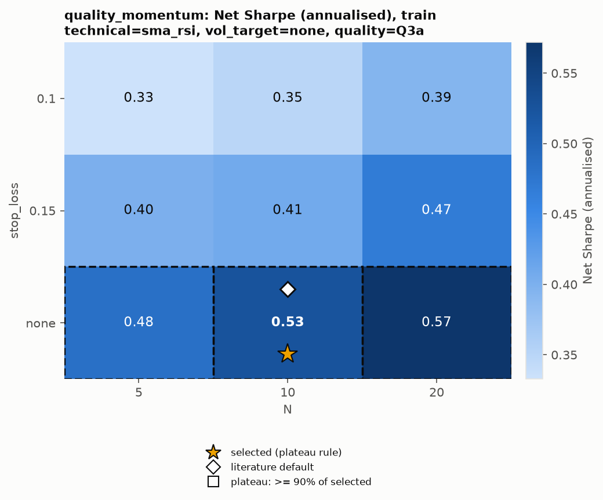

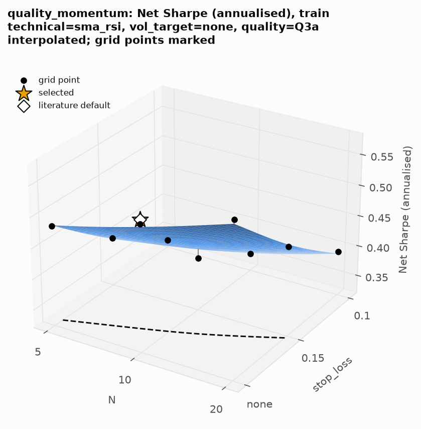

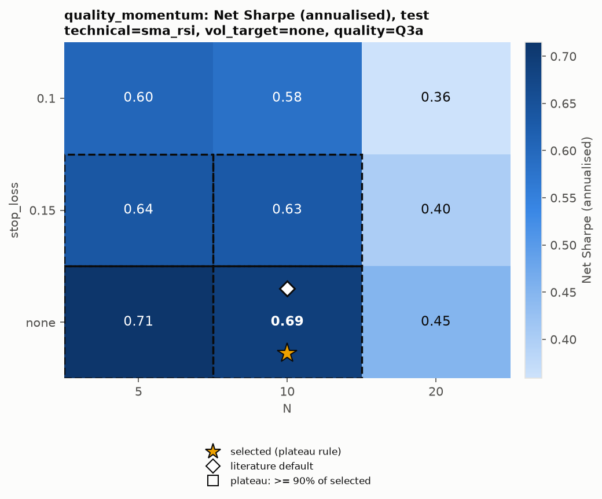

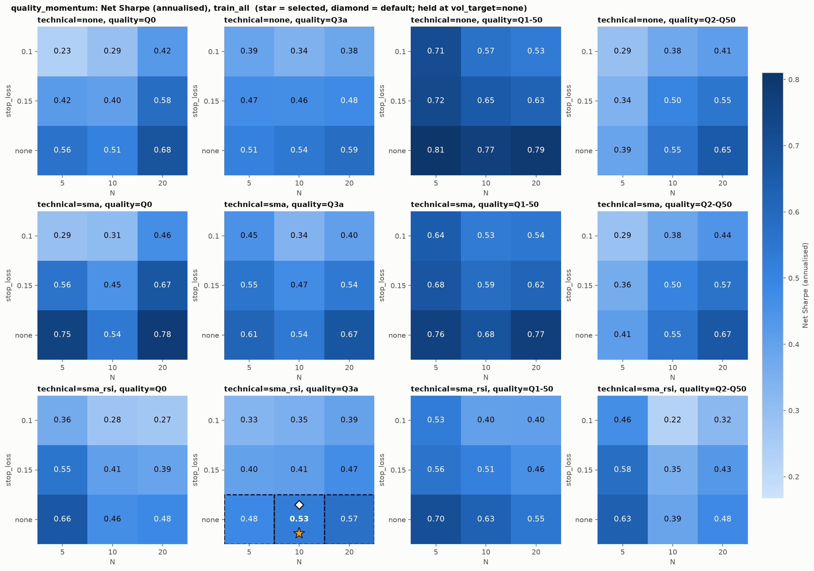

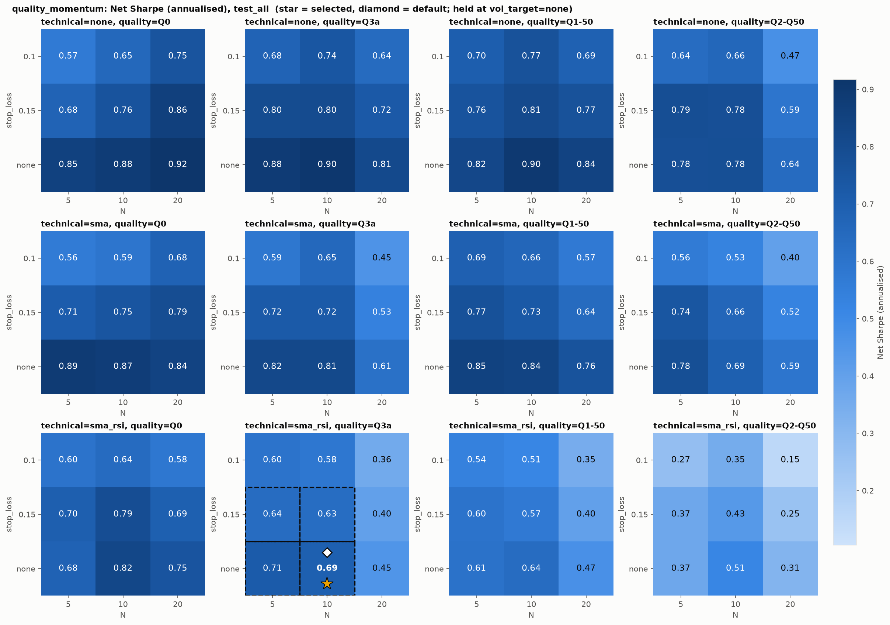

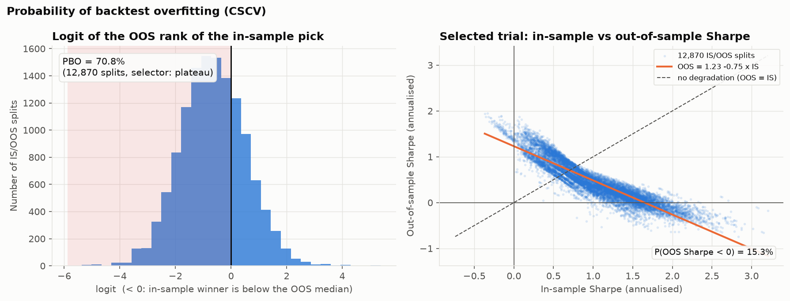

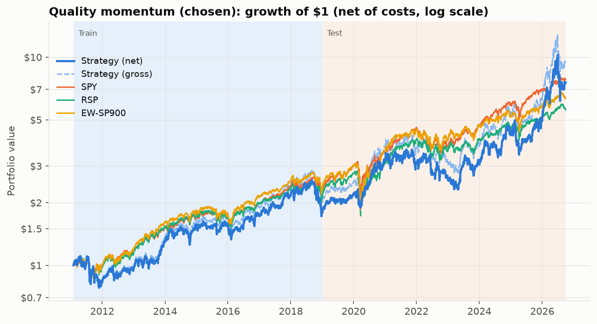

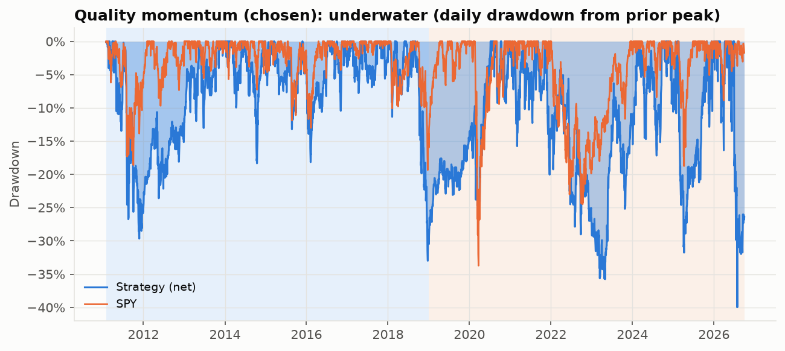

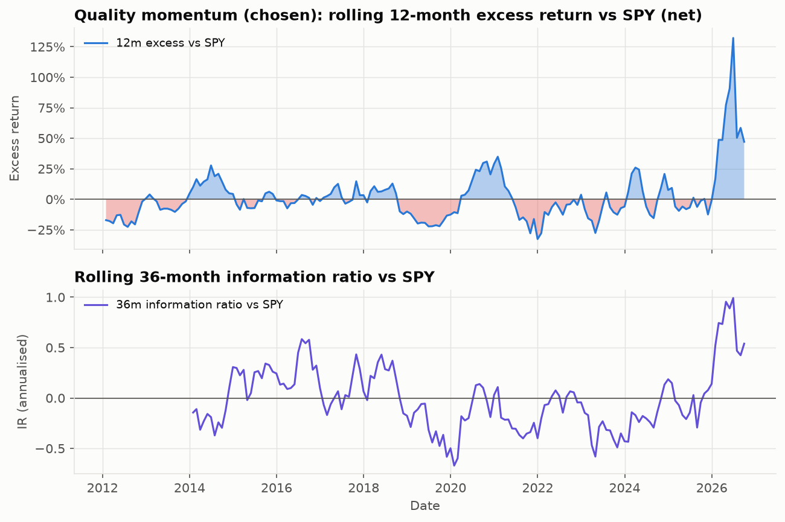

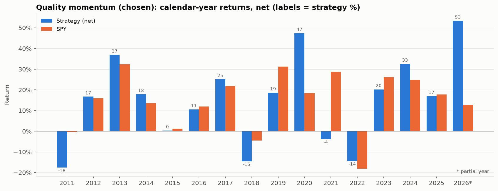

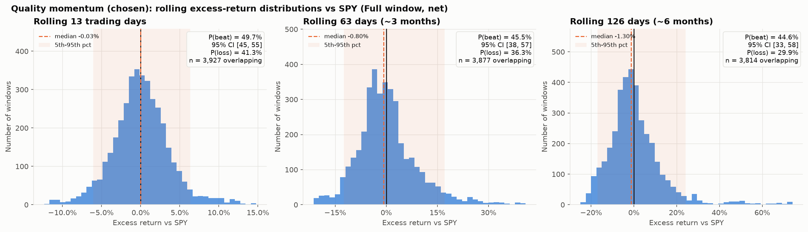

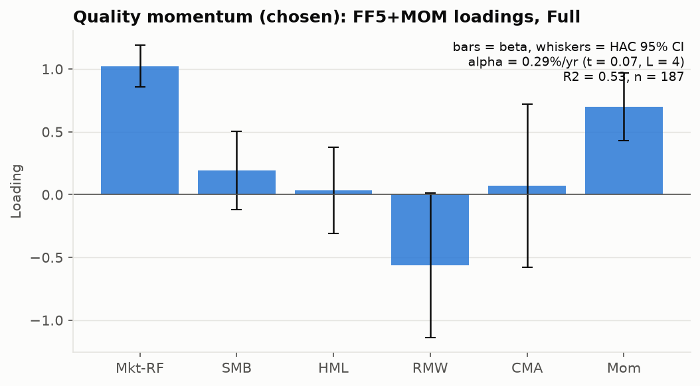

## Runtime (seconds)

| start_date | grid | select_confirm | pbo_regression | grid_figures | final_backtests | benchmarks | analysis | robustness | horizon | tearsheets | live |
|---|---|---|---|---|---|---|---|---|---|---|---|
| 1.2 | 19.8 | 1.0 | 24.0 | 3.0 | 0.0 | 0.5 | 0.0 | 0.8 | 1.9 | 1.6 | 0.1 |
