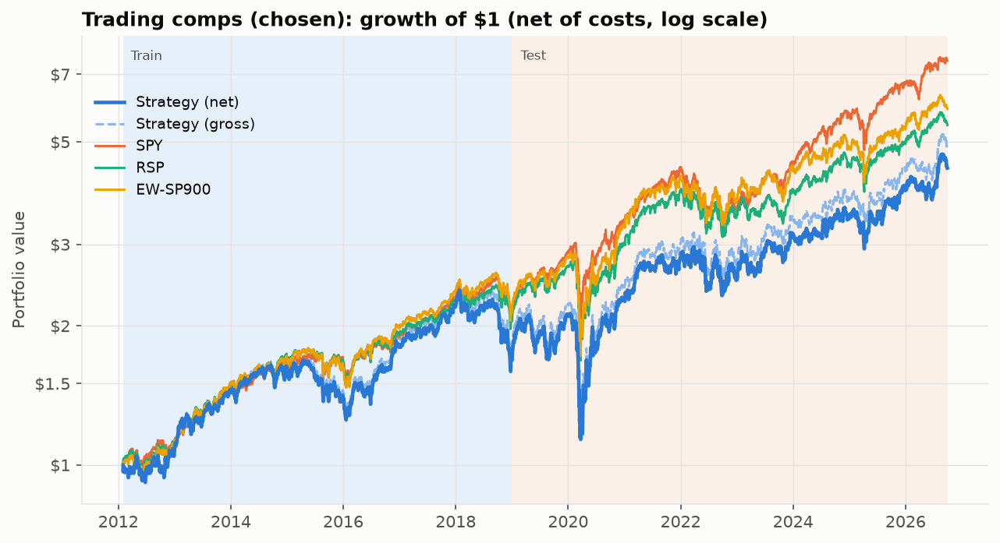
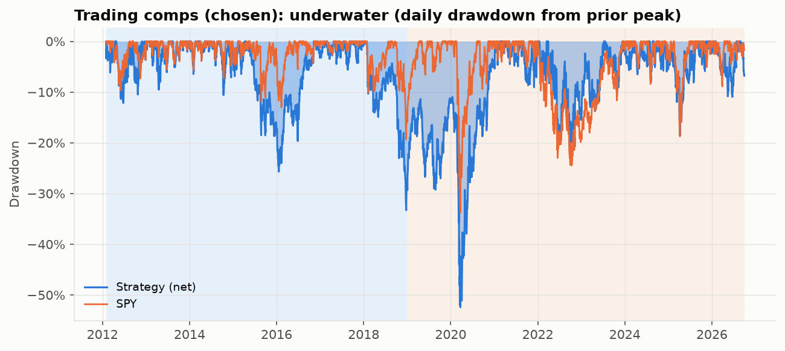
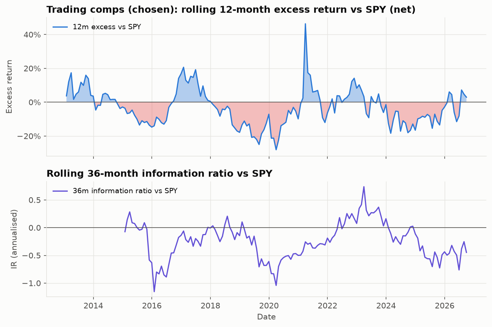
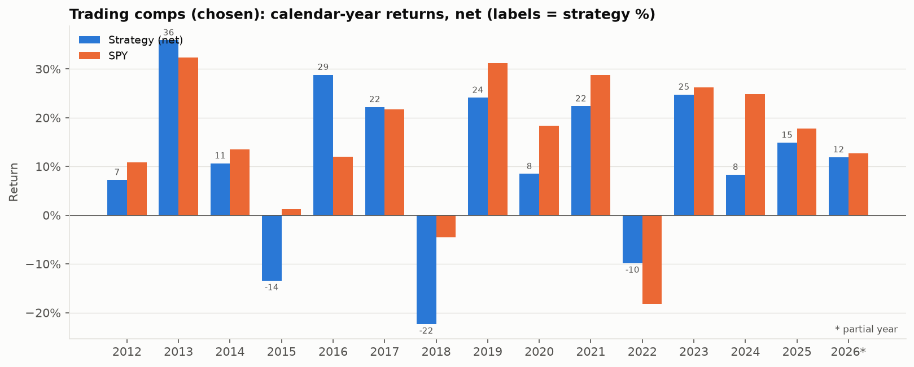
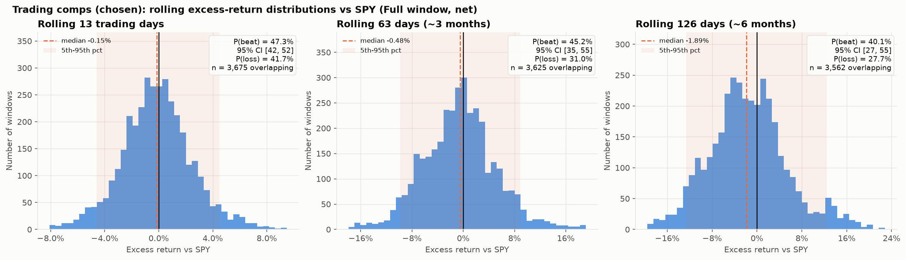
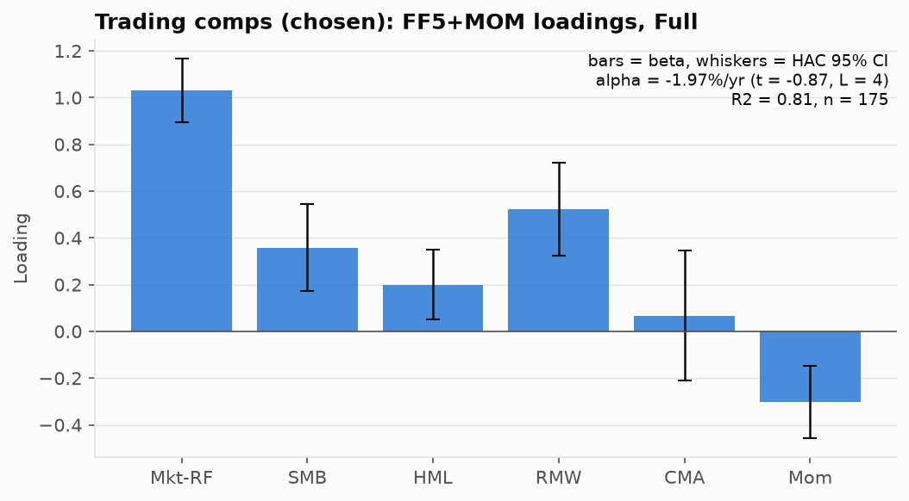

# Trading comps (chosen): tear sheet

| item | value |
|---|---|
| Generated | 2026-10-19 04:14 UTC |
| Data | 2012-02-01 to 2026-09-30 (3,687 trading days) |
| Benchmarks | SPY, RSP, EW-SP900 (reference: SPY) |
| strategy | Trading comps (trading_comps) |
| parameter set | theta=0.1, pe_cap=40, ev_cap=35, size_filter=False, basis=TTM  [plateau_v1 choice] |
| literature default | theta=0.15, pe_cap=40, ev_cap=35, size_filter=True, basis=TTM |
| universe | point-in-time S&P 900 (S&P 500 + MidCap 400) ex GICS Financials and Real Estate, mcap >= $300M, raw price >= $5 |
| windows | train 2012-02 to 2018-12; test 2019-01 to 2026-09 (single look); data end 2026-10-16 |
| trials N (ledger, distinct) | 62 |
| grid | 54 pre-registered cells, registered 2026-10-19T02:29:30+00:00 |
| costs | 10 bps one-way on every buy and sell (robustness 0/25/50) |
| timing | signal at the close of the month-end, trade at the next close; filings usable only if filed strictly before the signal date |
| survivorship | SURVIVORSHIP-BIASED (yfinance has no delisted names): 81.0% of point-in-time S&P 900 members have a price history (monthly mean 2011-2026, minimum 63.2%); EW-SP900 minus RSP = +0.5%/yr CAGR gap (EW-SP500 minus RSP +0.9%/yr, the like-for-like bias proxy; the S&P 900 gap also contains the mid-cap premium); see output/survivorship.md |
| benchmarks | SPY, RSP, EW-SP900 = equal-weight S&P 900 with the strategy's sector exclusions (Financials, Real Estate), 10 bps |
| git commit | 2c7657cd70 |
| tear sheet for | chosen |

## T1 Performance, net of costs

Monthly statistics from calendar-month compounded daily returns (partial leading/trailing months dropped); MaxDD is daily. Benchmark-relative rows are vs SPY; Sharpe CI = stationary bootstrap (mean block 6, B=500).

### Full (2012-02 to 2026-09)

| metric | Strategy (net) | Strategy (gross) | SPY | RSP | EW-SP900 |
|---|---|---|---|---|---|
| Months | 176 | 176 | 176 | 176 | 176 |
| CAGR | 10.6% | 11.4% | 14.7% | 12.2% | 12.9% |
| AnnVol | 20.7% | 20.7% | 13.9% | 15.1% | 16.2% |
| Sharpe | 0.51 | 0.54 | 0.94 | 0.73 | 0.73 |
| Sharpe 95% CI | [0.13, 1.01] | [0.16, 1.05] | [0.56, 1.47] | [0.36, 1.21] | [0.36, 1.21] |
| Sortino | 0.79 | 0.85 | 1.51 | 1.13 | 1.14 |
| MaxDD (daily) | -52.4% | -51.7% | -33.7% | -39.0% | -40.1% |
| MaxDD peak>trough | 2018-01-26 > 2020-03-23 | 2018-01-26 > 2020-03-23 | 2020-02-19 > 2020-03-23 | 2020-02-12 > 2020-03-23 | 2020-01-16 > 2020-03-23 |
| Calmar | 0.20 | 0.22 | 0.44 | 0.31 | 0.32 |
| Beta vs SPY | 1.18 | 1.18 | – | 1.02 | 1.08 |
| TE vs SPY | 12.9% | 12.9% | – | 5.2% | 6.2% |
| IR vs SPY | -0.19 | -0.14 | – | -0.39 | -0.21 |
| ActiveCAGR vs SPY | -3.6% | -2.9% | – | -2.2% | -1.6% |
| HitRate 1m | 46% | 46% | – | 46% | 47% |
| HitRate 3m | 44% | 45% | – | 40% | 41% |
| HitRate 6m | 39% | 40% | – | 39% | 44% |
| Up capture vs SPY | 104% | 106% | – | 95% | 100% |
| Down capture vs SPY | 128% | 127% | – | 106% | 110% |
| IR vs RSP | -0.04 | – | – | – | – |
| IR vs EW-SP900 | -0.12 | – | – | – | – |
| Cost drag (bps/yr, gross CAGR - net CAGR) | 76 | – | – | – | – |
| Avg holdings | 18.56 | – | – | – | – |
| Annual one-way turnover | 355% | – | – | – | – |

### Train (2012-02 to 2018-12)

| metric | Strategy (net) | Strategy (gross) | SPY | RSP | EW-SP900 |
|---|---|---|---|---|---|
| Months | 83 | 83 | 83 | 83 | 83 |
| CAGR | 8.0% | 8.8% | 12.0% | 11.2% | 11.9% |
| AnnVol | 15.3% | 15.3% | 10.6% | 11.1% | 11.7% |
| Sharpe | 0.55 | 0.59 | 1.08 | 0.97 | 0.98 |
| Sharpe 95% CI | [-0.30, 1.51] | [-0.26, 1.56] | [0.39, 2.03] | [0.24, 1.99] | [0.24, 1.99] |
| Sortino | 0.86 | 0.94 | 1.71 | 1.52 | 1.53 |
| MaxDD (daily) | -33.3% | -32.8% | -19.3% | -19.8% | -21.3% |
| MaxDD peak>trough | 2018-01-26 > 2018-12-24 | 2018-01-26 > 2018-12-24 | 2018-09-20 > 2018-12-24 | 2018-09-21 > 2018-12-24 | 2018-09-21 > 2018-12-24 |
| Calmar | 0.24 | 0.27 | 0.62 | 0.57 | 0.56 |
| Beta vs SPY | 1.12 | 1.12 | – | 1.02 | 1.04 |
| TE vs SPY | 9.8% | 9.7% | – | 2.6% | 3.9% |
| IR vs SPY | -0.32 | -0.24 | – | -0.25 | 0.01 |
| ActiveCAGR vs SPY | -3.6% | -2.9% | – | -0.7% | -0.1% |
| HitRate 1m | 43% | 43% | – | 45% | 51% |
| HitRate 3m | 43% | 44% | – | 43% | 46% |
| HitRate 6m | 44% | 44% | – | 45% | 56% |
| Up capture vs SPY | 89% | 91% | – | 98% | 102% |
| Down capture vs SPY | 107% | 105% | – | 102% | 104% |
| IR vs RSP | -0.27 | – | – | – | – |
| IR vs EW-SP900 | -0.37 | – | – | – | – |
| Cost drag (bps/yr, gross CAGR - net CAGR) | 75 | – | – | – | – |
| Avg holdings | 16.96 | – | – | – | – |
| Annual one-way turnover | 374% | – | – | – | – |

### Test (2019-01 to 2026-09)

| metric | Strategy (net) | Strategy (gross) | SPY | RSP | EW-SP900 |
|---|---|---|---|---|---|
| Months | 93 | 93 | 93 | 93 | 93 |
| CAGR | 13.0% | 13.8% | 17.2% | 13.1% | 13.7% |
| AnnVol | 24.6% | 24.6% | 16.4% | 17.9% | 19.4% |
| Sharpe | 0.51 | 0.54 | 0.89 | 0.63 | 0.62 |
| Sharpe 95% CI | [0.04, 1.16] | [0.07, 1.19] | [0.35, 1.59] | [0.10, 1.33] | [0.10, 1.28] |
| Sortino | 0.79 | 0.84 | 1.44 | 0.97 | 0.97 |
| MaxDD (daily) | -46.6% | -46.5% | -33.7% | -39.0% | -40.1% |
| MaxDD peak>trough | 2020-01-16 > 2020-03-23 | 2020-01-16 > 2020-03-23 | 2020-02-19 > 2020-03-23 | 2020-02-12 > 2020-03-23 | 2020-01-16 > 2020-03-23 |
| Calmar | 0.28 | 0.30 | 0.51 | 0.34 | 0.34 |
| Beta vs SPY | 1.20 | 1.20 | – | 1.02 | 1.10 |
| TE vs SPY | 15.2% | 15.2% | – | 6.8% | 7.6% |
| IR vs SPY | -0.13 | -0.09 | – | -0.49 | -0.33 |
| ActiveCAGR vs SPY | -3.6% | -2.9% | – | -3.5% | -3.0% |
| HitRate 1m | 48% | 48% | – | 47% | 44% |
| HitRate 3m | 43% | 45% | – | 35% | 36% |
| HitRate 6m | 38% | 40% | – | 32% | 36% |
| Up capture vs SPY | 113% | 114% | – | 93% | 99% |
| Down capture vs SPY | 140% | 139% | – | 107% | 114% |
| IR vs RSP | 0.11 | – | – | – | – |
| IR vs EW-SP900 | 0.05 | – | – | – | – |
| Cost drag (bps/yr, gross CAGR - net CAGR) | 76 | – | – | – | – |
| Avg holdings | 19.99 | – | – | – | – |
| Annual one-way turnover | 338% | – | – | – | – |

### Last 36m (2023-10 to 2026-09)

| metric | Strategy (net) | Strategy (gross) | SPY | RSP | EW-SP900 |
|---|---|---|---|---|---|
| Months | 36 | 36 | 36 | 36 | 36 |
| CAGR | 14.1% | 14.9% | 22.8% | 15.5% | 14.0% |
| AnnVol | 16.6% | 16.6% | 12.4% | 12.9% | 14.0% |
| Sharpe | 0.62 | 0.66 | 1.37 | 0.85 | 0.70 |
| Sharpe 95% CI | [-0.03, 1.21] | [0.01, 1.25] | [0.60, 2.16] | [0.19, 1.64] | [-0.02, 1.55] |
| Sortino | 1.12 | 1.21 | 2.86 | 1.38 | 1.11 |
| MaxDD (daily) | -18.6% | -18.4% | -18.8% | -17.8% | -21.1% |
| MaxDD peak>trough | 2024-12-02 > 2025-04-08 | 2024-12-02 > 2025-04-08 | 2025-02-19 > 2025-04-08 | 2024-11-29 > 2025-04-08 | 2024-11-25 > 2025-04-08 |
| Calmar | 0.76 | 0.81 | 1.21 | 0.87 | 0.66 |
| Beta vs SPY | 0.64 | 0.64 | – | 0.84 | 0.91 |
| TE vs SPY | 15.2% | 15.2% | – | 7.8% | 8.3% |
| IR vs SPY | -0.45 | -0.41 | – | -0.78 | -0.88 |
| ActiveCAGR vs SPY | -7.0% | -6.4% | – | -5.9% | -7.1% |
| HitRate 1m | 39% | 39% | – | 47% | 33% |
| HitRate 3m | 29% | 32% | – | 26% | 21% |
| HitRate 6m | 19% | 23% | – | 16% | 23% |
| Up capture vs SPY | 96% | 97% | – | 84% | 84% |
| Down capture vs SPY | 168% | 166% | – | 116% | 132% |
| IR vs RSP | -0.06 | – | – | – | – |
| IR vs EW-SP900 | 0.04 | – | – | – | – |
| Cost drag (bps/yr, gross CAGR - net CAGR) | 71 | – | – | – | – |
| Avg holdings | 20.00 | – | – | – | – |
| Annual one-way turnover | 310% | – | – | – | – |

### 2011-14 (2012-02 to 2014-12)

| metric | Strategy (net) | Strategy (gross) | SPY | RSP | EW-SP900 |
|---|---|---|---|---|---|
| Months | 35 | 35 | 35 | 35 | 35 |
| CAGR | 17.8% | 18.6% | 19.1% | 20.3% | 19.9% |
| AnnVol | 14.1% | 14.1% | 9.1% | 9.9% | 10.2% |
| Sharpe | 1.23 | 1.29 | 1.97 | 1.92 | 1.83 |
| Sharpe 95% CI | [0.46, 1.89] | [0.52, 1.95] | [1.23, 3.02] | [1.08, 3.10] | [0.97, 2.99] |
| Sortino | 2.61 | 2.76 | 3.74 | 3.61 | 3.51 |
| MaxDD (daily) | -12.2% | -12.0% | -9.7% | -11.2% | -10.4% |
| MaxDD peak>trough | 2012-04-27 > 2012-06-25 | 2012-04-27 > 2012-06-25 | 2012-04-02 > 2012-06-04 | 2012-03-26 > 2012-06-04 | 2012-03-26 > 2012-06-04 |
| Calmar | 1.46 | 1.55 | 1.97 | 1.81 | 1.91 |
| Beta vs SPY | 0.96 | 0.96 | – | 1.06 | 1.04 |
| TE vs SPY | 11.1% | 11.0% | – | 2.4% | 3.7% |
| IR vs SPY | -0.05 | 0.01 | – | 0.47 | 0.21 |
| ActiveCAGR vs SPY | -1.1% | -0.4% | – | 1.0% | 0.7% |
| HitRate 1m | 46% | 46% | – | 51% | 54% |
| HitRate 3m | 45% | 48% | – | 61% | 48% |
| HitRate 6m | 60% | 60% | – | 67% | 67% |
| Up capture vs SPY | 90% | 92% | – | 106% | 106% |
| Down capture vs SPY | 71% | 69% | – | 105% | 110% |
| IR vs RSP | -0.16 | – | – | – | – |
| IR vs EW-SP900 | -0.14 | – | – | – | – |
| Cost drag (bps/yr, gross CAGR - net CAGR) | 83 | – | – | – | – |
| Avg holdings | 13.31 | – | – | – | – |
| Annual one-way turnover | 389% | – | – | – | – |

### 2015-18 (2015-01 to 2018-12)

| metric | Strategy (net) | Strategy (gross) | SPY | RSP | EW-SP900 |
|---|---|---|---|---|---|
| Months | 48 | 48 | 48 | 48 | 48 |
| CAGR | 1.4% | 2.1% | 7.1% | 5.0% | 6.4% |
| AnnVol | 16.0% | 16.0% | 11.5% | 11.7% | 12.6% |
| Sharpe | 0.11 | 0.16 | 0.58 | 0.41 | 0.49 |
| Sharpe 95% CI | [-0.93, 1.46] | [-0.89, 1.52] | [-0.25, 1.98] | [-0.42, 1.70] | [-0.36, 1.83] |
| Sortino | 0.16 | 0.22 | 0.86 | 0.58 | 0.71 |
| MaxDD (daily) | -33.3% | -32.8% | -19.3% | -19.8% | -21.3% |
| MaxDD peak>trough | 2018-01-26 > 2018-12-24 | 2018-01-26 > 2018-12-24 | 2018-09-20 > 2018-12-24 | 2018-09-21 > 2018-12-24 | 2018-09-21 > 2018-12-24 |
| Calmar | 0.04 | 0.06 | 0.37 | 0.25 | 0.30 |
| Beta vs SPY | 1.18 | 1.18 | – | 0.99 | 1.04 |
| TE vs SPY | 8.8% | 8.8% | – | 2.8% | 4.1% |
| IR vs SPY | -0.56 | -0.48 | – | -0.71 | -0.13 |
| ActiveCAGR vs SPY | -5.4% | -4.7% | – | -1.9% | -0.7% |
| HitRate 1m | 42% | 42% | – | 40% | 48% |
| HitRate 3m | 43% | 43% | – | 28% | 41% |
| HitRate 6m | 37% | 37% | – | 23% | 47% |
| Up capture vs SPY | 88% | 90% | – | 90% | 98% |
| Down capture vs SPY | 123% | 121% | – | 101% | 102% |
| IR vs RSP | -0.38 | – | – | – | – |
| IR vs EW-SP900 | -0.61 | – | – | – | – |
| Cost drag (bps/yr, gross CAGR - net CAGR) | 71 | – | – | – | – |
| Avg holdings | 19.62 | – | – | – | – |
| Annual one-way turnover | 363% | – | – | – | – |

### 2019-22 (2019-01 to 2022-12)

| metric | Strategy (net) | Strategy (gross) | SPY | RSP | EW-SP900 |
|---|---|---|---|---|---|
| Months | 48 | 48 | 48 | 48 | 48 |
| CAGR | 10.4% | 11.1% | 13.1% | 13.5% | 14.5% |
| AnnVol | 30.1% | 30.1% | 19.4% | 21.4% | 23.2% |
| Sharpe | 0.44 | 0.47 | 0.67 | 0.65 | 0.65 |
| Sharpe 95% CI | [-0.16, 1.40] | [-0.13, 1.43] | [-0.06, 1.74] | [-0.06, 1.78] | [-0.03, 1.73] |
| Sortino | 0.65 | 0.69 | 1.03 | 0.99 | 1.02 |
| MaxDD (daily) | -46.6% | -46.5% | -33.7% | -39.0% | -40.1% |
| MaxDD peak>trough | 2020-01-16 > 2020-03-23 | 2020-01-16 > 2020-03-23 | 2020-02-19 > 2020-03-23 | 2020-02-12 > 2020-03-23 | 2020-01-16 > 2020-03-23 |
| Calmar | 0.22 | 0.24 | 0.39 | 0.35 | 0.36 |
| Beta vs SPY | 1.38 | 1.38 | – | 1.06 | 1.14 |
| TE vs SPY | 15.6% | 15.6% | – | 5.6% | 7.1% |
| IR vs SPY | 0.02 | 0.06 | – | 0.14 | 0.29 |
| ActiveCAGR vs SPY | -2.4% | -1.7% | – | 0.4% | 1.3% |
| HitRate 1m | 54% | 54% | – | 50% | 54% |
| HitRate 3m | 50% | 50% | – | 46% | 50% |
| HitRate 6m | 49% | 49% | – | 49% | 49% |
| Up capture vs SPY | 126% | 127% | – | 104% | 110% |
| Down capture vs SPY | 141% | 141% | – | 103% | 108% |
| IR vs RSP | -0.05 | – | – | – | – |
| IR vs EW-SP900 | -0.17 | – | – | – | – |
| Cost drag (bps/yr, gross CAGR - net CAGR) | 76 | – | – | – | – |
| Avg holdings | 19.98 | – | – | – | – |
| Annual one-way turnover | 342% | – | – | – | – |

### 2023-26 (2023-01 to 2026-09)

| metric | Strategy (net) | Strategy (gross) | SPY | RSP | EW-SP900 |
|---|---|---|---|---|---|
| Months | 45 | 45 | 45 | 45 | 45 |
| CAGR | 15.9% | 16.6% | 21.7% | 12.7% | 12.9% |
| AnnVol | 17.2% | 17.2% | 12.5% | 13.6% | 14.6% |
| Sharpe | 0.68 | 0.72 | 1.29 | 0.62 | 0.60 |
| Sharpe 95% CI | [0.11, 1.22] | [0.16, 1.26] | [0.70, 2.10] | [-0.00, 1.29] | [-0.05, 1.27] |
| Sortino | 1.36 | 1.45 | 2.58 | 1.00 | 0.98 |
| MaxDD (daily) | -18.6% | -18.4% | -18.8% | -17.8% | -21.1% |
| MaxDD peak>trough | 2024-12-02 > 2025-04-08 | 2024-12-02 > 2025-04-08 | 2025-02-19 > 2025-04-08 | 2024-11-29 > 2025-04-08 | 2024-11-25 > 2025-04-08 |
| Calmar | 0.85 | 0.90 | 1.16 | 0.71 | 0.61 |
| Beta vs SPY | 0.74 | 0.74 | – | 0.90 | 0.98 |
| TE vs SPY | 14.9% | 14.9% | – | 7.7% | 8.0% |
| IR vs SPY | -0.29 | -0.25 | – | -1.00 | -0.92 |
| ActiveCAGR vs SPY | -4.8% | -4.2% | – | -7.4% | -7.3% |
| HitRate 1m | 42% | 42% | – | 44% | 33% |
| HitRate 3m | 33% | 37% | – | 21% | 19% |
| HitRate 6m | 22% | 28% | – | 12% | 18% |
| Up capture vs SPY | 96% | 98% | – | 80% | 84% |
| Down capture vs SPY | 136% | 134% | – | 120% | 130% |
| IR vs RSP | 0.28 | – | – | – | – |
| IR vs EW-SP900 | 0.26 | – | – | – | – |
| Cost drag (bps/yr, gross CAGR - net CAGR) | 77 | – | – | – | – |
| Avg holdings | 20.00 | – | – | – | – |
| Annual one-way turnover | 333% | – | – | – | – |

## T2 Factor regressions (monthly, Newey-West HAC)

alpha is annualised (12 x monthly intercept); loadings show beta (HAC t, L=4). t at L=6 / L=12 are robustness checks; excess = strategy minus rf, active = strategy minus the reference benchmark.

| window | y | model | n | alpha (ann %) | t (L=4) | t (L=6) | t (L=12) | Mkt-RF | SMB | HML | RMW | CMA | Mom | R2 | adj R2 |
|---|---|---|---|---|---|---|---|---|---|---|---|---|---|---|---|
| Full | excess vs rf | CAPM | 175 | -4.20 | -1.30 | -1.35 | -1.24 | 1.15 (9.7) |  |  |  |  |  | 0.65 | 0.64 |
| Full | excess vs rf | FF3+MOM | 175 | -1.18 | -0.51 | -0.57 | -0.54 | 1.02 (11.9) | 0.16 (1.7) | 0.31 (4.8) |  |  | -0.38 (-3.6) | 0.77 | 0.77 |
| Full | excess vs rf | FF5+MOM | 175 | -1.97 | -0.87 | -0.93 | -0.85 | 1.03 (14.8) | 0.36 (3.8) | 0.20 (2.6) | 0.52 (5.2) | 0.07 (0.5) | -0.30 (-3.9) | 0.81 | 0.80 |
| Full | active vs SPY | FF5+MOM | 175 | -1.78 | -0.78 | -0.83 | -0.76 | 0.04 (0.6) | 0.47 (5.0) | 0.18 (2.2) | 0.48 (4.4) | 0.05 (0.3) | -0.31 (-3.8) | 0.48 | 0.47 |
| Train | excess vs rf | CAPM | 83 | -4.51 | -1.33 | -1.37 | -1.30 | 1.10 (12.7) |  |  |  |  |  | 0.63 | 0.62 |
| Train | excess vs rf | FF3+MOM | 83 | -2.77 | -0.86 | -0.91 | -0.84 | 1.04 (10.5) | 0.14 (1.1) | 0.12 (1.3) |  |  | -0.18 (-2.7) | 0.66 | 0.64 |
| Train | excess vs rf | FF5+MOM | 83 | -3.22 | -1.00 | -1.04 | -0.99 | 1.08 (11.4) | 0.28 (1.8) | 0.07 (0.4) | 0.48 (2.2) | 0.19 (0.6) | -0.15 (-2.3) | 0.68 | 0.66 |
| Train | active vs SPY | FF5+MOM | 83 | -2.91 | -0.90 | -0.93 | -0.88 | 0.09 (0.9) | 0.40 (2.6) | 0.08 (0.5) | 0.44 (2.0) | 0.15 (0.5) | -0.15 (-2.3) | 0.20 | 0.13 |
| Test | excess vs rf | CAPM | 92 | -3.68 | -0.72 | -0.76 | -0.72 | 1.16 (7.3) |  |  |  |  |  | 0.65 | 0.65 |
| Test | excess vs rf | FF3+MOM | 92 | -0.54 | -0.16 | -0.17 | -0.19 | 1.00 (10.2) | 0.11 (0.9) | 0.37 (5.9) |  |  | -0.48 (-3.6) | 0.83 | 0.82 |
| Test | excess vs rf | FF5+MOM | 92 | -1.55 | -0.46 | -0.48 | -0.47 | 1.01 (12.0) | 0.34 (2.9) | 0.23 (2.8) | 0.47 (4.0) | 0.09 (0.5) | -0.39 (-3.5) | 0.86 | 0.85 |
| Test | active vs SPY | FF5+MOM | 92 | -1.44 | -0.42 | -0.44 | -0.44 | 0.03 (0.3) | 0.46 (3.9) | 0.20 (2.3) | 0.42 (3.4) | 0.07 (0.4) | -0.39 (-3.3) | 0.61 | 0.59 |

## T7 Short-horizon behaviour (rolling windows from the backtest)

Overlapping compounded windows on daily net returns; excess = strategy minus benchmark. Effective independent windows (`indep.`) are about n/h, so the binomial uncertainty of P(beat) is large; the bracket is a stationary-bootstrap 95% CI.

| vs | window | horizon | windows | indep. | mean excess | 5% | 25% | median | 75% | 95% | worst | P(beat) | P(loss) | P(beat by >2pt) |
|---|---|---|---|---|---|---|---|---|---|---|---|---|---|---|
| SPY | Full | 13d | 3675 | 284 | -0.11% | -4.62% | -1.78% | -0.15% | 1.44% | 4.49% | -16.33% | 47.3% [42-52] | 41.7% | 18.4% |
| SPY | Full | 63d | 3625 | 59 | -0.57% | -9.82% | -4.23% | -0.48% | 2.76% | 8.89% | -21.79% | 45.2% [35-55] | 31.0% | 29.7% |
| SPY | Full | 126d | 3562 | 29 | -1.49% | -12.66% | -5.95% | -1.89% | 2.53% | 12.44% | -21.49% | 40.1% [27-55] | 27.7% | 28.0% |
| SPY | Test | 13d | 1935 | 150 | -0.12% | -5.37% | -2.10% | -0.15% | 1.78% | 5.21% | -16.33% | 47.7% [40-54] | 42.2% | 22.5% |
| SPY | Test | 63d | 1885 | 31 | -0.80% | -11.34% | -5.21% | -0.76% | 3.22% | 10.05% | -21.79% | 45.2% [32-60] | 33.4% | 32.4% |
| SPY | Test | 126d | 1822 | 15 | -2.06% | -14.56% | -7.47% | -2.31% | 2.75% | 11.34% | -21.49% | 38.1% [23-61] | 27.7% | 28.4% |
| RSP | Full | 13d | 3675 | 284 | -0.01% | -3.50% | -1.38% | -0.08% | 1.34% | 3.74% | -11.34% | 48.3% [43-53] | 41.7% | 16.0% |
| RSP | Full | 63d | 3625 | 59 | -0.11% | -7.88% | -3.17% | -0.10% | 2.58% | 7.91% | -15.89% | 49.1% [40-58] | 31.0% | 29.4% |
| RSP | Full | 126d | 3562 | 29 | -0.54% | -9.46% | -4.44% | -0.96% | 2.53% | 10.51% | -17.32% | 42.8% [30-58] | 27.7% | 28.8% |
| EW-SP900 | Full | 13d | 3675 | 284 | -0.05% | -3.26% | -1.35% | -0.10% | 1.14% | 3.41% | -8.11% | 48.1% [42-53] | 41.7% | 13.7% |
| EW-SP900 | Full | 63d | 3625 | 59 | -0.33% | -7.51% | -3.38% | -0.36% | 2.30% | 7.14% | -16.78% | 46.2% [36-56] | 31.0% | 27.6% |
| EW-SP900 | Full | 126d | 3562 | 29 | -1.00% | -9.27% | -4.82% | -1.26% | 2.15% | 9.48% | -18.63% | 41.8% [29-56] | 27.7% | 26.0% |

### Forward expectation: P(beat SPY) = Phi(IR x sqrt(h/252))

Backtest IR (full sample, monthly) = -0.19. Haircuts follow McLean & Pontiff (2016): a self-tuned strategy can decay by more than their 26% data-mining cap, so treat these as optimistic.

| scenario | IR | 13d | 63d | 126d |
|---|---|---|---|---|
| IR = 0 (no skill) | 0.00 | 50.0% | 50.0% | 50.0% |
| backtest IR, no haircut | -0.19 | 48.2% | 46.1% | 44.5% |
| haircut 26% (data-mining only) | -0.14 | 48.7% | 47.1% | 45.9% |
| haircut 58% (post-publication) | -0.08 | 49.3% | 48.4% | 47.7% |

## Charts

### C1 Growth of $1

### C2 Underwater

### C3 Rolling excess and IR

### C4 Calendar-year returns

### C5 Rolling-horizon excess-return histograms

### C8 Factor loadings

## T3 Overfitting diagnostics (train window)

| diagnostic | value |
|---|---|
| Months / window | 83 / 2012-02-29..2018-12-31 |
| Trials N (ledger, distinct configurations) | 62 |
| Cells in grid / effective trials N_hat | 54 / 4.86 |
| Net Sharpe (annualised) | 0.55 |
| t-stat of mean excess return | 1.44  (vs 2.0: fail; 3.0: fail; 3.39: fail) |
| PSR(0) | 0.918 |
| Expected max Sharpe SR0 of N null trials (annualised) | 0.38 |
| DSR at N = 62 (ledger) | 0.663 |
| DSR at N_hat = 4.86 | 0.818 |
| DSR at N = 54 (grid cells) | 0.671 |
| Bonferroni haircut Sharpe (annualised) / haircut | 0.00 / 100% |
| Minimum track record for PSR(0) >= 95% (years) | 9.63 |
| PBO (CSCV, S=16, selector: plateau) | 32.1%  (12,870 splits) |
| P(OOS Sharpe < 0) of the selected trial | 17.4% |
| Degradation slope (OOS on IS Sharpe; negative = overfit) | -0.69 |

## T3b DSR on the full sample (ledger N)

| diagnostic | value |
|---|---|
| Months / window | 176 / full |
| Trials N (ledger, distinct configurations) | 62 |
| Cells in grid / effective trials N_hat | 54 / 3.13 |
| Net Sharpe (annualised) | 0.51 |
| t-stat of mean excess return | 1.96  (vs 2.0: fail; 3.0: fail; 3.39: fail) |
| PSR(0) | 0.971 |
| Expected max Sharpe SR0 of N null trials (annualised) | 0.16 |
| DSR at N = 62 (ledger) | 0.900 |
| DSR at N_hat = 3.13 | 0.952 |
| DSR at N = 54 (grid cells) | 0.903 |
| Bonferroni haircut Sharpe (annualised) / haircut | 0.00 / 100% |
| Minimum track record for PSR(0) >= 95% (years) | 11.13 |

## T4 Parameter selection (train) and one-look confirmation (test)

- chosen: **theta=0.1, pe_cap=40, ev_cap=35, size_filter=False, basis=TTM** (plateau_v1 choice)
- default: theta=0.15, pe_cap=40, ev_cap=35, size_filter=True, basis=TTM (train Sharpe 0.20)
- train Sharpe of chosen 0.55; plateau score 0.516; peak ratio 1.00; plateau width 12 cells (>= 90% of chosen)
- bootstrap stability (B=500, mean block 6): 45% select exactly this cell, 74% within one grid step -> pass
- sensitivity (not used for selection): argmax -> 84c50070ba (Sharpe 0.61, MORE THAN one step); lam0 -> 296dff0554 (Sharpe 0.61, within one step)

Reasons:
- train window 2012-02-29..2018-12-31: 83 months, 54 of 54 cells evaluable; metric = net Sharpe (annualised, excess of rf)
- plateau pick: score 0.516, peak ratio 1.00 (max 1.25)
- categorical plateau scores: size_filter=True=0.247; size_filter=False=0.516 (default category kept unless another beats it by >= 0.10)
- bootstrap stability (B=500): 45% exactly this cell, 74% within one grid step (need >= 50%) -> pass

Neighbourhood of the chosen cell (train):

| role | axis | step | theta | pe_cap | ev_cap | size_filter | sharpe |
|---|---|---|---|---|---|---|---|
| self |  | 0 | 0.1 | 40 | 35 | False | 0.55 |
| neighbor | theta | 1 | 0.15 | 40 | 35 | False | 0.50 |
| neighbor | pe_cap | -1 | 0.1 | 30 | 35 | False | 0.61 |
| neighbor | pe_cap | 1 | 0.1 | 50 | 35 | False | 0.53 |
| neighbor | ev_cap | -1 | 0.1 | 40 | 25 | False | 0.56 |
| neighbor | ev_cap | 1 | 0.1 | 40 | 45 | False | 0.54 |

Plateau result per categorical level:

| category | n_cells | is_default_category | n_eligible | score | peak_ratio | sharpe | chosen |
|---|---|---|---|---|---|---|---|
| size_filter=True | 27 | True | 24 | 0.25 | 1.14 | 0.34 | False |
| size_filter=False | 27 | False | 27 | 0.52 | 1.00 | 0.55 | True |

Confirmation on the untouched test window 2019-01-01 to 2026-09-30:

| cell | sharpe | cagr | vol | maxdd | tstat | n_months |
|---|---|---|---|---|---|---|
| chosen | 0.51 | 13.0% | 24.6% | -38.7% | 1.42 | 93 |
| default | 0.47 | 11.9% | 24.0% | -35.9% | 1.32 | 93 |
| grid_median | 0.48 | 12.1% | 24.5% | -37.9% | 1.34 | 93 |

- chosen minus default Sharpe: 0.04; chosen minus grid median: 0.03; rank percentile among cells: 59%
- Spearman(train Sharpe, test Sharpe) across cells: 0.12; test/train Sharpe of the chosen cell: 0.93
- criteria: test_sharpe_positive=yes, test_ge_half_train=yes, landscape_persists=yes, beats_grid_median=yes

## T4b Parameter regression over the grid (train)

Response: net Sharpe of each of 54 grid cells on 2012-02-29..2018-12-31; ordinal parameters scaled to [-1, 1]; R2 = 0.94. Bootstrap SDs resample months jointly across cells (B=500); cells overlap, so OLS p-values would be meaningless. A flat surface (small coefficients, low R2) is good news.

| term | coef | bootstrap SD | coef / SD |
|---|---|---|---|
| const | 0.486 | 0.469 | 1.0 |
| theta | -0.080 | 0.031 | -2.6 |
| pe_cap | 0.023 | 0.029 | 0.8 |
| ev_cap | -0.002 | 0.005 | -0.4 |
| theta^2 | 0.038 | 0.023 | 1.7 |
| pe_cap^2 | -0.035 | 0.033 | -1.1 |
| ev_cap^2 | -0.006 | 0.003 | -1.7 |
| theta*pe_cap | 0.015 | 0.011 | 1.4 |
| theta*ev_cap | 0.001 | 0.003 | 0.4 |
| pe_cap*ev_cap | 0.000 | 0.004 | 0.1 |
| size_filter=True | -0.275 | 0.152 | -1.8 |

## T5 Robustness (each run is a ledger trial)

Full-period net results of one-at-a-time changes around the chosen cell. Every run is logged in the ledger as an extra trial (it raises N for the DSR).

| run | full CAGR | full Sharpe | train Sharpe | test Sharpe | test CAGR | MaxDD | turnover/yr | FF5+MOM alpha | IR vs SPY | IR vs EW |
|---|---|---|---|---|---|---|---|---|---|---|
| chosen (base, 10 bps) | 10.6% | 0.51 | 0.55 | 0.51 | 13.0% | -52.4% | 355% | -2.0% (t=-0.87) | -0.19 | -0.12 |
| cost 0 bps | 11.4% | 0.54 | 0.59 | 0.54 | 13.8% | -51.7% | 355% | -1.3% (t=-0.57) | -0.14 | -0.05 |
| cost 25 bps | 9.5% | 0.46 | 0.48 | 0.47 | 11.9% | -53.5% | 355% | -3.0% (t=-1.32) | -0.28 | -0.22 |
| cost 50 bps | 7.6% | 0.38 | 0.36 | 0.40 | 10.0% | -55.2% | 355% | -4.7% (t=-2.06) | -0.41 | -0.40 |
| basis LFY (last fiscal year) | 12.4% | 0.60 | 0.68 | 0.57 | 14.5% | -46.3% | 349% | -0.4% (t=-0.19) | -0.08 | 0.04 |

## T6 Bias stress and survivorship

SURVIVORSHIP-BIASED (yfinance has no delisted names): 81.0% of point-in-time S&P 900 members have a price history (monthly mean 2011-2026, minimum 63.2%); EW-SP900 minus RSP = +0.5%/yr CAGR gap (EW-SP500 minus RSP +0.9%/yr, the like-for-like bias proxy; the S&P 900 gap also contains the mid-cap premium); see output/survivorship.md

Break-even drag (alpha = 0): -197 bps/yr.

| assumed drag (bps/yr) | FF5+MOM alpha after drag | t |
|---|---|---|
| 0 | -1.97% | -0.87 |
| 50 | -2.47% | -1.09 |
| 100 | -2.97% | -1.31 |
| 150 | -3.47% | -1.54 |
| 200 | -3.97% | -1.76 |
| 300 | -4.97% | -2.20 |

Coverage by year and the EW-minus-RSP gap are in `output/survivorship.md`. Overall: share with prices 81.0%; EW-SP900 minus RSP +0.48%/yr.

## Evidence ladder (research/06 section 5.7)

**3/7 criteria passed -> mixed (failed: #1, #3, #6, #7); fewer than 5/7: do not claim it works, hold it as a research hypothesis at a modest weight**

| # | criterion | pass | evidence |
|---|---|---|---|
| 1 | Direction replicates: net IR vs same-universe EW > 0 on train AND test | NO | IR train -0.37, test 0.05 |
| 2 | Plateau: chosen cell passes the 5.4 eligibility and bootstrap stability | yes | passed; stability 74% within one step |
| 3 | Costs: FF5+MOM net alpha still > 0 at 25 bps one-way | NO | alpha -3.0%/yr (t=-1.32) at 25 bps; buy/hold-spread check for momentum not run |
| 4 | Factor view: FF5+MOM alpha > 0, or explained by the expected factors with no large negative alpha | yes | alpha -2.0%/yr (t=-0.87, full sample to 2026-08, French data end 2026-08); expected-factor loadings with abs(t) > 2: HML 0.20 (t=2.6) |
| 5 | Overfitting: PBO < 0.5 (DSR at N_hat and haircut Sharpe reported) | yes | PBO 32.1%; DSR(ledger N=62) 0.663, DSR(N_hat=4.86) 0.818; haircut Sharpe 0.00 (train, aim DSR > 0.5: met) |
| 6 | Bias stress: FF5+MOM alpha survives a 150 bps/yr survivorship drag | NO | break-even drag -197 bps/yr (alpha -1.97%); active CAGR vs EW-SP900 -2.0% |
| 7 | Subperiods: positive active return vs SPY in at least 3 of 4 subperiods | NO | 0 of 4 positive (2011-14 -1.1%, 2015-18 -5.4%, 2019-22 -2.4%, 2023-26 -4.8%); worst 12m active return vs SPY -28.1% |

## Assumptions and limitations

- Returns are net of the stated trading costs (per side, on traded notional); signals at the close of day t, trades at the close of t+1; point-in-time rule: filings usable only if filed strictly before the signal date.
- Survivorship, XBRL tag mapping and a short test window limit what can be concluded; see the header and the coverage audit.
- Sharpe ratios are annualised from monthly data with sqrt(12), exact only for iid returns; HAC t-statistics over-reject in short samples.
- Expected decay: published anomalies lose roughly a quarter to a half of their returns out of sample and after publication (McLean & Pontiff 2016, Journal of Finance 71(1)); parameters were fixed on the train window with a pre-registered plateau rule and confirmed once on the test window, so the live result should be expected to be smaller than the backtest.

